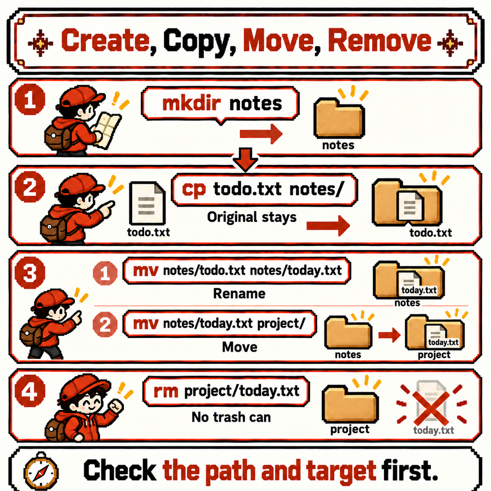
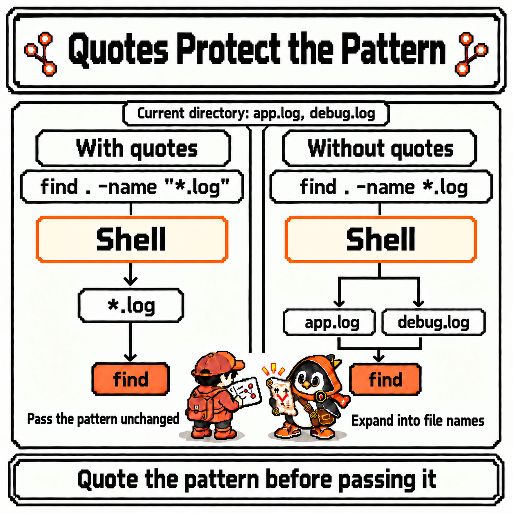

# Codigdex #02 — Linux Paths and Files: Absolute and Relative Paths


Last observation confirmed that the shell is always standing somewhere in the filesystem. We asked where with `pwd`, looked around with `ls`, and moved with `cd`.

But just wandering around doesn't get much done. Sooner or later you have to create files, copy them, move them, find them, and delete them. And to do that, you first need to tell the shell exactly *where* that file is. A little deeper into the Shell Cave, a specimen appeared that was quietly moving files all over the cave.


---

## Specimen info

- Dex number: NO.007
- Name: Path Forager
- Classification: File explorer type
- Encounter rate: Very high (scripts, config files, CI logs — there's hardly anywhere paths don't show up)
- Danger level: ⚠️⚠️ (`rm` has no trash can, and `cp` and `mv` overwrite a file with the same name without asking)

---

## First impression

Meeting the Path Forager for the first time, these questions came up.

- Apparently `/home/lupi/notes` and `../notes` can be the same place — so when are they the same, and when aren't they?
- In a file explorer you just drag and drop. How do you tell "copy" from "move" in the shell?
- Can a file deleted in the shell be rescued from the trash?

Once again, I decided to sort out the questions before the commands.

---

## Observation 1 — a path is a file's address, and it has two starting points

The first thing I pinned down was what a **path** is. A path is the address of a file or directory in the filesystem tree, written as the route to it joined by `/`. And there are two ways to write that address, depending on where it starts.


Say the tree for this observation looks like this.

```text
/
└── home
    └── lupi
        ├── todo.txt
        ├── notes
        └── project
            └── app.log
```

- **Absolute path**: an address written starting from the very top, `/` (the root). It always starts with `/`, like `/home/lupi/notes`, and points to the same place no matter where the shell is standing
- **Relative path**: an address written starting from the **working directory**, where the shell is currently standing. It doesn't start with `/`, and the same characters can point to different places depending on where you are

The `.` and `..` from last week are what relative paths are built from. `.` is where you are, and `..` is one level up. If the shell is standing in `/home/lupi/project`, you can point to the same `notes` directory in two ways.

```bash
pwd                   # /home/lupi/project
ls /home/lupi/notes   # absolute path: start from the root
ls ../notes           # relative path: go up one level from here, then into notes
```

Both commands show the same directory. But move somewhere else and type the same relative path, and the result changes.

```bash
cd ~          # go home (/home/lupi)
ls ../notes   # this time it looks for /home/notes
```

```text
ls: cannot access '../notes': No such file or directory
```

One level up from home is `/home`, and there's no `notes` under it. The same `../notes` points somewhere else once you stand somewhere else. A relative path comes as a set with "where you're standing right now."

So which kind is the `~/project` from last week? `~` is a marker the shell expands into your home directory's absolute path before running the command. So once it passes through the shell, `~/project` becomes the absolute path `/home/lupi/project`.

Put together, here's how to tell them apart.

- If it starts with `/`, it's an absolute path. It points to the same place wherever you run it, which makes it a good fit for places like scripts, where you can't be sure where they'll run from
- If it starts with `~`, the shell turns it into your home's absolute path
- Every other path (`notes`, `./notes`, `../notes`) is relative. Short and handy, but it calls for the habit of checking where you are with `pwd` before running anything

---

## Observation 2 — mkdir, cp, mv: create, copy, move

Now that I can write addresses, it's time to handle some files. Pretend the `notes` directory in the tree above doesn't exist yet, and build things one at a time starting from home.



```bash
cd ~                                # start at home
mkdir notes                         # create the notes directory
cp todo.txt notes/                  # copy todo.txt into notes (the original stays)
ls notes                            # → todo.txt
mv notes/todo.txt notes/today.txt   # rename it in place
mv notes/today.txt project/         # move it into project
```

Here's what I observed about each command.

- `mkdir directory`: creates a new directory (**m**a**k**e **dir**ectory). To create intermediate directories in one go, add `-p`, as in `mkdir -p project/logs/2026`. With `-p`, it doesn't complain even if the directory already exists
- `cp source target`: **copies** the source (**c**o**p**y). The original stays where it is
- `mv source target`: **moves** the source (**m**o**v**e). It disappears from where it was

The interesting part was that `cp` and `mv` behave differently depending on **what the target is**.

- If the target is an existing directory, the source goes **into** that directory under the same name (`cp todo.txt notes/`)
- If the target is a name that doesn't exist yet, it becomes a **new file** with that name (`cp todo.txt backup.txt`)
- That's why `mv` has no separate "rename" command. Moving something to a different name in the same directory *is* renaming it

This is also where one reason for the danger rating shows up. If a file with the same name already exists at the target, `cp` and `mv` **overwrite it without asking** by default. If you want to be asked first, add the `-i` (interactive) option.

```bash
cp -i todo.txt notes/      # asks before overwriting if notes/todo.txt already exists
```

Copying a whole directory needs `-r` (recursive). Run plain `cp notes backup`, and GNU `cp` tells you it skipped the directory, with something like `-r not specified; omitting directory 'notes'`. Only `cp -r notes backup` copies everything inside it too. `mv`, on the other hand, moves directories as they are, no `-r` needed.

---

## Observation 3 — find to search, rm to delete

The last thing I observed was finding and deleting. I grouped the two because the order matters: find it and check it with your own eyes before you delete it.

`find` walks the whole tree downward from the starting point you give it and prints every path that matches the condition.

```bash
find . -name "*.log"         # anything under here whose name ends in .log
find ~ -type d -name notes   # only directories named notes, anywhere under home
```

```text
./project/app.log
```

This is example output from the first command. You write it as `find start condition`. If the starting point is a relative path (`.`), the results come out as relative paths starting with `./`; if it's an absolute path (`/home/lupi`, which is what `~` expands to), the results are absolute too. The two kinds of address from Observation 1 carry straight through here.



There's a reason `"*.log"` is wrapped in quotes, too. Last week I noted that the shell expands `~` ahead of time — and `*` works the same way. Before running the command, the shell replaces `*.log` with the matching file names in the **current directory**.

Say the current directory holds `app.log` and `debug.log`. Type `find . -name *.log` without quotes, and the command `find` actually receives turns into this.

```bash
find . -name app.log debug.log   # what's left after the shell expands *.log
```

```text
find: paths must precede expression: `debug.log'
find: possible unquoted pattern after predicate `-name'?
```

GNU `find` errors out and even hints that you probably forgot the quotes. The trickier case is when `app.log` is the only `.log` file there. Then it runs without any error as `find . -name app.log`, finds only files named exactly `app.log`, and quietly leaves out every other `.log` file. The result looks plausible, so it's easy to miss that it's wrong.

The quotes say: "Shell, don't expand this — hand it to `find` as is." Always quote `find` patterns.

Now for deleting.

```bash
rm project/today.txt    # delete a file (the today.txt moved there in Observation 2)
rm -i project/app.log   # ask once before deleting (only y deletes it)
rmdir notes             # delete an empty directory (fails if anything is inside)
rm -r backup            # delete a directory and everything in it (the backup made with cp -r in Observation 2)
```

The most important thing I recorded about `rm` (**r**e**m**ove) is that **there's no trash can**. Deleting in a file explorer usually means moving things to the trash, but `rm` deletes them on the spot. There's no undo button either. That's why `rm -rf` — `-r` for directories plus `-f` (force), which skips confirmations and error messages — is so often called out as the combination to be especially careful with.

So I settled on one habit before deleting.

1. If I'm going to use relative paths, check where I am with `pwd` first
2. Print the targets with `find` or `ls`
3. Only if the list matches what I expect, run `rm` on exactly the printed paths


---

## Summary

- A path is a file's address in the filesystem tree. An absolute path, starting with `/`, points to the same place from anywhere; a relative path points to a place measured from the working directory
- The shell expands `~` into your home directory's absolute path
- Create with `mkdir` (`-p`), copy with `cp` (`-r`), and move or rename with `mv`
- When the target is a directory, `cp` and `mv` put things inside it, and if a file with the same name exists, they overwrite it without asking. Use `-i` to be asked
- Search with `find start condition`, and quote patterns so the shell doesn't expand them first
- `rm` has no trash can. Print and check the targets before you delete them

---

## Codigdex notes

Last week I learned how to ask the shell where it's standing; this week I learned how to point it precisely at "that file over there." Once I could tell an address that starts at the root from one that starts where I'm standing, `cp`, `mv`, `rm`, and `find` all read with the same grammar. In the end, every command came down to "which path, to which path."

The next observation meets permissions and users. Finally, I'll read strings like the `drwxr-xr-x` I set aside in last week's `ls -l`, and observe how `chmod`, `chown`, and `sudo` control who can read, write, and run each file.

Before that, the second specimen of the Linux chapter goes into the Codigdex. **NO.007 Path Forager** — follows path maps to gather and move files. The second of the Linux chapter's five slots is filled.


