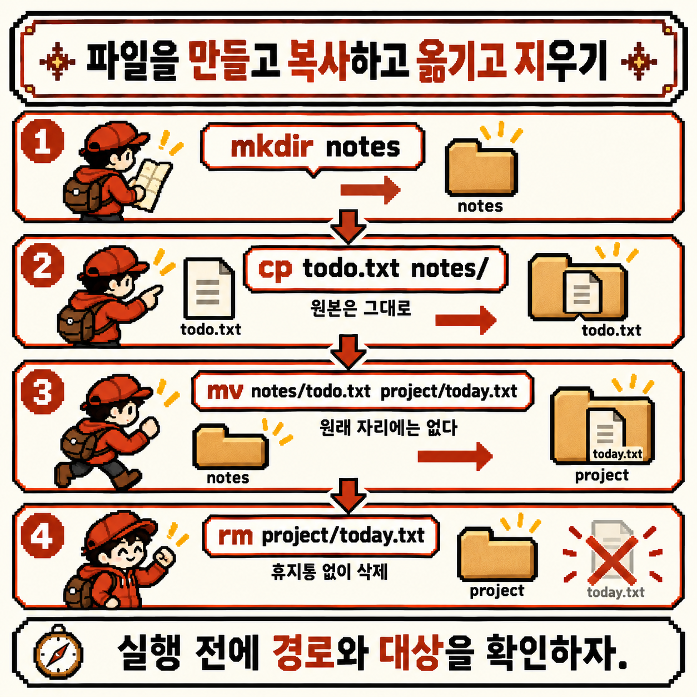

# 코딩 도감 #02 — Linux 경로와 파일: 절대·상대 경로


지난 관찰에서는 셸이 늘 파일시스템 어딘가에 서 있다는 걸 확인했다. `pwd`로 위치를 묻고, `ls`로 둘러보고, `cd`로 옮겨 다녔다.

그런데 돌아다니기만 해서는 할 수 있는 일이 별로 없다. 결국 파일을 만들고, 복사하고, 옮기고, 찾고, 지워야 한다. 그러려면 먼저 "그 파일이 어디 있는지"를 셸에게 정확히 말할 수 있어야 한다. 셸 동굴을 조금 더 들어가자, 동굴 곳곳의 파일을 몰래 옮기고 있는 개체가 나타났다.


---

## 개체 정보

- 도감 번호: NO.007 경로 채집가
- 이름: 경로와 파일 — 절대/상대 경로, `mkdir`, `cp`, `mv`, `rm`, `find`
- 분류: 파일 탐색형
- 출현 빈도: 매우 높음 (스크립트, 설정 파일, CI 로그처럼 경로가 등장하지 않는 곳이 거의 없음)
- 위험도: ⚠️⚠️ (`rm`에는 휴지통이 없고, `cp`·`mv`는 같은 이름의 파일을 묻지도 않고 덮어씀)

---

## 처음 만났을 때의 인상

경로 채집가를 처음 마주했을 때 이런 질문들이 떠올랐다.

- `/home/lupi/notes`와 `../notes`는 같은 곳일 수도 있다는데, 언제 같고 언제 다를까?
- 파일 탐색기에서는 끌어다 놓으면 끝인데, 셸에서 "복사"와 "이동"은 어떻게 구분할까?
- 셸에서 지운 파일은 휴지통에서 되살릴 수 있을까?

이번에도 명령어보다 이 질문들부터 정리해 보기로 했다.

---

## 관찰 1 — 경로는 파일의 주소이고, 출발점이 두 가지다

가장 먼저 정리한 건 **경로(path)** 가 무엇인지였다. 경로는 파일시스템 나무에서 어떤 파일이나 디렉터리까지 가는 길을 `/`로 이어 적은 주소다. 그리고 이 주소를 적는 방법은 출발점에 따라 두 가지로 나뉜다.


이번 관찰에서 쓸 나무는 이렇게 생겼다고 해 보자.

```text
/
└── home
    └── lupi
        ├── todo.txt
        ├── notes
        └── project
            └── app.log
```

- **절대 경로(absolute path)**: 맨 꼭대기인 `/`(루트)에서 출발해 적는 주소다. `/home/lupi/notes`처럼 항상 `/`로 시작하고, 셸이 지금 어디 서 있든 같은 곳을 가리킨다
- **상대 경로(relative path)**: 셸이 지금 서 있는 **현재 작업 디렉터리**에서 출발해 적는 주소다. `/`로 시작하지 않고, 같은 글자라도 서 있는 자리에 따라 가리키는 곳이 달라진다

지난주에 본 `.`과 `..`이 상대 경로의 재료다. `.`은 지금 자리, `..`은 한 단계 위다. 셸이 `/home/lupi/project`에 서 있다면 같은 `notes` 디렉터리를 이렇게 두 가지로 가리킬 수 있다.

```bash
pwd                   # /home/lupi/project
ls /home/lupi/notes   # 절대 경로: 루트에서 출발
ls ../notes           # 상대 경로: 지금 자리에서 한 단계 위로 올라간 뒤 notes로
```

두 명령은 같은 디렉터리를 보여 준다. 하지만 `cd ~`로 홈에 돌아가서 `ls ../notes`를 다시 치면, 이번에는 `/home/notes`를 찾게 되고 보통은 그런 디렉터리가 없다는 오류를 만난다. 상대 경로는 "지금 어디 서 있는지"와 한 세트라는 뜻이다.

그럼 지난주에 쓴 `~/project`는 어느 쪽일까? `~`는 셸이 명령을 실행하기 전에 홈 디렉터리의 절대 경로로 펼쳐 주는 표시다. 그래서 `~/project`는 셸을 거치면 `/home/lupi/project`라는 절대 경로가 된다.

정리하면 이렇게 구분할 수 있었다.

- `/`로 시작하면 절대 경로다. 어디서 실행해도 같은 곳을 가리키므로, 스크립트처럼 실행 위치를 장담할 수 없는 곳에 적합하다
- `~`로 시작하면 셸이 홈의 절대 경로로 바꿔 준다
- 그 밖의 경로(`notes`, `./notes`, `../notes`)는 상대 경로다. 짧고 편하지만, 실행하기 전에 `pwd`로 지금 자리를 확인하는 습관이 필요하다

---

## 관찰 2 — mkdir·cp·mv: 만들고, 복사하고, 옮긴다

주소를 적을 수 있게 됐으니 이제 파일을 다뤄 볼 차례다. 앞의 나무에서 `notes` 디렉터리가 아직 없다고 치고, 홈에서부터 하나씩 만들어 본다.



```bash
cd ~                       # 홈에서 시작
mkdir notes                # notes 디렉터리 만들기
cp todo.txt notes/         # todo.txt를 notes 안으로 복사 (원본은 그대로)
ls notes                   # → todo.txt
mv notes/todo.txt notes/today.txt   # 같은 자리에서 이름 바꾸기
mv notes/today.txt project/         # project 안으로 옮기기
```

명령마다 관찰한 특징은 이렇다.

- `mkdir 디렉터리`: 새 디렉터리를 만든다 (**m**a**k**e **dir**ectory). 중간 디렉터리까지 한 번에 만들려면 `mkdir -p project/logs/2026`처럼 `-p`를 붙인다. `-p`는 이미 있는 디렉터리라도 오류를 내지 않는다
- `cp 원본 대상`: 원본을 **복사**한다 (**c**o**p**y). 원본은 그대로 남는다
- `mv 원본 대상`: 원본을 **옮긴다** (**m**o**v**e). 원본 자리에서는 사라진다

흥미로웠던 건 `cp`와 `mv`가 **대상이 무엇이냐**에 따라 다르게 동작한다는 점이었다.

- 대상이 이미 있는 디렉터리라면, 그 디렉터리 **안으로** 같은 이름으로 넣는다 (`cp todo.txt notes/`)
- 대상이 없는 이름이라면, 그 이름의 **새 파일**로 만든다 (`cp todo.txt backup.txt`)
- 그래서 `mv`는 "이름 바꾸기" 명령을 따로 두지 않는다. 같은 디렉터리 안에서 다른 이름으로 옮기는 게 곧 이름 바꾸기다

여기서 위험도 표시의 이유가 하나 드러난다. 대상 자리에 같은 이름의 파일이 이미 있으면, `cp`와 `mv`는 기본적으로 **묻지 않고 덮어쓴다**. 덮어쓰기 전에 확인을 받고 싶다면 `-i`(interactive) 옵션을 붙인다.

```bash
cp -i todo.txt notes/      # notes/todo.txt가 이미 있으면 덮어쓸지 물어봄
```

디렉터리를 통째로 복사할 때는 `-r`(recursive)이 필요하다. 그냥 `cp notes backup`을 실행하면 GNU `cp`는 `-r not specified; omitting directory 'notes'`처럼 디렉터리를 건너뛰었다고 알려 준다. `cp -r notes backup`이라고 해야 안에 든 파일까지 모두 복사된다. 반면 `mv`는 디렉터리도 `-r` 없이 그대로 옮긴다.

---

## 관찰 3 — find로 찾고, rm으로 지운다

마지막으로 관찰한 건 찾기와 지우기였다. 두 명령을 같이 묶은 이유는, 지우기 전에 먼저 찾아서 눈으로 확인하는 순서가 중요하기 때문이다.

`find`는 지정한 출발점부터 아래로 나무 전체를 훑으면서 조건에 맞는 경로를 출력한다.

```bash
find . -name "*.log"         # 현재 위치 아래에서 이름이 .log로 끝나는 것
find ~ -type d -name notes   # 홈 아래에서 이름이 notes인 디렉터리만
```

```text
./project/app.log
```

출력은 예시다. `find 출발점 조건` 순서로 쓰고, 출발점이 상대 경로(`.`)면 결과도 `./`로 시작하는 상대 경로로, 절대 경로(`~`가 펼쳐진 `/home/lupi`)면 결과도 절대 경로로 나온다. 관찰 1의 두 주소가 여기서도 그대로 이어진다.

`"*.log"`를 따옴표로 감싼 데도 이유가 있다. 지난주에 셸이 `~`를 미리 펼쳐 준다고 했는데, `*`도 마찬가지다. 따옴표 없이 `find . -name *.log`라고 치면, 현재 디렉터리에 `.log` 파일이 있을 때 셸이 `*.log`를 그 파일 이름들로 먼저 바꿔 버린다. 그러면 `find`는 패턴이 아니라 엉뚱한 파일 이름을 받게 된다. 따옴표는 "이건 셸이 펼치지 말고 `find`에게 그대로 넘겨 줘"라는 표시다.

이제 지우기다.

```bash
rm project/app.log      # 파일 지우기
rmdir notes             # 빈 디렉터리 지우기 (안에 뭔가 있으면 실패)
rm -r backup            # 디렉터리와 그 안의 모든 것 지우기
rm -i project/*.log     # 하나씩 지울지 물어보며 지우기
```

`rm`(**r**e**m**ove)에서 가장 중요하게 기록해 둔 건 **휴지통이 없다**는 점이다. 파일 탐색기의 삭제는 보통 휴지통으로 옮기는 것이지만, `rm`은 그 자리에서 바로 지운다. 되돌리기 버튼도 없다. 디렉터리를 지우는 `-r`에 확인과 오류 메시지까지 생략하는 `-f`(force)를 붙인 `rm -rf`가 특히 조심해야 할 조합으로 자주 언급되는 이유다.

그래서 지우기 전 습관을 하나 정했다. 지울 대상을 `find`나 `ls`로 먼저 출력해 보고, 목록이 예상과 맞는지 확인한 다음에 같은 경로로 `rm`을 실행한다. 상대 경로를 쓴다면 그 전에 `pwd`도 한 번 친다.

---

## 요약 정리

- 경로는 파일시스템 나무에서 파일까지 가는 주소다. `/`로 시작하는 절대 경로는 어디서나 같은 곳을, 상대 경로는 현재 작업 디렉터리를 기준으로 한 곳을 가리킨다
- `~`는 셸이 홈 디렉터리의 절대 경로로 펼쳐 준다
- `mkdir`(`-p`)로 만들고, `cp`(`-r`)로 복사하고, `mv`로 옮기거나 이름을 바꾼다
- `cp`와 `mv`는 대상이 디렉터리면 그 안으로 넣고, 같은 이름이 있으면 묻지 않고 덮어쓴다. 확인을 받으려면 `-i`
- `find 출발점 조건`으로 찾고, 패턴은 따옴표로 감싸 셸이 미리 펼치지 않게 한다
- `rm`에는 휴지통이 없다. 지우기 전에 대상을 먼저 출력해 확인한다

---

## 코딩 도감 메모

지난주에는 셸이 어디 서 있는지를 묻는 법을 배웠다면, 이번 주에는 셸에게 "저기 있는 그 파일"을 정확히 가리키는 법을 배웠다. 루트에서 출발하는 주소와 지금 자리에서 출발하는 주소, 이 두 가지만 구분하고 나니 `cp`, `mv`, `rm`, `find`가 모두 같은 문법으로 읽혔다. 결국 모든 명령은 "어떤 경로를, 어떤 경로로"의 문제였다.

다음 관찰에서는 권한과 사용자를 만난다. 지난주 `ls -l`에서 미뤄 둔 `drwxr-xr-x` 같은 문자열을 드디어 읽어 보고, 파일마다 누가 읽고 쓰고 실행할 수 있는지를 `chmod`, `chown`, `sudo`로 다루는 법을 관찰할 예정이다.

그 전에, Linux 챕터의 두 번째 개체를 코딩 도감에 등록한다. **NO.007 경로 채집가** — 경로 지도를 따라 파일을 모으고 옮긴다. Linux 챕터 다섯 칸 중 두 번째 칸이 채워졌다.


