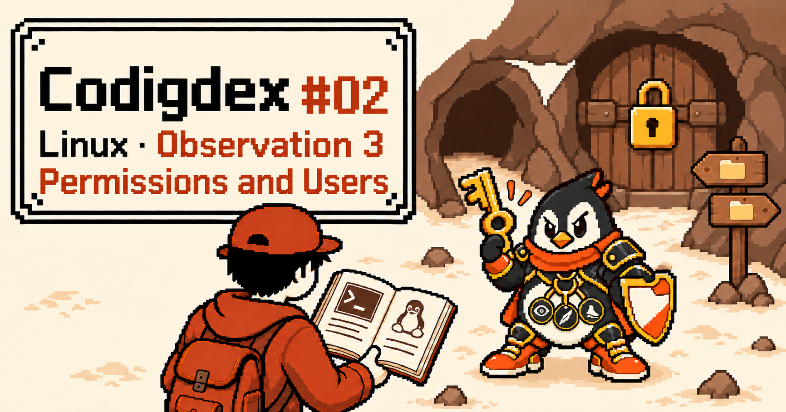
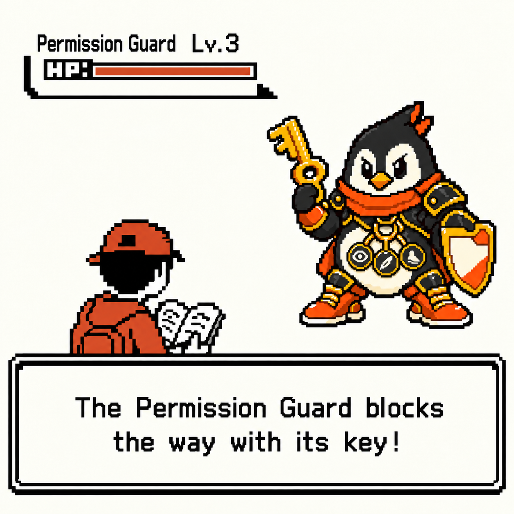
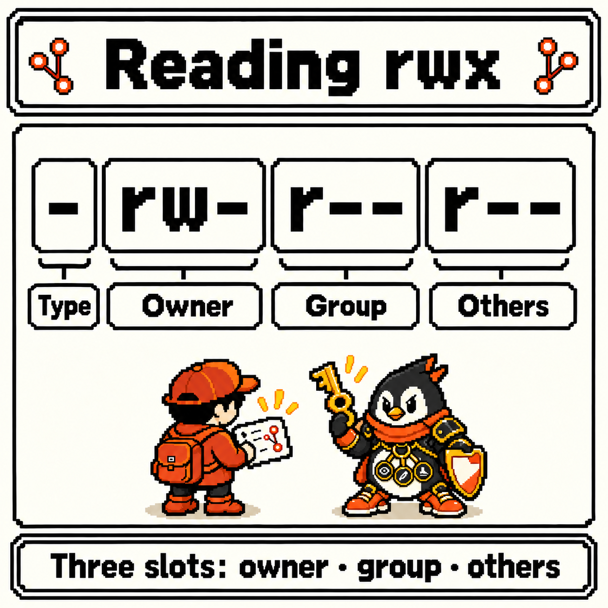
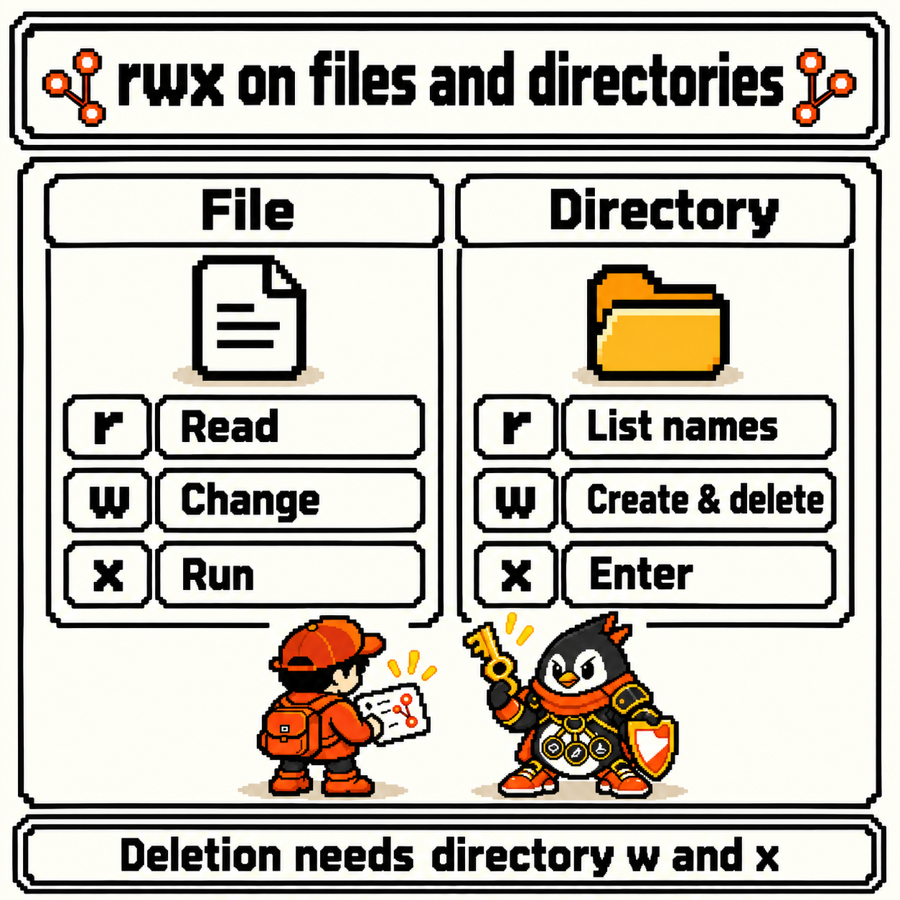
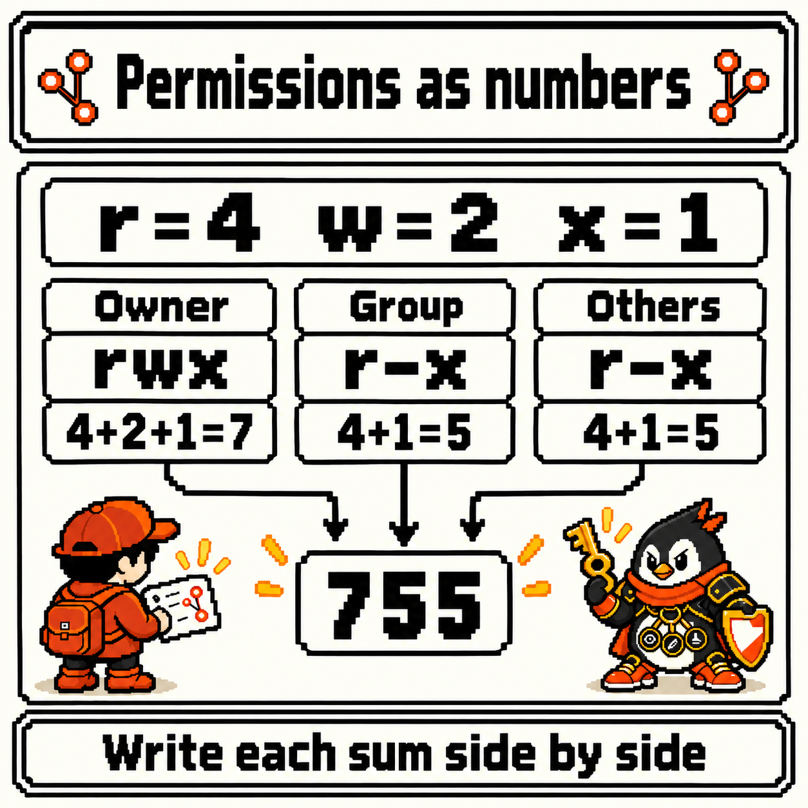
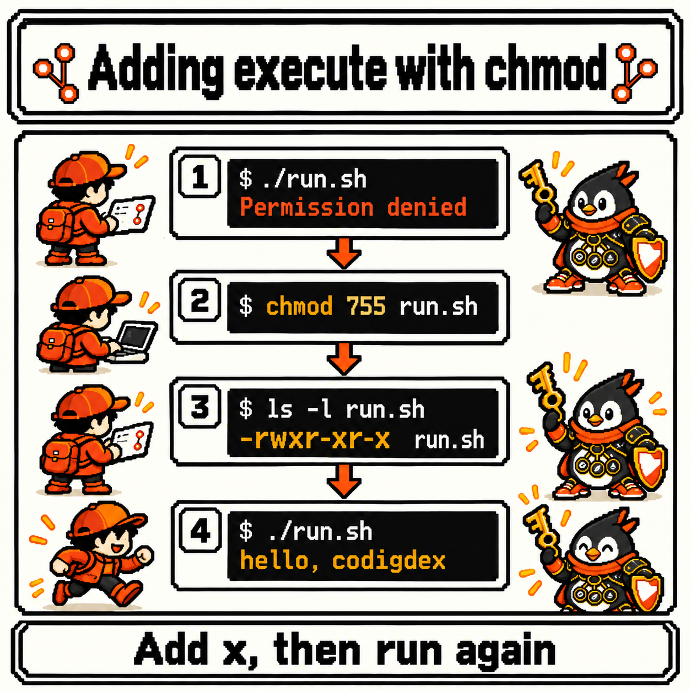
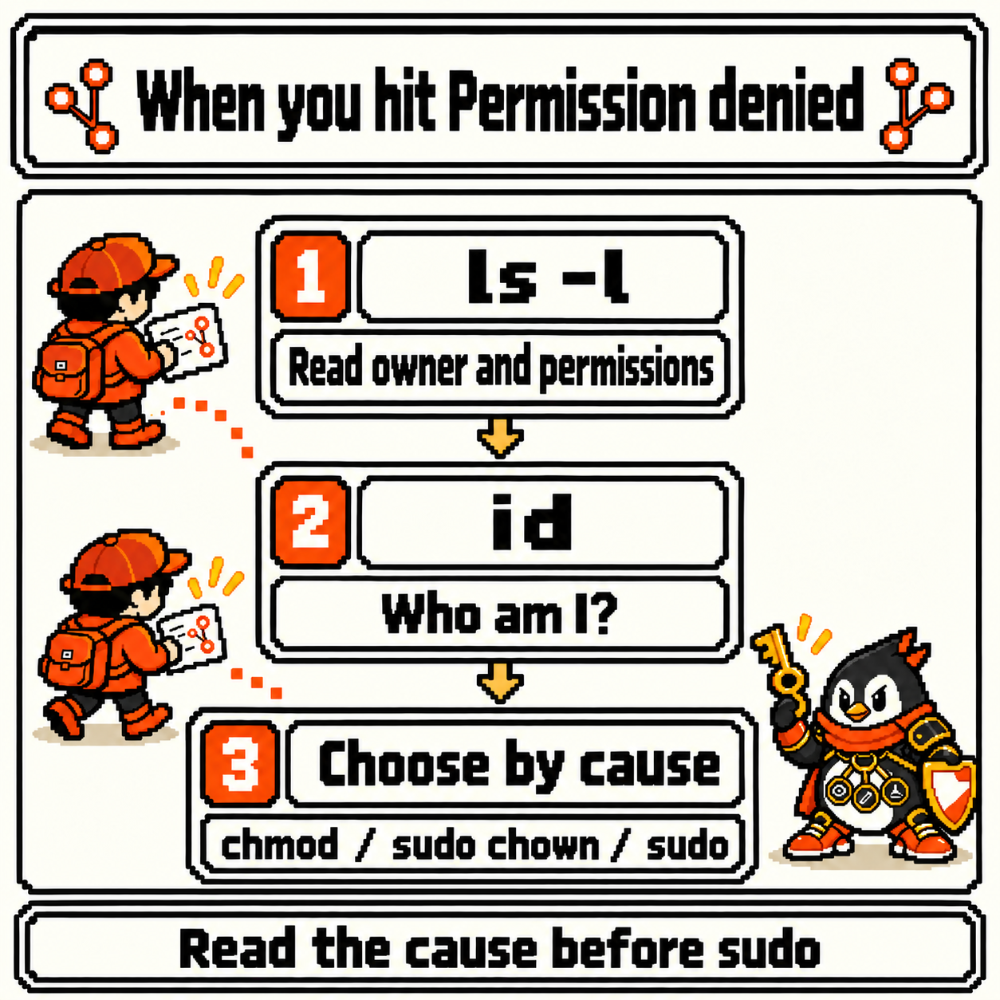
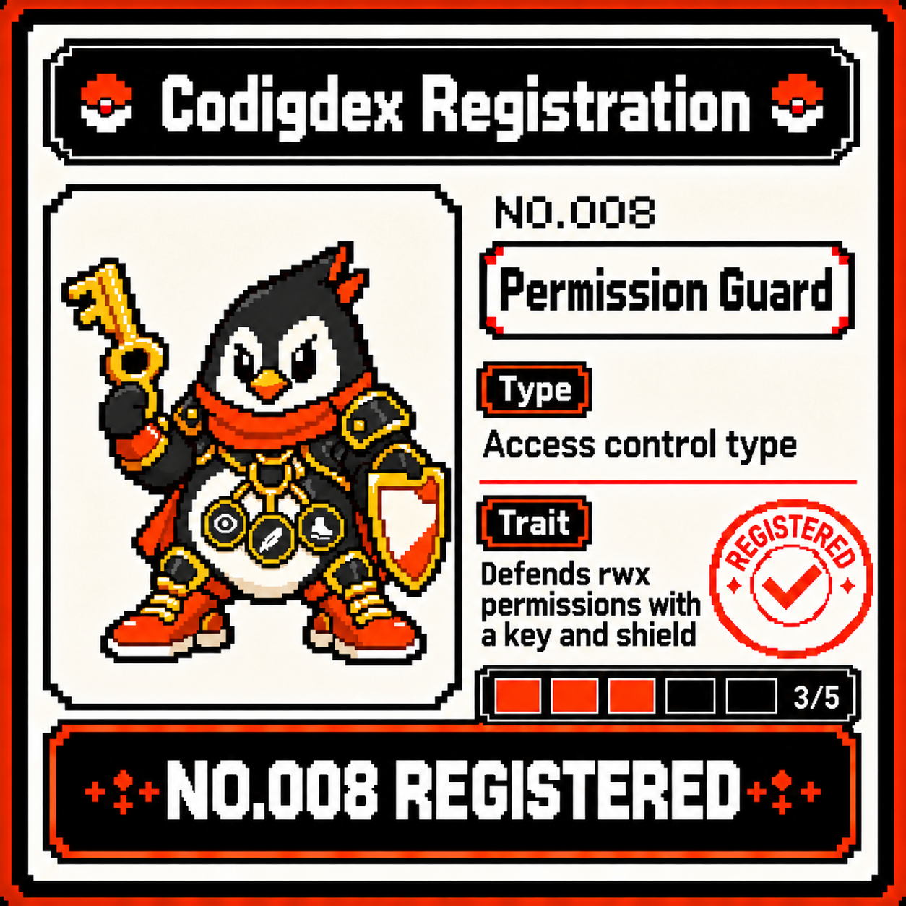

# Codigdex #02 — Linux Permissions and Users: rwx and chmod



Last observation, we pointed at files with paths and handled them with `mkdir`, `cp`, `mv`, and `rm`. Back then, creating, moving, and deleting all went through without a hitch.

But things in the shell don't always go along that quietly. You write a small script, try to run it, and get `Permission denied` back — or a file that clearly exists refuses to be edited. Strings like the `drwxr-xr-x` I spotted at the front of `ls -l` in the first week and set aside are exactly where the reason is written down. In front of a locked door in the Shell Cave, a specimen holding a key and a shield blocked the way.



---

## Specimen info

- Dex number: NO.008
- Name: Permission Guard
- Classification: Access control type
- Encounter rate: Very high (running scripts, server config files, deploy directories — wherever `Permission denied` shows up)
- Danger level: ⚠️⚠️⚠️ (borrowing root through `sudo` gets past most permission checks, and a single `chmod -R 777` strips the protection off wholesale)

---

## First impression

Meeting the Permission Guard for the first time, these questions came up.

- What does each of the ten characters in `-rw-r--r--` mean?
- It's a script I wrote myself — so why does running it say `Permission denied`?
- When I hit `Permission denied`, do I just put `sudo` in front?

Once again, I decided to sort out the questions before the commands.

---

## Observation 1 — the first column of ls -l is "who can do what"

This observation picks up in last week's `project` directory. A new log file has turned up where we deleted `app.log` last week, and say we've added a `logs` directory and a small shell script called `run.sh` next to it.

```bash
#!/bin/bash
echo "hello, codigdex"
```

A detailed look with `ls -l` shows this.

```bash
cd ~/project
ls -l
```

```text
-rw-r--r-- 1 lupi lupi  120 Oct 19 09:00 app.log
drwxr-xr-x 2 lupi lupi 4096 Oct 19 09:00 logs
-rw-r--r-- 1 lupi lupi   35 Oct 19 09:00 run.sh
```

Reading a line from the left, it's permissions, link count, **owner**, **group**, size, modification time, and name. I'll skip the link count this time and focus on the first ten characters and the `lupi lupi` after them. `run.sh` is owned by `lupi`, and its group is `lupi` too.



The ten characters are read in chunks of 1 + 3 + 3 + 3.

- **First character: type**. `-` is a regular file, `d` is a directory, and `l` is a symbolic link. That's why the `logs` line starts with `d`
- **Next three: the owner's (user, `u`)** permissions
- **The three after that: permissions for users in the group (`g`)**
- **Last three: others (`o`)** — everyone else

The three characters always come in the order `r` (read), `w` (write), `x` (execute), and any permission that's missing is shown as `-`. So `-rw-r--r--` on `run.sh` means "a regular file; the owner can read and write it, and the group and others can only read it." Nobody has `x`.

So which of the three am I, the one using this shell right now? `id` tells you.

```bash
id
```

```text
uid=1000(lupi) gid=1000(lupi) groups=1000(lupi),27(sudo)
```

The output varies by environment, but in this example I'm the user `lupi`, and I belong to the `lupi` and `sudo` groups. When I access a file, Linux decides like this.

1. If I'm the file's owner, it looks **only at the owner's three characters**
2. If I'm not the owner but belong to the file's group, it looks **only at the group's three characters**
3. If neither, it looks at **the others' three characters**

The interesting part was that word "only." Since it checks a single slot and stops, an owner whose slot is narrower than the group's can actually do *less*. Permissions don't add up; they're decided by the one slot I fall into.

That said, this is the **basic model** of owner, group, and others. Real systems also have mechanisms outside these ten characters, such as ACLs and capabilities, that control access more finely; this observation leaves them out. The basic model's rules are laid out in the GNU coreutils manual under [Mode Structure](https://www.gnu.org/software/coreutils/manual/html_node/Mode-Structure.html).

One more thing I observed: the same `rwx` means different things on a file and on a directory.

- `r`: on a file, read its contents (`cat`); on a directory, see the list of names inside (`ls`)
- `w`: on a file, change its contents; on a directory, create, delete, and rename things inside
- `x`: on a file, run it as a program; on a directory, enter it (`cd`) and reach the entries inside



One thing surprised me here. Whether you can **delete** a file isn't decided by the file's own `w`, but by the `w` (and `x`) of the **directory it lives in**. Deleting doesn't change the file's contents; it removes one line from the directory's list of names. Last week I was so careful with `rm` — and the key that stops `rm` turns out to sit with the directory, not the file. One exception: in a directory with the **sticky bit** set (the `t` at the end of the permissions, as on `/tmp`), having `w` on the directory still doesn't let you delete other people's files. It keeps users of a shared directory from deleting each other's files.

To see the permissions of a directory **itself** rather than the list inside it, use `ls -ld`. `ls -l logs` lists the entries inside `logs`, while `ls -ld logs` shows just the one line for `logs`.

---

## Observation 2 — chmod: changing permissions

Now let's run `run.sh`. As we saw last week, `./` means "right here."

```bash
./run.sh
```

```text
bash: ./run.sh: Permission denied
```

It's a file I made, and I'm the owner, but it's still blocked. Observation 1 already told us why: the owner slot in `-rw-r--r--` has no `x`. Files freshly created with an editor or `touch` usually don't come with execute permission, so to run one, you have to add `x` yourself.

The command that changes permissions is `chmod` (**ch**ange **mod**e). There are two ways to write it. First, with letters.

```bash
chmod u+x run.sh    # give the owner (u) execute (x)
ls -l run.sh        # → -rwxr--r--
./run.sh            # → hello, codigdex
```

Read it as `who` + `add/remove/set` + `what`.

- Who: `u` (owner), `g` (group), `o` (others), `a` (all)
- Operation: `+` (add), `-` (remove), `=` (set to exactly this)
- What: `r`, `w`, `x`

```bash
chmod go-r app.log       # remove read from group and others → -rw-------
chmod a+r app.log        # add read for everyone → -rw-r--r--
chmod u=rwx,go=rx run.sh # owner gets rwx, group and others get r-x → -rwxr-xr-x
```

The second way is with numbers. Each permission gets a number, and a slot is written as the sum of its three characters.

- `r` = 4, `w` = 2, `x` = 1, none = 0
- `rwx` = 4 + 2 + 1 = **7**, `r-x` = 4 + 1 = **5**, `r--` = **4**, `rw-` = 4 + 2 = **6**



Write the three slots side by side in owner, group, others order, and the whole set of permissions becomes a three-digit number.

```bash
chmod 755 run.sh   # rwx r-x r-x → -rwxr-xr-x
chmod 644 app.log  # rw- r-- r-- → -rw-r--r--
chmod 600 .env     # rw- --- --- → only the owner can read and write
```

Solving the `run.sh` that was blocked at the start of Observation 2 the number way, the whole flow (blocked, add the permission, check, run) looks like this.



Here's how I summarized the combinations that show up most.

- `755`: executables and directories. The owner can do everything; everyone else can only read and execute (for a directory, enter)
- `644`: regular files. Only the owner can change them; everyone else can only read
- `600`: files holding passwords or keys. Nobody but the owner can read them

The letter form fits "change just this part of the current permissions"; the number form fits "set the whole thing to exactly this." The full syntax for both is in the GNU coreutils manual under [Setting Permissions](https://www.gnu.org/software/coreutils/manual/html_node/Setting-Permissions.html).

This is also where the first reason for the danger rating shows up. When people hit `Permission denied`, you often see the advice to fix it with `chmod 777`. But `777` is `rwxrwxrwx` — **every user can read, change, and run it**. The locked door opens, but only because you've taken the door off its hinges. Add `-R` (recursive), which changes everything underneath, and every file in the directory is thrown open at once. The right move is to add only the characters that are needed, only for whoever needs them.

---

## Observation 3 — chown and sudo: changing the owner, borrowing admin rights

The last thing I observed was what happens when the problem isn't the permissions but the **owner**. This time, say `run.sh` looks like this — which is what you get if, for example, you create the file with an editor run under `sudo`.

```text
-rw-r--r-- 1 root root 35 Oct 19 09:10 run.sh
```

Both the owner and the group are `root`. `root` is Linux's administrator account, a special user that can skip most permission checks. I (`lupi`) am neither the owner nor in the `root` group, so only the others slot, `r--`, applies. I can read the file but not change it. And trying to change its permissions is blocked too.

```bash
chmod u+x run.sh
```

```text
chmod: changing permissions of 'run.sh': Operation not permitted
```

That's because a regular user can only `chmod` **files they own**; changing the permissions on someone else's file usually takes administrator rights. In this case, the owner has to change. The command for that is `chown` (**ch**ange **own**er).

```bash
chown lupi run.sh
```

```text
chown: changing ownership of 'run.sh': Operation not permitted
```

Blocked again. A regular user can't take someone else's file for themselves, and can't hand their own file over to someone else either. Changing a file's owner usually takes administrator rights. This is where `sudo` comes in.

```bash
sudo chown lupi:lupi run.sh   # set both owner and group to lupi
ls -l run.sh                  # → -rw-r--r-- 1 lupi lupi 35 ... run.sh
chmod u+x run.sh              # I'm the owner now, so no sudo needed
```

`chown` can change both at once in the `owner:group` form, just the owner as in `chown lupi`, or just the group as in `chown :lupi`. To change a directory and everything inside it, add `-R`, the same as with `chmod`. Changing your own file's group to a group you belong to is something a regular user can do without `sudo`.

`sudo` **runs an allowed command as another user**. If you don't name a target user, the default is root, so in everyday use it means "run this one command as root." The details are in the [official sudo manual](https://www.sudo.ws/docs/man/sudo.man/). Here's what I observed about it.

- Not just anyone can use it. Only users the administrator has allowed can, and on Ubuntu the default configuration grants that to the `sudo` group in the `id` example above (some distributions use a `wheel` group instead)
- With the default settings, it asks for **your own password**, not root's. Once you've entered it, it won't ask again for a configured length of time
- Only that one line borrows the rights. The next command runs as `lupi` again

Here's the second reason for the danger rating. A command run as root through `sudo` passes almost straight through the Permission Guard's shield. If last week's `rm -rf` was scary, `sudo rm -rf` won't stop even at system files. And as in the example above, files created with `sudo` end up owned by root, so they block you again later when you try to edit them from your own account. Reflexively putting `sudo` in front of every `Permission denied` doesn't solve the problem — it sets up the next one.

So I settled on an order to follow when I hit `Permission denied`.

1. Read the file's owner, group, and permissions with `ls -l` (for a directory itself, `ls -ld`)
2. Check who I am right now and which groups I belong to with `id`
3. Pick one of three
   - I'm the owner but a character is missing → add only the needed characters with `chmod`
   - The owner is wrong → set the owner right with `sudo chown`
   - It's root's territory to begin with, like `/etc` → put `sudo` on that one line only



---

## Summary

- Read the ten characters of `ls -l` as 1 type character plus 3 characters (`rwx`) each for owner, group, and others. A missing permission is `-`
- Linux checks whether I'm the owner, in the group, or other, in that order, and applies only the one slot that matches. `id` shows who I am
- On a directory, `r` lists, `w` creates and deletes inside, and `x` enters. Whether a file can be deleted is decided by its directory's permissions by default, and a sticky bit on the directory restricts it further
- `chmod` changes permissions with letters like `u+x` or numbers like `755` (r=4, w=2, x=1). A regular user can only change their own files. `777` is the same as taking the door off
- `chown owner:group` changes the owner, and changing the owner usually takes administrator rights (`sudo`)
- `sudo` runs one allowed command as another user (root by default). Don't add it out of habit; read the cause with `ls -l` and `id` first

---

## Codigdex notes

Up to last week, I learned how to tell the shell exactly "which file, where"; this week I found out that every file comes with a condition attached: "who can do what." The `drwxr-xr-x` I set aside in the first week no longer reads as just a string, but as a ring of keys handed out separately to the owner, the group, and others. And `Permission denied` stopped feeling like a dead end and started reading more like a sign that says "check your keys."

The next observation is set to meet pipes and processes. I plan to observe how to pass one command's output to the next with `|`, save it to a file with `>` and `>>`, and inspect and stop running processes with `ps`, `top`, and `kill`.

Before that, the third specimen of the Linux chapter goes into the Codigdex. **NO.008 Permission Guard** — defends rwx permissions with a key and shield. The third of the Linux chapter's five slots is filled.


