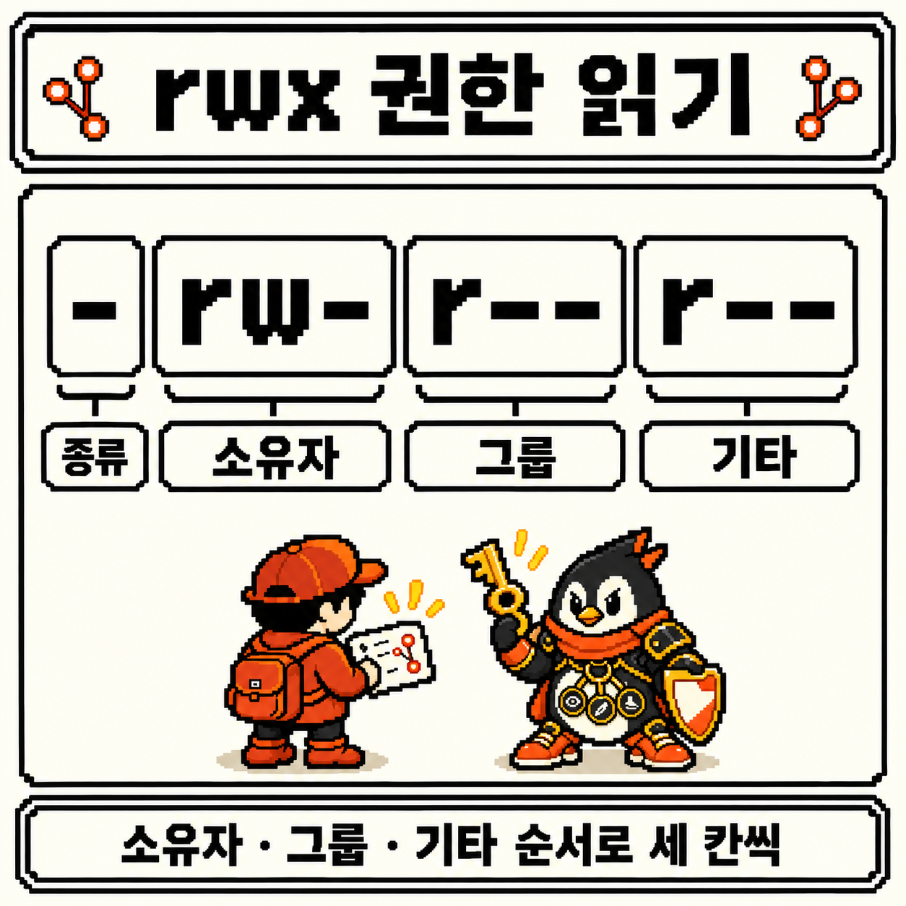
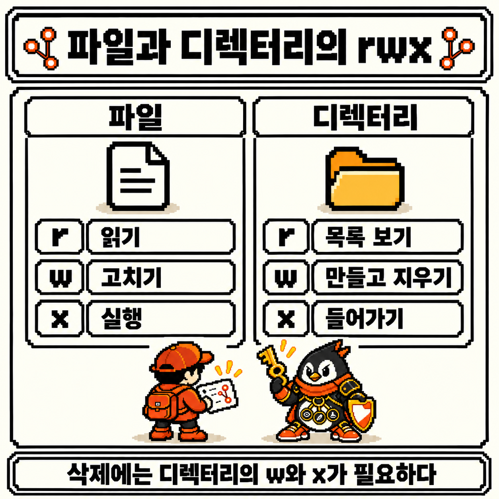
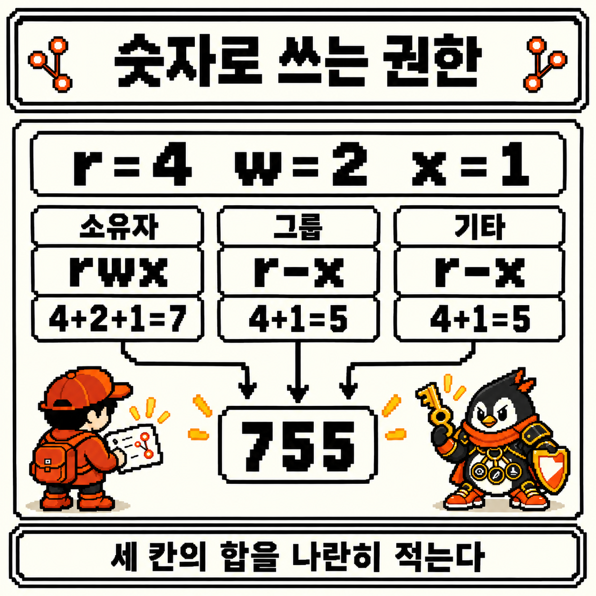
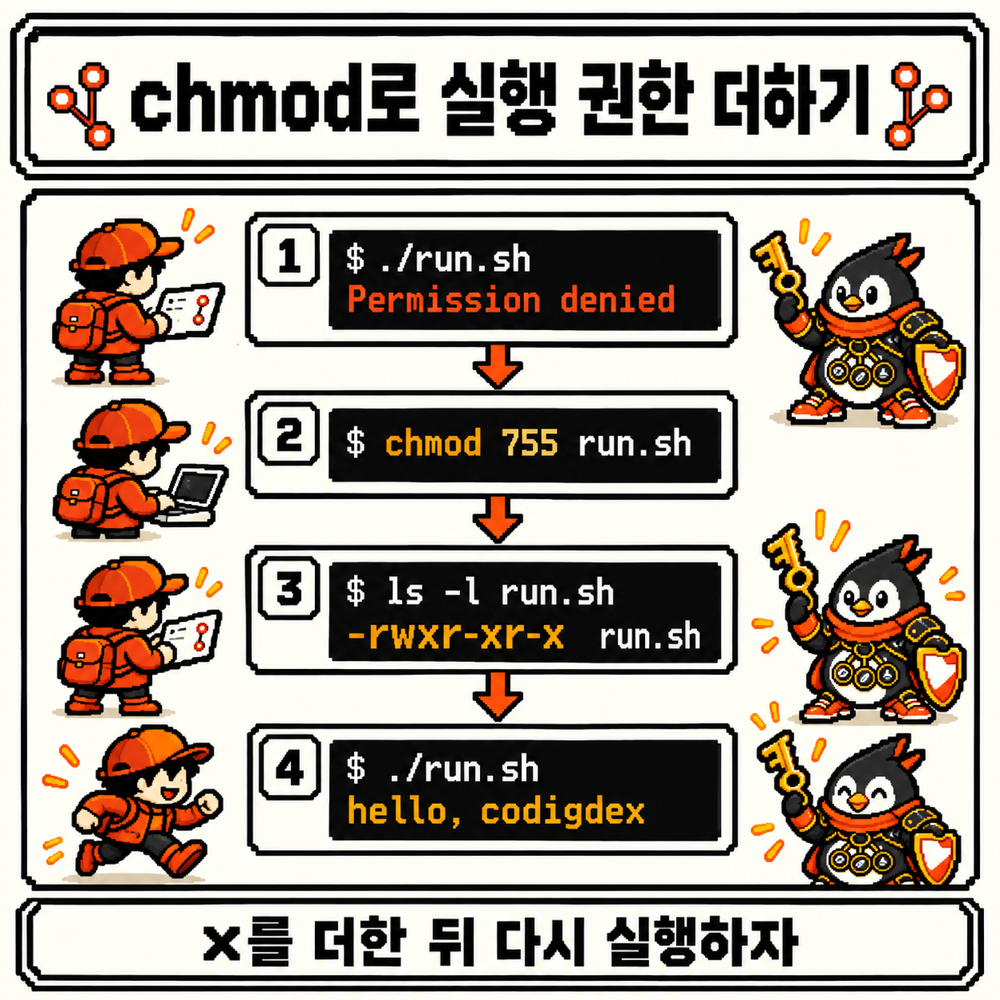
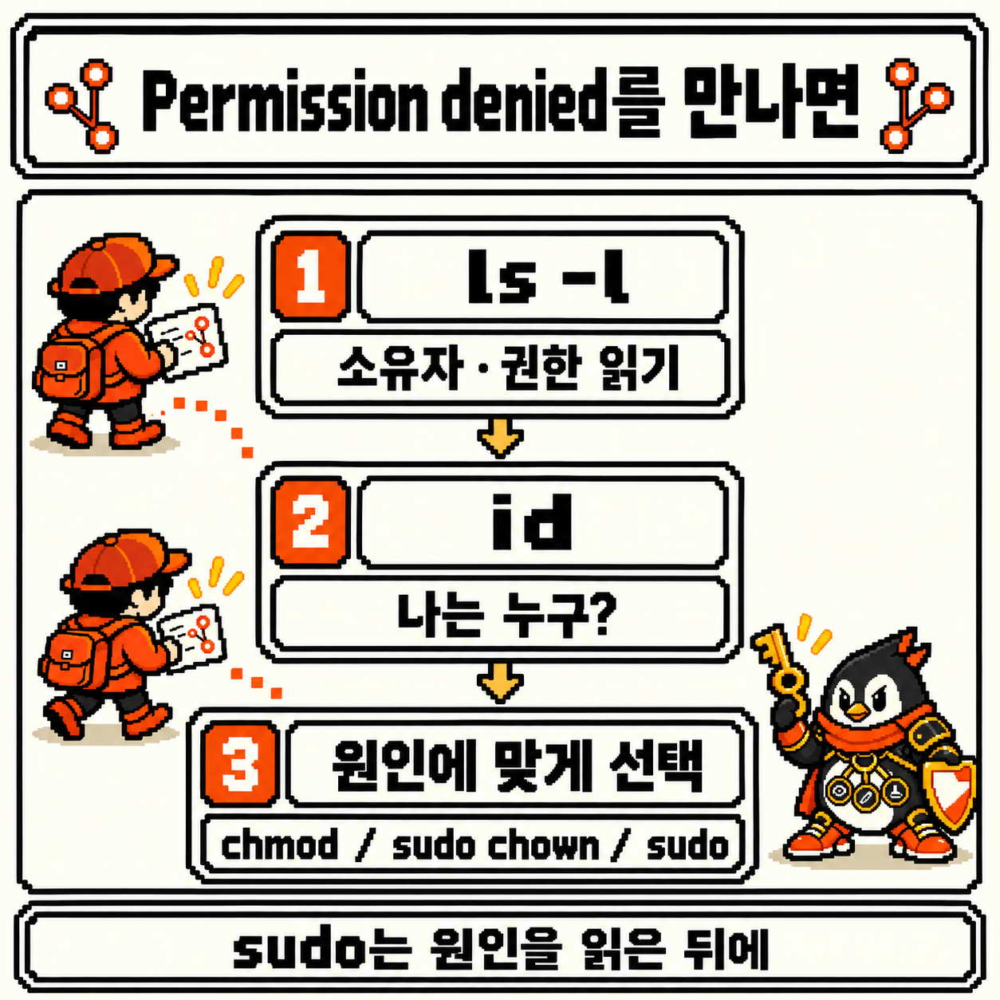
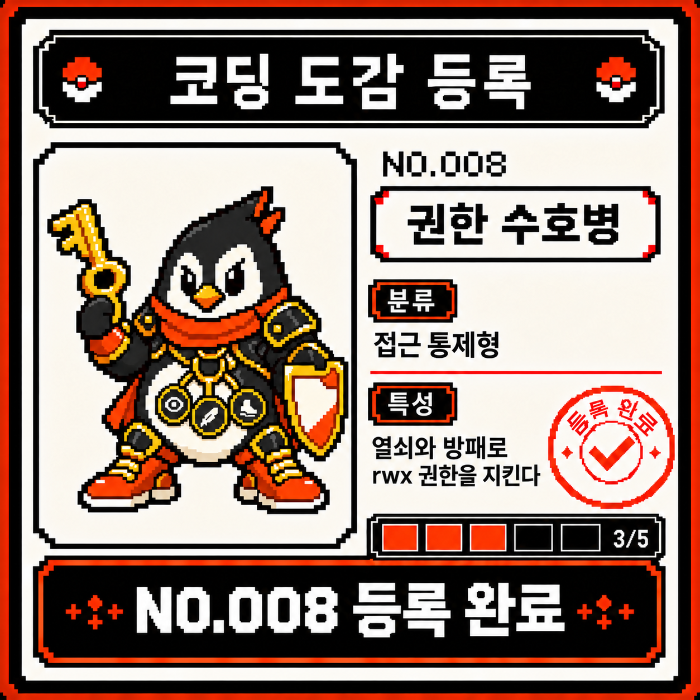

# 코딩 도감 #02 — Linux 권한과 사용자: rwx와 chmod


지난 관찰에서는 경로로 파일을 가리키고 `mkdir`, `cp`, `mv`, `rm`으로 다뤘다. 그때는 만들고 옮기고 지우는 일이 모두 막힘없이 됐다.

그런데 셸에서 하는 일이 늘 그렇게 순순히 되지는 않는다. 간단한 스크립트를 하나 만들어 실행하려는데 `Permission denied`가 돌아오거나, 분명 있는 파일인데 고칠 수 없다고 나오는 순간이 온다. 첫 주에 `ls -l` 맨 앞에서 보고 미뤄 둔 `drwxr-xr-x` 같은 문자열이 바로 그 이유를 적어 둔 곳이다. 셸 동굴의 잠긴 문 앞에서, 열쇠와 방패를 든 개체가 길을 막아섰다.


---

## 개체 정보

- 도감 번호: NO.008
- 이름: 권한 수호병
- 분류: 접근 통제형
- 출현 빈도: 매우 높음 (스크립트 실행, 서버 설정 파일, 배포 디렉터리처럼 `Permission denied`가 나오는 곳마다 등장)
- 위험도: ⚠️⚠️⚠️ (`sudo`로 root 권한을 빌리면 대부분의 권한 검사를 넘어서고, `chmod -R 777` 한 줄이면 보호가 통째로 풀림)

---

## 처음 만났을 때의 인상

권한 수호병을 처음 마주했을 때 이런 질문들이 떠올랐다.

- `-rw-r--r--`의 열 글자는 각각 무엇을 말하는 걸까?
- 내가 직접 만든 스크립트인데, 왜 실행하면 `Permission denied`가 나올까?
- `Permission denied`가 나오면 앞에 `sudo`를 붙이면 되는 걸까?

이번에도 명령어보다 이 질문들부터 정리해 보기로 했다.

---

## 관찰 1 — ls -l의 첫 열은 "누가 무엇을 할 수 있는지"다

이번 관찰은 지난주의 `project` 디렉터리에서 이어 간다. 지난주에 지운 `app.log` 자리에는 새 로그 파일이 하나 생겼고, 그 옆에 `logs` 디렉터리와 `run.sh`라는 간단한 셸 스크립트를 만들었다고 해 보자.

```bash
#!/bin/bash
echo "hello, codigdex"
```

`ls -l`로 자세히 보면 이렇게 나온다.

```bash
cd ~/project
ls -l
```

```text
-rw-r--r-- 1 lupi lupi  120 Oct 19 09:00 app.log
drwxr-xr-x 2 lupi lupi 4096 Oct 19 09:00 logs
-rw-r--r-- 1 lupi lupi   35 Oct 19 09:00 run.sh
```

한 줄을 왼쪽부터 읽으면 권한, 링크 수, **소유자**, **그룹**, 크기, 수정 시각, 이름 순서다. 링크 수는 이번 관찰에서는 넘어가고, 맨 앞의 열 글자와 그 뒤의 `lupi lupi`에 집중한다. `run.sh`의 소유자는 `lupi`이고, 그룹도 `lupi`다.



열 글자는 1 + 3 + 3 + 3으로 끊어 읽는다.

- **첫 글자: 종류**. `-`는 일반 파일, `d`는 디렉터리, `l`은 심볼릭 링크다. 그래서 `logs` 줄은 `d`로 시작한다
- **다음 세 글자: 소유자(user, `u`)** 의 권한
- **그다음 세 글자: 그룹(group, `g`)** 에 속한 사용자의 권한
- **마지막 세 글자: 기타(others, `o`)**, 즉 그 밖의 모든 사용자의 권한

세 글자는 항상 `r`(read, 읽기), `w`(write, 쓰기), `x`(execute, 실행) 순서이고, 권한이 없는 자리에는 `-`가 들어간다. `run.sh`의 `-rw-r--r--`는 "일반 파일이고, 소유자는 읽고 쓸 수 있고, 그룹과 기타는 읽기만 할 수 있다"는 뜻이다. 누구에게도 `x`가 없다.

그럼 지금 셸을 쓰는 나는 셋 중 어디에 해당할까? `id`로 확인할 수 있다.

```bash
id
```

```text
uid=1000(lupi) gid=1000(lupi) groups=1000(lupi),27(sudo)
```

출력은 환경마다 다르지만, 이 예시에서 나는 사용자 `lupi`이고 `lupi`와 `sudo` 그룹에 속해 있다. 파일에 접근할 때 Linux는 이렇게 판단한다.

1. 내가 파일의 소유자라면 **소유자 세 글자만** 본다
2. 소유자가 아니고 파일의 그룹에 속해 있다면 **그룹 세 글자만** 본다
3. 둘 다 아니라면 **기타 세 글자**를 본다

흥미로웠던 건 "만"이라는 부분이었다. 해당하는 칸 하나만 보고 끝나기 때문에, 소유자 칸이 그룹 칸보다 좁으면 소유자가 오히려 덜 할 수 있다. 권한은 더해지는 게 아니라, 내가 속한 칸 하나로 정해진다.

다만 이건 소유자·그룹·기타로 나누는 **기본 모델** 이야기다. 실제 시스템에는 ACL이나 capabilities처럼 이 열 글자 바깥에서 접근을 더 세밀하게 정하는 장치도 있는데, 이번 관찰에서는 다루지 않는다. 기본 모델의 자세한 규칙은 GNU coreutils 문서의 [Mode Structure](https://www.gnu.org/software/coreutils/manual/html_node/Mode-Structure.html)에 정리되어 있다.

하나 더 관찰한 건, 같은 `rwx`라도 파일과 디렉터리에서 뜻이 다르다는 점이었다.

| 권한 | 파일 | 디렉터리 |
| --- | --- | --- |
| `r` | 내용을 읽는다 (`cat`) | 안의 이름 목록을 본다 (`ls`) |
| `w` | 내용을 고친다 | 안에서 파일을 만들고, 지우고, 이름을 바꾼다 |
| `x` | 프로그램으로 실행한다 | 안으로 들어가고(`cd`) 안의 항목에 접근한다 |



여기서 의외였던 점이 하나 있다. 파일을 **지울 수 있는지**는 파일 자신의 `w`가 아니라 그 파일이 들어 있는 **디렉터리의 `w`(와 `x`)** 가 정한다. 지우기는 파일 내용을 바꾸는 일이 아니라, 디렉터리의 이름 목록에서 한 줄을 빼는 일이기 때문이다. 지난주에 `rm`을 그렇게 조심했는데, `rm`을 막는 열쇠는 파일이 아니라 디렉터리 쪽에 있었다. 단, `/tmp`처럼 **sticky bit**(권한 끝의 `t`)가 붙은 디렉터리에서는 디렉터리에 `w`가 있어도 남의 파일은 지울 수 없다. 공유 디렉터리에서 서로의 파일을 지우지 못하게 하는 장치다.

디렉터리 안의 목록이 아니라 디렉터리 **자체**의 권한을 보고 싶을 때는 `ls -ld`를 쓴다. `ls -l logs`는 `logs` 안의 항목을 나열하지만, `ls -ld logs`는 `logs` 한 줄만 보여 준다.

---

## 관찰 2 — chmod: 권한을 바꾼다

이제 `run.sh`를 실행해 본다. 지난주에 본 대로 `./`는 "지금 자리의"라는 뜻이다.

```bash
./run.sh
```

```text
bash: ./run.sh: Permission denied
```

내가 만든 파일이고 내가 소유자인데도 막혔다. 이유는 관찰 1에서 이미 읽었다. `-rw-r--r--`의 소유자 칸에 `x`가 없다. 편집기나 `touch`로 새로 만든 파일에는 보통 실행 권한이 붙지 않는다. 그래서 실행하려면 `x`를 직접 더해 줘야 한다.

권한을 바꾸는 명령이 `chmod`(**ch**ange **mod**e)다. 쓰는 방법은 두 가지다. 먼저 글자로 쓰는 방법이다.

```bash
chmod u+x run.sh    # 소유자(u)에게 실행(x)을 더한다
ls -l run.sh        # → -rwxr--r--
./run.sh            # → hello, codigdex
```

`누구` + `더하기/빼기/정하기` + `무엇` 순서로 읽으면 된다.

- 누구: `u`(소유자), `g`(그룹), `o`(기타), `a`(모두)
- 연산: `+`(더하기), `-`(빼기), `=`(정확히 이것으로 정하기)
- 무엇: `r`, `w`, `x`

```bash
chmod go-r app.log       # 그룹과 기타에게서 읽기를 뺀다 → -rw-------
chmod a+r app.log        # 모두에게 읽기를 더한다 → -rw-r--r--
chmod u=rwx,go=rx run.sh # 소유자는 rwx, 그룹·기타는 r-x로 정한다 → -rwxr-xr-x
```

두 번째는 숫자로 쓰는 방법이다. 각 권한에 숫자를 하나씩 주고, 세 글자를 더한 값으로 한 칸을 나타낸다.

- `r` = 4, `w` = 2, `x` = 1, 없음 = 0
- `rwx` = 4 + 2 + 1 = **7**, `r-x` = 4 + 1 = **5**, `r--` = **4**, `rw-` = 4 + 2 = **6**



세 칸을 소유자·그룹·기타 순서로 나란히 적으면 권한 전체가 세 자리 숫자가 된다.

```bash
chmod 755 run.sh   # rwx r-x r-x → -rwxr-xr-x
chmod 644 app.log  # rw- r-- r-- → -rw-r--r--
chmod 600 .env     # rw- --- --- → 소유자만 읽고 쓸 수 있음
```

관찰 2를 시작할 때 막혔던 `run.sh`를 숫자 방식으로 풀면, 막히고 → 권한을 더하고 → 확인하고 → 실행하는 흐름은 이렇게 된다.



자주 보이는 조합은 이 정도로 정리했다.

- `755`: 실행 파일이나 디렉터리. 소유자는 모두 할 수 있고, 나머지는 읽고 실행(디렉터리라면 들어가기)만 한다
- `644`: 일반 파일. 소유자만 고칠 수 있고, 나머지는 읽기만 한다
- `600`: 비밀번호나 키가 들어 있는 파일. 소유자 말고는 아무도 읽을 수 없다

글자 방식은 "지금 권한에서 이것만 바꾼다"에, 숫자 방식은 "권한 전체를 이것으로 정한다"에 잘 맞는다. 두 방식의 전체 문법은 GNU coreutils 문서의 [Setting Permissions](https://www.gnu.org/software/coreutils/manual/html_node/Setting-Permissions.html)에서 볼 수 있다.

위험도 표시의 첫 번째 이유도 여기서 드러난다. `Permission denied`를 만났을 때 `chmod 777`로 해결하라는 말을 종종 보게 되는데, `777`은 `rwxrwxrwx`, 즉 **모든 사용자가 읽고 고치고 실행할 수 있다**는 뜻이다. 막힌 문은 열리지만, 문 자체를 떼어 버리는 셈이다. 여기에 하위 전체를 바꾸는 `-R`(recursive)까지 붙으면 디렉터리 안의 모든 파일이 한꺼번에 열린다. 필요한 사람에게 필요한 글자만 더하는 쪽이 맞다.

---

## 관찰 3 — chown과 sudo: 주인을 바꾸고, 관리자 권한을 빌린다

마지막으로 관찰한 건 권한이 아니라 **주인**이 문제일 때였다. 이번에는 `run.sh`가 이렇게 보인다고 해 보자. 예를 들어 `sudo`를 붙여 실행한 편집기로 파일을 만들면 이렇게 된다.

```text
-rw-r--r-- 1 root root 35 Oct 19 09:10 run.sh
```

소유자와 그룹이 모두 `root`다. `root`는 Linux의 관리자 계정으로, 권한 검사를 대부분 건너뛸 수 있는 특별한 사용자다. 나(`lupi`)는 소유자도 아니고 `root` 그룹도 아니므로 기타 칸 `r--`만 적용된다. 읽을 수는 있지만 고칠 수 없다. 권한을 바꾸려고 해도 막힌다.

```bash
chmod u+x run.sh
```

```text
chmod: changing permissions of 'run.sh': Operation not permitted
```

일반 사용자는 **자기가 소유한 파일**의 권한만 `chmod`로 바꿀 수 있고, 남의 파일 권한을 바꾸려면 보통 관리자 권한이 필요하기 때문이다. 이럴 때는 주인을 바꿔야 한다. 소유자를 바꾸는 명령이 `chown`(**ch**ange **own**er)이다.

```bash
chown lupi run.sh
```

```text
chown: changing ownership of 'run.sh': Operation not permitted
```

이것도 막혔다. 일반 사용자는 다른 사람의 파일을 자기 것으로 가져올 수 없고, 반대로 자기 파일을 남에게 넘길 수도 없다. 파일의 주인을 바꾸는 건 보통 관리자 권한이 필요한 일이다. 그래서 여기서 `sudo`가 등장한다.

```bash
sudo chown lupi:lupi run.sh   # 소유자와 그룹을 모두 lupi로
ls -l run.sh                  # → -rw-r--r-- 1 lupi lupi 35 ... run.sh
chmod u+x run.sh              # 이제 내가 소유자이므로 sudo 없이 가능
```

`chown`은 `소유자:그룹` 형태로 둘을 한 번에 바꿀 수 있고, `chown lupi`처럼 소유자만, `chown :lupi`처럼 그룹만 바꿀 수도 있다. 디렉터리와 그 안을 통째로 바꿀 때는 `chmod`와 마찬가지로 `-R`을 붙인다. 자기 파일의 그룹을 자기가 속한 그룹으로 바꾸는 정도는 일반 사용자도 `sudo` 없이 할 수 있다.

`sudo`는 **허락된 명령을 다른 사용자로 실행**해 준다. 대상 사용자를 따로 정하지 않으면 기본값이 root라서, 보통은 "명령 한 줄을 root로 실행"하는 데 쓴다. 자세한 동작은 [sudo 공식 매뉴얼](https://www.sudo.ws/docs/man/sudo.man/)에 있다. 관찰한 특징은 이렇다.

- 아무나 쓸 수 있는 게 아니다. 관리자가 허락한 사용자만 쓸 수 있고, Ubuntu는 기본 설정에서 위의 `id` 예시에 나온 `sudo` 그룹에 이 허락을 준다 (배포판에 따라 `wheel` 그룹을 쓰기도 한다)
- 기본 설정에서는 root의 비밀번호가 아니라 **내 비밀번호**를 묻는다. 한 번 입력하면 설정된 시간 동안은 다시 묻지 않는다
- 권한이 빌려지는 건 그 한 줄뿐이다. 다음 명령은 다시 `lupi`로 실행된다

위험도 표시의 두 번째 이유가 여기 있다. `sudo`로 root가 되어 실행한 명령은 권한 수호병의 방패를 거의 그대로 통과한다. 지난주의 `rm -rf`가 무서웠다면, `sudo rm -rf`는 시스템 파일까지 막지 않는다. 그리고 앞의 예시처럼 `sudo`로 만든 파일은 root 소유가 되어, 나중에 내 계정으로 고치려 할 때 다시 막힌다. `Permission denied`마다 습관처럼 `sudo`를 붙이면 문제를 푸는 게 아니라 다음 문제를 만드는 셈이다.

그래서 `Permission denied`를 만났을 때의 순서를 하나 정했다.

1. `ls -l`로 그 파일의(디렉터리라면 `ls -ld`로 디렉터리 자체의) 소유자, 그룹, 권한을 읽는다
2. `id`로 지금 내가 누구이고 어느 그룹에 속해 있는지 확인한다
3. 셋 중 하나를 고른다
   - 내가 소유자인데 글자가 모자라면 → `chmod`로 필요한 글자만 더한다
   - 주인이 잘못되어 있다면 → `sudo chown`으로 주인을 바로잡는다
   - `/etc`처럼 원래 root의 영역이라면 → 그 한 줄에만 `sudo`를 붙인다



---

## 요약 정리

- `ls -l`의 열 글자는 종류 1글자 + 소유자·그룹·기타 각 3글자(`rwx`)로 읽는다. 권한이 없는 자리는 `-`다
- Linux는 내가 소유자인지, 그룹에 속하는지, 기타인지를 차례로 확인하고, 해당하는 칸 하나의 권한만 적용한다. `id`로 내가 누구인지 확인할 수 있다
- 디렉터리에서 `r`은 목록 보기, `w`는 안에서 만들고 지우기, `x`는 들어가기다. 파일을 지울 수 있는지는 기본적으로 디렉터리의 권한이 정하고, sticky bit가 붙은 디렉터리에서는 더 제한된다
- `chmod`는 `u+x`처럼 글자로, `755`처럼 숫자(r=4, w=2, x=1)로 권한을 바꾼다. 일반 사용자는 자기 파일만 바꿀 수 있다. `777`은 문을 떼어 내는 것과 같다
- `chown 소유자:그룹`으로 주인을 바꾸고, 소유자를 바꾸는 건 보통 관리자 권한(`sudo`)이 필요하다
- `sudo`는 허락된 명령 한 줄을 다른 사용자(기본값은 root)로 실행한다. 습관처럼 붙이지 말고, `ls -l`과 `id`로 먼저 원인을 읽는다

---

## 코딩 도감 메모

지난주까지는 셸에게 "어디의 어떤 파일"을 정확히 말하는 법을 배웠다면, 이번 주에는 그 파일 앞에 "누가 무엇을 할 수 있는지"라는 조건이 붙어 있다는 걸 알게 됐다. 첫 주에 미뤄 둔 `drwxr-xr-x`가 이제는 그냥 문자열이 아니라, 소유자·그룹·기타에게 각각 건네진 열쇠 꾸러미로 읽혔다. `Permission denied`도 더 이상 막다른 길이 아니라 "열쇠를 확인하라"는 안내문에 가까웠다.

다음 관찰에서는 파이프와 프로세스를 만날 예정이다. 한 명령의 출력을 `|`로 다음 명령에 넘기고 `>`·`>>`로 파일에 저장하는 법, 그리고 `ps`·`top`·`kill`로 실행 중인 프로세스를 살피고 멈추는 법을 관찰할 예정이다.

그 전에, Linux 챕터의 세 번째 개체를 코딩 도감에 등록한다. **NO.008 권한 수호병** — 열쇠와 방패로 rwx 권한을 지킨다. Linux 챕터 다섯 칸 중 세 번째 칸이 채워졌다.


