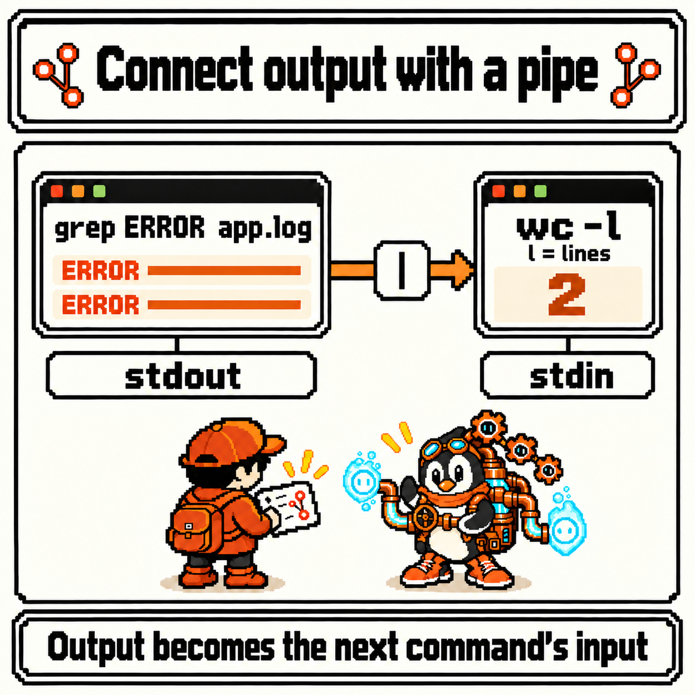
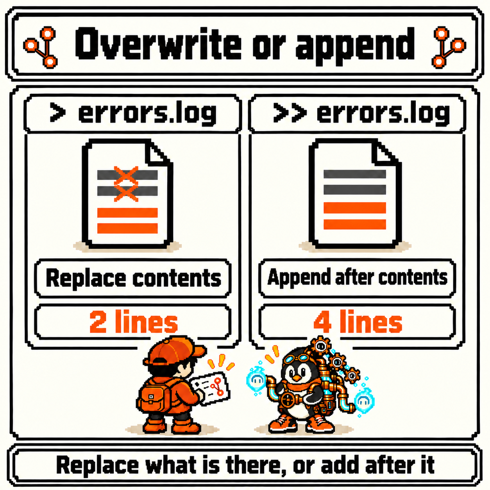
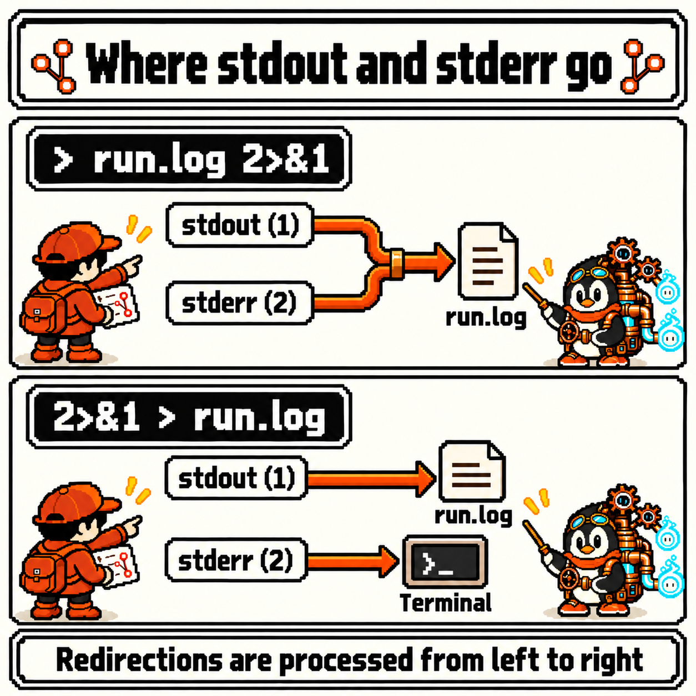
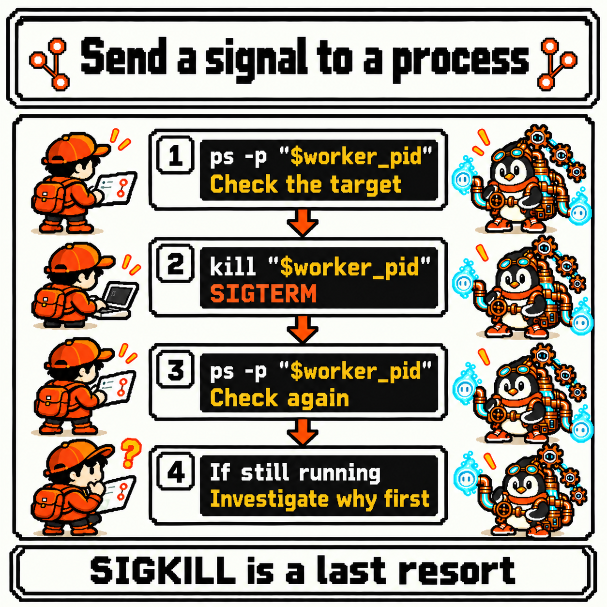
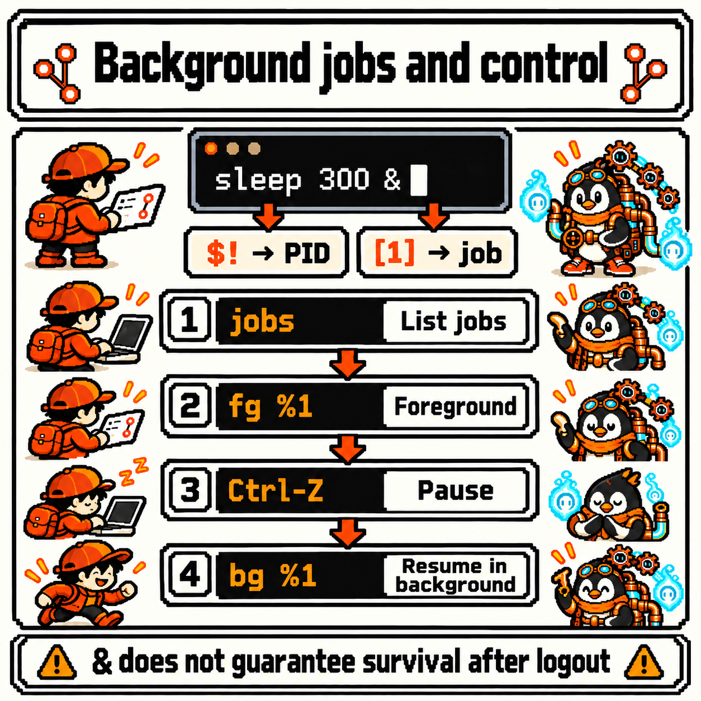

# Codigdex #02 — Linux Pipes and Processes


Last observation, we read the `rwx` in `ls -l` and handled "who can do what" with `chmod`, `chown`, and `sudo`. By now we can point at files, handle them, and even check the keys.

But so far, every command has run on its own. One command prints its result to the screen, I read it, and I type the next command. What about when I want to pick only the error lines out of a log file and count them, or keep a result in a file, or send a long-running command to the back or pause it? Do I just keep going the same way? Deep in the Shell Cave, among a tangle of pipes, a specimen wearing a copper pipe rig was steering the flow.


---

## Specimen info

- Dex number: NO.009
- Name: Pipe Engineer
- Classification: Flow control type
- Encounter rate: Very high (picking lines out of logs, saving command output, checking on a program that seems stuck — the longer you use the shell, the more often it shows up)
- Danger level: ⚠️⚠️⚠️ (a single `>` empties an existing file, and a `kill` sent to the wrong PID can stop some other process)

---

## First impression

Meeting the Pipe Engineer for the first time, these questions came up.

- In `grep ERROR app.log | wc -l`, where does `|` keep the first command's result before handing it over?
- `>` and `>>` both write to a file, so what's the difference? And why does `2>&1` look like that?
- Are a program and a process the same thing? Does `kill` really "kill" a process?

Once again, I decided to sort out the questions before the commands.

---

## Observation 1 — the pipe |: connecting one command's output to the next command's input

These examples assume an interactive Bash terminal on Linux. The output below is illustrative; actual PIDs, column spacing, and the timing of notifications vary by environment.

This observation also picks up in last week's `project` directory. For practice, say we recreate `app.log` with the five lines below. It's a made-up server log, with three `INFO` lines and two `ERROR` lines mixed together. What the `>` at the end does is covered in Observation 2. If a file with the same name already exists, its contents will change, so I recommend following along in a practice directory.

```bash
cd ~/project
printf '%s\n' \
  '2026-10-26 09:00:01 INFO server started' \
  '2026-10-26 09:00:05 INFO GET /health 200' \
  '2026-10-26 09:01:12 ERROR db connection timeout' \
  '2026-10-26 09:01:40 INFO GET /items 200' \
  '2026-10-26 09:02:03 ERROR GET /items 500' > app.log
```

First, the concept. A command run from the shell starts out with three channels by default.

- **Standard input (stdin, 0)**: where the command reads from. Unless you say otherwise, it's the keyboard
- **Standard output (stdout, 1)**: where the command sends its results. Unless you say otherwise, it's the terminal screen
- **Standard error (stderr, 2)**: where the command sends error messages. This also defaults to the terminal screen

The numbers in parentheses are **file descriptor** numbers. They come back in Observation 2 when we read `2>` and `2>&1`.

`grep` picks out only the lines that contain certain text in a file and sends them to standard output.

```bash
grep ERROR app.log
```

```text
2026-10-26 09:01:12 ERROR db connection timeout
2026-10-26 09:02:03 ERROR GET /items 500
```

`wc -l` counts the lines that come in on standard input. And `|` (the pipe) **connects the standard output of the command on the left to the standard input of the command on the right**.

```bash
grep ERROR app.log | wc -l
```

```text
2
```

The two lines `grep` used to print to the screen flowed into `wc -l` instead, and `wc -l` counted them and printed `2`. The last command's standard output isn't connected to anything, so it goes to the screen as usual.



The answer to my first question was here too. A pipe doesn't **save the first command's result to a file** and then hand it over. Nor does the second command start only after the first one has **completely finished**.

- According to the Bash manual's [Pipelines](https://www.gnu.org/software/bash/manual/html_node/Pipelines.html), each command in a pipeline runs **as its own separate process**, connected by pipes. `grep` and `wc` are up at the same time
- The pipe itself is a one-way channel set up by the kernel. As [pipe(7)](https://man7.org/linux/man-pages/man7/pipe.7.html) describes, the reading side waits until data arrives, and when the channel is full, the writing side waits. It's a buffer of limited size, not a warehouse that holds the whole result
- `wc -l` prints its number only once because it can't settle the count until it gets the signal that input has ended (end of file, EOF). It wasn't waiting for the first command to finish; it was waiting for its input to end

By the way, if all you need is the line count, `grep -c ERROR app.log` also gives `2`. Still, once you get the hang of `|`, you can chain as many small commands as you like: "pick → count," "pick → sort → look at just the top." That connection is exactly what the Pipe Engineer works with.

---

## Observation 2 — redirection >, >>, 2>: changing where output flows

If a pipe sends output to **another command**, redirection sends it to a **file**. Say we want to collect the error lines in a separate `errors.log`.

```bash
grep ERROR app.log > errors.log
cat errors.log
```

```text
2026-10-26 09:01:12 ERROR db connection timeout
2026-10-26 09:02:03 ERROR GET /items 500
```

The output from `grep` went to `errors.log` instead of the screen, and `cat` showed us those two lines. `>` points standard output (1) at a file. Let's run the same command once more with `>>`.

```bash
grep ERROR app.log >> errors.log
cat errors.log
```

```text
2026-10-26 09:01:12 ERROR db connection timeout
2026-10-26 09:02:03 ERROR GET /items 500
2026-10-26 09:01:12 ERROR db connection timeout
2026-10-26 09:02:03 ERROR GET /items 500
```

Now there are four lines. Run it with `>` again from here, and all four are emptied out and it goes back to two, just like the first time.



To sum up — the detailed rules are in the Bash manual under [Redirections](https://www.gnu.org/software/bash/manual/html_node/Redirections.html):

- `>`: creates the file if it doesn't exist; **if it does, empties it** and writes fresh (replace)
- `>>`: creates the file if it doesn't exist; if it does, writes **after the existing contents** (append)

Here's the first reason for the danger rating. The shell handles redirections **before** the command runs. So if you try to keep only the error lines in `app.log` by sending the output back to the input file, as in `grep ERROR app.log > app.log`, the shell empties `app.log` before `grep` even reads it. The original is gone. Always send results to a file with a different name. If you're worried about overwriting something by accident, you can turn on `set -o noclobber`; then `>` refuses to overwrite an existing file and reports an error instead.

Next, I observed **standard error**. Let's pass `grep` both a file that exists, `app.log`, and one that doesn't, `missing.log`. When given several files, `grep` puts the file name in front of each line.

```bash
grep ERROR app.log missing.log
```

```text
app.log:2026-10-26 09:01:12 ERROR db connection timeout
app.log:2026-10-26 09:02:03 ERROR GET /items 500
grep: missing.log: No such file or directory
```

The screen shows all three lines together (the line order may vary by environment), but the first two came out on standard output and the last one on standard error. Redirect only standard output with `>`, and the difference shows.

```bash
grep ERROR app.log missing.log > run.log
```

```text
grep: missing.log: No such file or directory
```

The two result lines went to `run.log`, but the error message stayed on the screen. That's because `>` is short for `1>`, so it moves only channel 1. To move channel 2, put its number in front.

```bash
grep ERROR app.log missing.log > run.log 2> grep-errors.log
```

This splits them: results go to `run.log`, errors to `grep-errors.log`. When you want to gather both **into the same file**, you use `2>&1`. It means "make channel 2 a copy of wherever channel 1 points right now."

```bash
grep ERROR app.log missing.log > run.log 2>&1
cat run.log
```

```text
app.log:2026-10-26 09:01:12 ERROR db connection timeout
app.log:2026-10-26 09:02:03 ERROR GET /items 500
grep: missing.log: No such file or directory
```

This time both the results and the error from `grep` went into `run.log`, and `cat` showed us all three lines. What I found interesting here was the **order**. The shell processes redirections one at a time, from left to right.

- `> run.log 2>&1`: first point 1 at `run.log`, then copy 2 to "the current 1," which is `run.log`. Both go to the file
- `2>&1 > run.log`: first copy 2 to "the current 1," which is still the terminal, then point only 1 at `run.log`. Errors still show up on the screen



The Bash manual puts exactly these two examples side by side and notes that "the order of redirections is significant." There's also a Bash-specific shorthand that does the same thing, `&> run.log`, which the manual describes as semantically equivalent to `> run.log 2>&1`.

---

## Observation 3 — processes and PIDs: watching with ps and top, signaling with kill

While observing pipes, the phrase "each command runs as a separate process" came up. Before going further, I decided to tell two words apart.

- **Program**: an executable file stored on disk. The file itself, like `/usr/bin/sleep`
- **Process**: **one running instance** of that program. Run the same program twice and you get two processes

The operating system tells processes apart by giving each one a number called a **PID** (process ID). Program names can overlap, but no two processes alive at the same time share a PID. That's why you point at a process by its PID rather than its name.

For the specimen under observation, I'll use `sleep 300`, which does nothing but wait for 300 seconds. The `&` at the end means "run this in the back and give me the prompt back right away" — more on that in Observation 4. When you run it this way, the shell stores the PID of the process it just sent to the back in `$!`, a value defined under [Special Parameters](https://www.gnu.org/software/bash/manual/html_node/Special-Parameters.html). We copy that value into a variable right away.

```bash
sleep 300 &
worker_pid=$!
echo "$worker_pid"
```

```text
[1] 12345
12345
```

The PID number differs every run and on every system. In this post I'll call it `12345`, but in commands I never type the number directly; I always point at it with `"$worker_pid"`. If you copy a PID from someone else's post, it may be an entirely different process on your system.

Now let's observe this process with `ps`. As the first line of the [ps(1)](https://man7.org/linux/man-pages/man1/ps.1.html) manual says, `ps` reports "a **snapshot** of the current processes." `-p` picks the PID, and `-o` picks the columns you want to see.

```bash
ps -p "$worker_pid" -o pid,comm,args
```

```text
    PID COMMAND         COMMAND
  12345 sleep           sleep 300
```

Column spacing can also vary a little by environment. The columns we picked are:

- `pid`: the process number
- `comm`: just the executable's name
- `args`: the full command, including its arguments

Both column headers reading `COMMAND` confused me at first, but the first is `comm` and the second is `args`. This one line confirms "is this PID really the `sleep 300` I started?"

If `ps` is a single photo, [top(1)](https://man7.org/linux/man-pages/man1/top.1.html) is a screen that updates in real time. `-p` narrows it to just the PIDs you want.

```bash
top -p "$worker_pid"
```

`top` is an **interactive** program: once it starts, it takes over the screen and redraws every few seconds. No need to panic when the prompt doesn't come back; press `q` to quit. Since `sleep` only waits, its CPU usage will show close to 0, and the state column (`S`) will likely show `S`, for sleeping.

With the check done, it's time to stop the process. The command for that is `kill`.

```bash
kill "$worker_pid"
```

The name makes it easy to misread, but what `kill` does isn't to remove the process directly; it **sends a signal**. A signal is a short notification the operating system delivers to a process. If you don't say which signal to send, Bash's `kill` sends **SIGTERM** ("please terminate"), as written under [Job Control Builtins](https://www.gnu.org/software/bash/manual/html_node/Job-Control-Builtins.html).

A process that receives SIGTERM usually terminates, but if the program is built to catch and handle that signal itself, it may wrap up what it was doing and close its open files before it exits. Some programs are even built to ignore it. In other words, typing `kill` comes with **no guarantee that the process disappears that instant**. [signal(7)](https://man7.org/linux/man-pages/man7/signal.7.html) also explains that between being generated and being delivered, a signal is "pending." That's why you should always check again after sending one.

```bash
ps -p "$worker_pid" -o pid,comm,args
```

```text
    PID COMMAND         COMMAND
```

Only the header is left, meaning no process with that PID exists anymore. Bash also shows a notice like `[1]+  Terminated              sleep 300` around the next prompt.



Here's the second reason for the danger rating. If the process is still there after the check, don't jump straight to a stronger signal; look at the situation first. Use `ps` again to see whether it's just taking time to clean up, and whether it's still the same PID (once a process ends, its PID can later be reused by a different process).

Only once you've decided it really won't stop do you reach for the last resort: **SIGKILL**, sent as in `kill -KILL "$worker_pid"`. According to signal(7), SIGKILL is a signal a process **cannot catch, block, or ignore**. The price of that certainty is that the process never gets a chance to run its shutdown cleanup code, so half-written files or temporary files can be left behind. In some cases the kernel still needs time to complete termination, so you can't assume the process disappears from the list the instant the signal is sent either.

To sum up, this is the order I settled on for stopping a process.

1. Use `ps -p` to confirm which process the PID points to
2. Send SIGTERM with `kill`
3. Check again with `ps -p`
4. If it's still there, look into why first, and consider SIGKILL only at the end

There are also ways to signal processes by name all at once, but they can sweep up other processes with the same name, so this observation only uses the approach of confirming a single PID and then signaling it.

---

## Observation 4 — background jobs &: getting the prompt back, handling it as a job

Now for the `&` we set aside in Observation 3. Normally the shell waits for a command to finish before showing the next prompt. That's called running in the **foreground**. Put `&` at the end of a command, and the shell runs it in the **background** and gives the prompt back right away without waiting for it to finish. This is the asynchronous execution described in the Bash manual's [Lists of Commands](https://www.gnu.org/software/bash/manual/html_node/Lists.html).

Let's start `sleep 300` in the background again.

```bash
sleep 300 &
worker_pid=$!
jobs
```

```text
[1] 12346
[1]+  Running                 sleep 300 &
```

The first line, `[1] 12346`, has two numbers in it. This is the part that confused me at first. Reading [Job Control Basics](https://www.gnu.org/software/bash/manual/html_node/Job-Control-Basics.html), I sorted it out like this.

- `[1]` is the **job number**. It's the number this shell gave to a task it started, and it only means something inside this shell. You refer to it with a `%`, as in `%1`
- `12346` is the **PID**. It's the number used across the whole operating system, and it's the value you pass to `ps` or `kill`

`jobs` shows the list of jobs the current shell is managing. Processes started from another terminal don't show up here. With `jobs -l`, the PID appears next to the job number as well.

A background job can be brought back to the foreground with `fg`.

```bash
fg %1
```

Now `sleep 300` holds the terminal, and the prompt doesn't come back. Press **Ctrl-Z** at this point, and a stop signal (SIGTSTP) goes to the foreground job, which is **paused**, and the shell gives the prompt back. It hasn't ended; it's stopped.

```text
^Z
[1]+  Stopped                 sleep 300
```

A stopped job can be set running again in the background with `bg`. (Pressing Ctrl-C while a job is in the foreground sends an interrupt signal, SIGINT, rather than pausing it.)

```bash
bg %1
jobs
```

```text
[1]+ sleep 300 &
[1]+  Running                 sleep 300 &
```

With the observation done, let's clean up in the same order as Observation 3: confirm with `ps` that the job and the PID point to the same process, send SIGTERM, and check again.

```bash
ps -p "$worker_pid" -o pid,comm,args
kill "$worker_pid"
ps -p "$worker_pid" -o pid,comm,args
```



The last thing I observed was the limit of `&`. `&` means "give me the prompt back right away," not "keep running even after I close the terminal." According to the Bash manual's [Signals](https://www.gnu.org/software/bash/manual/html_node/Signals.html), when the terminal connection drops and the shell receives SIGHUP, an interactive shell resends SIGHUP to all its jobs before exiting. If the `huponexit` option is on, the same happens when a login shell simply runs `exit`. SIGHUP's default action is to terminate, so a job running in the background can end right along with it. There are separate ways to hand off a program that needs to stay alive regardless of the shell, and they're outside the scope of this observation.

---

## Summary

- A command starts with three channels: standard input (0), standard output (1), and standard error (2)
- `|` connects the left command's standard output to the right command's standard input. It doesn't pile the result up in a file, and the two commands run at the same time as separate processes
- `>` empties a file and writes it fresh; `>>` writes after what's there. Redirections are handled before the command, so using `>` with the same name as the input file empties the original
- `2>` sends standard error elsewhere, and `> run.log 2>&1` gathers both into one file. Redirections are processed from the left, so order matters
- A program is an executable file on disk, a process is a running instance, and you point at a process by its PID. `ps` is a snapshot; `top` is a real-time interactive screen (`q` to quit)
- `kill` sends a signal, SIGTERM by default. Check again with `ps` after sending it, and consider SIGKILL — which can't be caught and leaves no room for cleanup — only at the end
- `&` runs a command in the background, and `$!` is its PID. A job number (`%1`) isn't a PID. Handle jobs with `jobs`, `fg`, Ctrl-Z, and `bg`, and remember that `&` alone doesn't guarantee survival after logout

---

## Codigdex notes

Up to last week, I learned what can be done to each individual file; this week I got to see what flows between commands. The text that showed up on the screen had actually been coming out through two separate channels, 1 and 2, and `|` and `>` were ways of plugging the ends of those channels in somewhere else. A running command no longer reads as just "something that's going," but as a process wearing a number called a PID. The most surprising part of this observation was that even `kill` isn't a command that destroys — it's a command that sends a message.

Next, I'll meet the kernel and the operating system. I plan to look at whatever handed out this week's PIDs and delivered its signals — the presence behind the processes that manages them.

Before that, the fourth specimen of the Linux chapter goes into the Codigdex. **NO.009 Pipe Engineer** — pipes command output together to direct processes. The fourth of the Linux chapter's five slots is filled.


