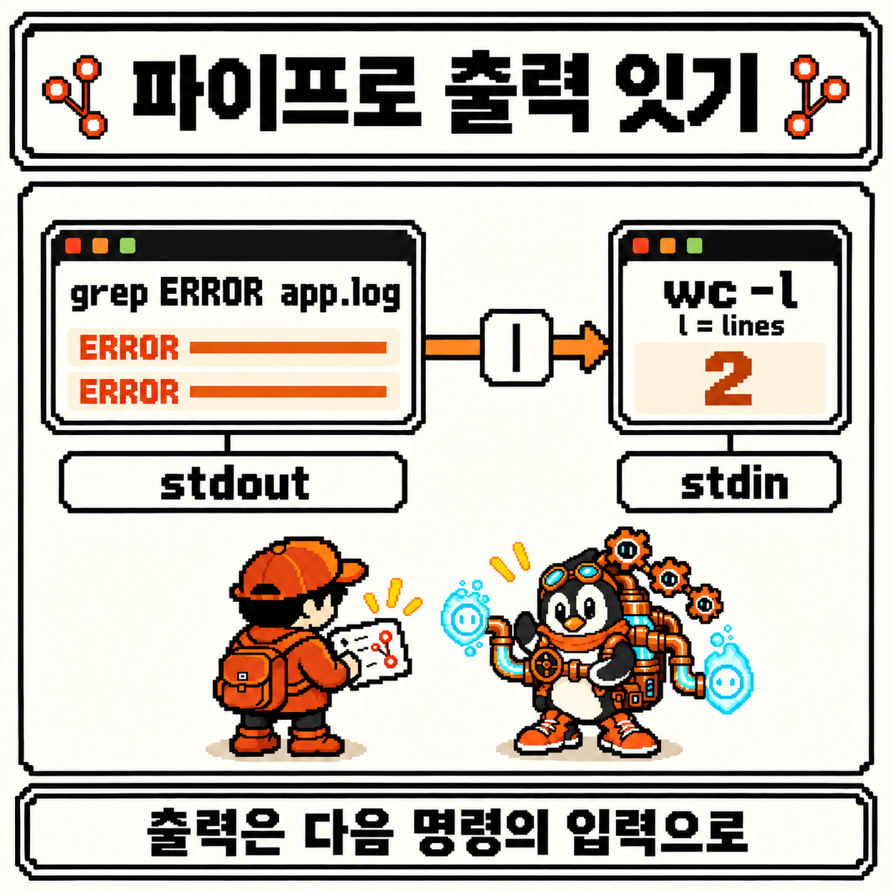
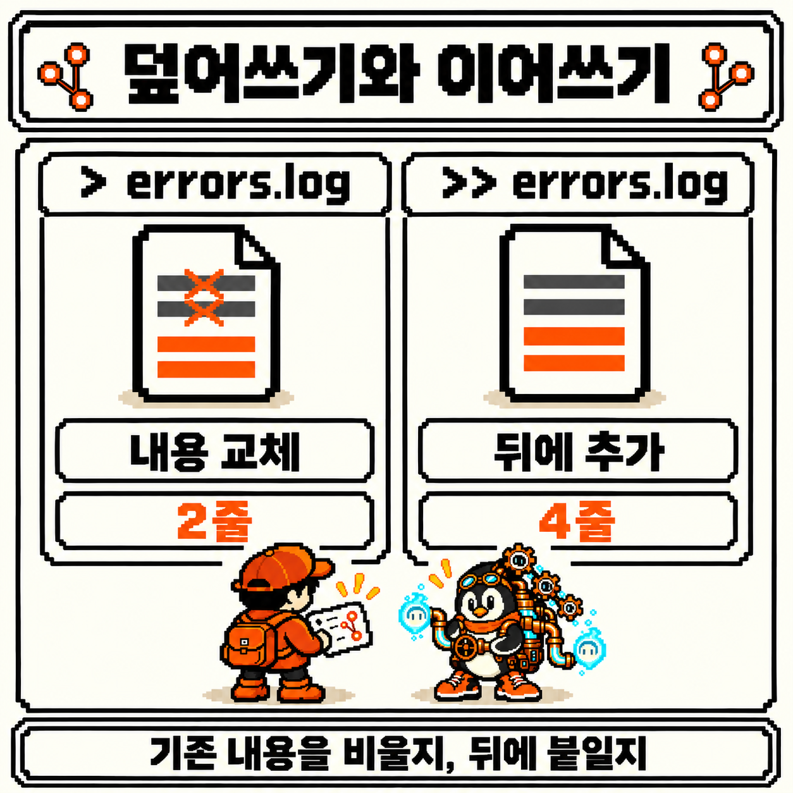
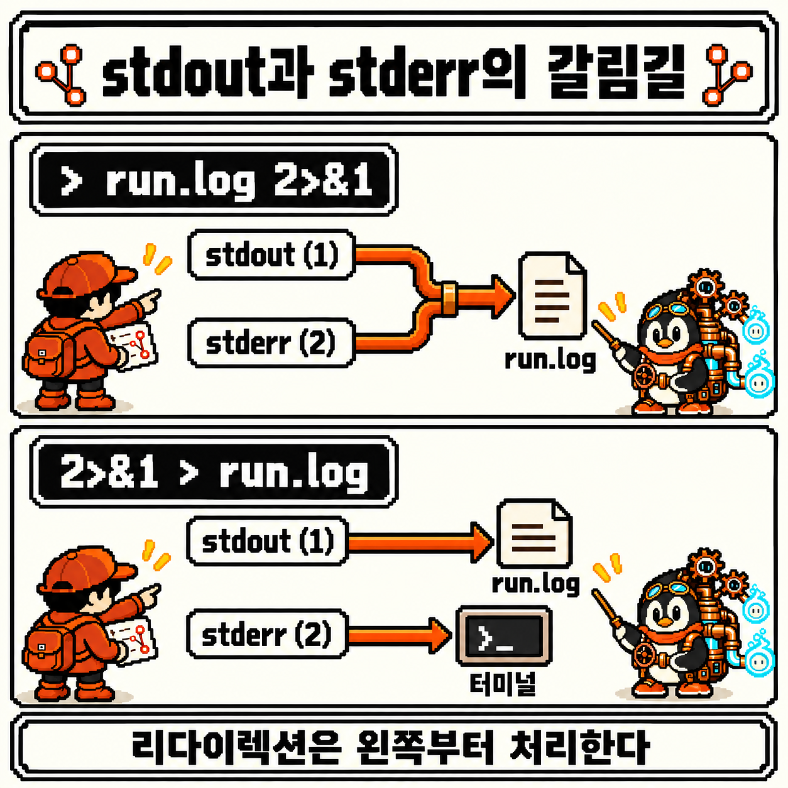
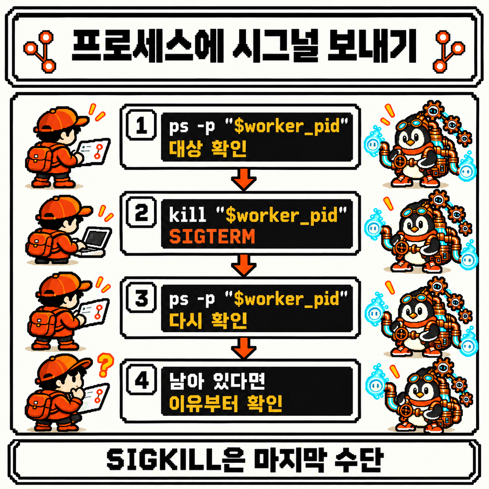
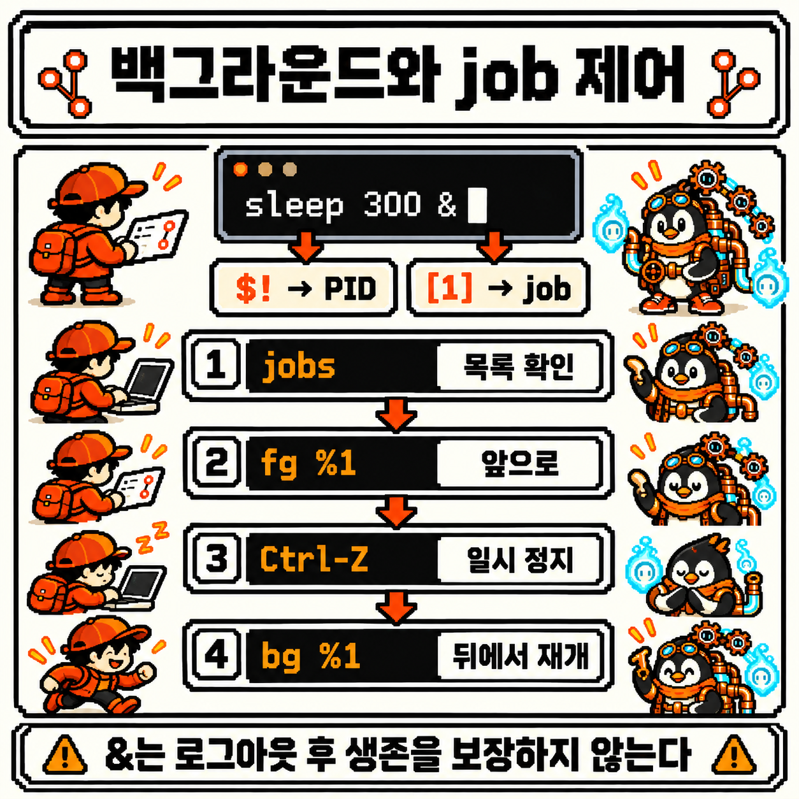

# 코딩 도감 #02 — Linux 파이프와 프로세스: |와 kill


지난 관찰에서는 `ls -l`의 `rwx`를 읽고, `chmod`·`chown`·`sudo`로 "누가 무엇을 할 수 있는지"를 다뤘다. 이제 파일을 가리키고, 다루고, 열쇠까지 확인할 수 있게 됐다.

그런데 지금까지는 명령을 하나씩 따로 실행했다. 명령 하나가 결과를 화면에 찍으면, 그걸 눈으로 읽고 다음 명령을 쳤다. 로그 파일에서 에러 줄만 골라 몇 줄인지 세고 싶을 때도, 결과를 파일로 남기고 싶을 때도, 오래 도는 명령을 잠시 뒤로 보내거나 멈추고 싶을 때도 같은 방식으로 버텨야 할까? 셸 동굴 깊은 곳, 얽힌 파이프 사이에서 구리 파이프 장치를 멘 개체가 흐름을 조종하고 있었다.


---

## 개체 정보

- 도감 번호: NO.009
- 이름: 파이프 엔지니어
- 분류: 흐름 제어형
- 출현 빈도: 매우 높음 (로그에서 원하는 줄 골라내기, 명령 결과 저장하기, 멈춘 듯한 프로그램 확인하기처럼 셸을 오래 쓸수록 자주 등장)
- 위험도: ⚠️⚠️⚠️ (`>` 한 글자로 기존 파일 내용이 비워지고, 엉뚱한 PID에 보낸 `kill`은 다른 프로세스를 멈출 수 있음)

---

## 처음 만났을 때의 인상

파이프 엔지니어를 처음 마주했을 때 이런 질문들이 떠올랐다.

- `grep ERROR app.log | wc -l`의 `|`는 앞 명령의 결과를 어디에 담아 두었다가 넘기는 걸까?
- `>`와 `>>`는 둘 다 파일에 쓰는데, 무엇이 다를까? 그리고 `2>&1`은 왜 저런 모양일까?
- 프로그램과 프로세스는 같은 말일까? `kill`은 정말 프로세스를 "죽이는" 명령일까?

이번에도 명령어보다 이 질문들부터 정리해 보기로 했다.

---

## 관찰 1 — 파이프 |: 앞 명령의 출력을 다음 명령의 입력으로 잇는다

예시는 Linux의 대화형 Bash 터미널을 기준으로 한다. 아래 출력은 설명용이며, 실제 PID와 열 간격, 알림이 표시되는 시점은 환경마다 다르다.

이번 관찰도 지난주의 `project` 디렉터리에서 이어 간다. 연습을 위해 `app.log`를 아래 다섯 줄로 다시 만든다고 해 보자. 가상의 서버 로그이고, `INFO` 세 줄과 `ERROR` 두 줄이 섞여 있다. 마지막의 `>`가 무슨 일을 하는지는 관찰 2에서 본다. 이미 같은 이름의 파일이 있다면 내용이 바뀌니, 연습용 디렉터리에서 따라 하는 걸 권한다.

```bash
cd ~/project
printf '%s\n' \
  '2026-10-26 09:00:01 INFO server started' \
  '2026-10-26 09:00:05 INFO GET /health 200' \
  '2026-10-26 09:01:12 ERROR db connection timeout' \
  '2026-10-26 09:01:40 INFO GET /items 200' \
  '2026-10-26 09:02:03 ERROR GET /items 500' > app.log
```

먼저 개념부터 정리했다. 셸에서 실행되는 명령은 기본적으로 세 개의 통로를 갖고 시작한다.

- **표준 입력(stdin, 0번)**: 명령이 읽어 들이는 쪽. 따로 정하지 않으면 키보드다
- **표준 출력(stdout, 1번)**: 명령이 결과를 내보내는 쪽. 따로 정하지 않으면 터미널 화면이다
- **표준 에러(stderr, 2번)**: 명령이 에러 메시지를 내보내는 쪽. 이것도 기본은 터미널 화면이다

괄호 안의 숫자는 **파일 디스크립터** 번호다. 관찰 2에서 `2>`나 `2>&1`을 읽을 때 이 숫자가 다시 나온다.

`grep`은 파일에서 특정 글자가 들어간 줄만 골라 표준 출력으로 내보낸다.

```bash
grep ERROR app.log
```

```text
2026-10-26 09:01:12 ERROR db connection timeout
2026-10-26 09:02:03 ERROR GET /items 500
```

`wc -l`은 표준 입력으로 들어온 줄 수를 센다. 그리고 `|`(파이프)는 **왼쪽 명령의 표준 출력을 오른쪽 명령의 표준 입력에 연결**한다.

```bash
grep ERROR app.log | wc -l
```

```text
2
```

`grep`이 화면에 찍던 두 줄이 화면 대신 `wc -l`로 흘러 들어갔고, `wc -l`은 그 두 줄을 세어 `2`를 내보냈다. 맨 마지막 명령의 표준 출력은 연결된 곳이 없으니 원래대로 화면에 나온다.



처음에 품었던 질문의 답도 여기 있었다. 파이프는 앞 명령의 결과를 **파일로 저장해 두었다가** 넘기는 게 아니다. 그리고 앞 명령이 **다 끝나야** 뒤 명령이 시작되는 것도 아니다.

- Bash 매뉴얼의 [Pipelines](https://www.gnu.org/software/bash/manual/html_node/Pipelines.html)에 따르면, 파이프라인의 각 명령은 파이프로 이어진 채 **각자 별도의 프로세스**로 실행된다. `grep`과 `wc`가 동시에 떠 있는 것이다
- 파이프 자체는 커널이 마련한 한 방향 통로다. [pipe(7)](https://man7.org/linux/man-pages/man7/pipe.7.html)을 보면 읽는 쪽은 데이터가 들어올 때까지 기다리고, 통로가 가득 차면 쓰는 쪽이 기다린다. 크기가 정해진 버퍼일 뿐, 결과를 통째로 쌓아 두는 창고가 아니다
- `wc -l`이 숫자를 한 번만 찍는 건 입력이 끝났다는 신호(파일의 끝, EOF)를 받아야 셀 수를 확정할 수 있기 때문이다. 앞 명령이 끝나기를 기다린 게 아니라, 입력이 끝나기를 기다린 것이다

참고로 줄 수만 필요하다면 `grep -c ERROR app.log`도 같은 `2`를 낸다. 그래도 `|`를 먼저 익혀 두면, "고르고 → 세고", "고르고 → 정렬하고 → 앞부분만 보고"처럼 작은 명령을 원하는 만큼 이어 붙일 수 있다. 파이프 엔지니어가 다루는 게 바로 이 연결이다.

---

## 관찰 2 — 리다이렉션 >, >>, 2>: 출력이 흘러갈 곳을 바꾼다

파이프가 출력을 **다른 명령**으로 보낸다면, 리다이렉션은 출력을 **파일**로 보낸다. 에러 줄을 따로 `errors.log`에 모아 두고 싶다고 해 보자.

```bash
grep ERROR app.log > errors.log
cat errors.log
```

```text
2026-10-26 09:01:12 ERROR db connection timeout
2026-10-26 09:02:03 ERROR GET /items 500
```

`grep`의 결과는 화면 대신 `errors.log`로 들어갔고, `cat`으로 그 두 줄을 확인했다. `>`는 표준 출력(1번)을 파일로 돌린다. 같은 명령을 `>>`로 한 번 더 실행해 본다.

```bash
grep ERROR app.log >> errors.log
cat errors.log
```

```text
2026-10-26 09:01:12 ERROR db connection timeout
2026-10-26 09:02:03 ERROR GET /items 500
2026-10-26 09:01:12 ERROR db connection timeout
2026-10-26 09:02:03 ERROR GET /items 500
```

네 줄이 됐다. 여기서 다시 `>`로 실행하면 네 줄이 모두 비워지고 처음처럼 두 줄로 돌아간다.



정리하면 이렇다. 자세한 규칙은 Bash 매뉴얼의 [Redirections](https://www.gnu.org/software/bash/manual/html_node/Redirections.html)에 있다.

- `>`: 파일이 없으면 만들고, **있으면 내용을 비운 뒤** 새로 쓴다 (교체)
- `>>`: 파일이 없으면 만들고, 있으면 **기존 내용 뒤에** 이어 쓴다 (추가)

위험도 표시의 첫 번째 이유가 여기 있다. 리다이렉션은 명령이 실행되기 **전에** 셸이 먼저 처리한다. 그래서 `app.log`에서 에러 줄만 남기겠다고 `grep ERROR app.log > app.log`처럼 입력 파일과 같은 이름으로 출력을 보내면, `grep`이 읽기도 전에 셸이 `app.log`를 비워 버린다. 원본이 사라지는 것이다. 결과는 항상 다른 이름의 파일로 보낸다. 실수로 덮어쓰는 게 걱정된다면 `set -o noclobber`를 켜 둘 수 있다. 그러면 `>`가 이미 있는 파일을 덮어쓰지 않고 에러를 낸다.

다음으로 관찰한 건 **표준 에러**였다. 있는 파일 `app.log`와 없는 파일 `missing.log`를 함께 `grep`에 넘겨 본다. 파일을 여러 개 넘기면 `grep`은 각 줄 앞에 파일 이름을 붙인다.

```bash
grep ERROR app.log missing.log
```

```text
app.log:2026-10-26 09:01:12 ERROR db connection timeout
app.log:2026-10-26 09:02:03 ERROR GET /items 500
grep: missing.log: No such file or directory
```

화면에는 세 줄이 함께 보이지만(줄 순서는 환경에 따라 다를 수 있다), 앞의 두 줄은 표준 출력, 마지막 줄은 표준 에러로 나온 것이다. `>`로 표준 출력만 파일로 돌리면 그 차이가 드러난다.

```bash
grep ERROR app.log missing.log > run.log
```

```text
grep: missing.log: No such file or directory
```

결과 두 줄은 `run.log`로 갔지만, 에러 메시지는 여전히 화면에 남았다. `>`는 `1>`의 줄임말이라 1번 통로만 옮기기 때문이다. 2번 통로를 옮기려면 번호를 붙인다.

```bash
grep ERROR app.log missing.log > run.log 2> grep-errors.log
```

이렇게 하면 결과는 `run.log`, 에러는 `grep-errors.log`로 나뉜다. 둘을 **한 파일에 같이** 모으고 싶을 때 쓰는 게 `2>&1`이다. "2번 통로를, 지금 1번 통로가 가리키는 곳으로 복제하라"는 뜻이다.

```bash
grep ERROR app.log missing.log > run.log 2>&1
cat run.log
```

```text
app.log:2026-10-26 09:01:12 ERROR db connection timeout
app.log:2026-10-26 09:02:03 ERROR GET /items 500
grep: missing.log: No such file or directory
```

이번에는 `grep`의 결과와 에러 세 줄이 모두 `run.log`에 들어갔고, `cat`으로 그 내용을 확인했다. 여기서 흥미로웠던 건 **순서**였다. 셸은 리다이렉션을 왼쪽에서 오른쪽으로 하나씩 처리한다.

- `> run.log 2>&1`: 먼저 1번을 `run.log`로 돌리고, 그다음 2번을 "지금의 1번", 즉 `run.log`로 복제한다. 둘 다 파일로 간다
- `2>&1 > run.log`: 먼저 2번을 "지금의 1번", 즉 아직 터미널인 곳으로 복제하고, 그다음 1번만 `run.log`로 돌린다. 에러는 여전히 화면에 나온다



Bash 매뉴얼도 정확히 이 두 예를 나란히 들어 "리다이렉션의 순서가 중요하다"고 적어 두었다. 같은 일을 하는 Bash 전용 줄임 표기로 `&> run.log`도 있는데, 매뉴얼은 이것이 `> run.log 2>&1`과 의미상 같다고 설명한다.

---

## 관찰 3 — 프로세스와 PID: ps·top으로 보고, kill로 시그널을 보낸다

파이프를 관찰하면서 "각 명령이 별도의 프로세스로 실행된다"는 말이 나왔다. 여기서 두 단어를 구분하고 넘어가기로 했다.

- **프로그램**: 디스크에 저장된 실행 파일이다. `/usr/bin/sleep` 같은 파일 자체다
- **프로세스**: 그 프로그램이 **실행되고 있는 하나의 사례**다. 같은 프로그램을 두 번 실행하면 프로세스가 두 개 생긴다

운영체제는 프로세스마다 **PID**(process ID)라는 번호를 붙여 구분한다. 프로그램 이름은 겹칠 수 있지만, 지금 살아 있는 프로세스끼리 PID는 겹치지 않는다. 그래서 프로세스를 다룰 때는 이름보다 PID로 가리킨다.

관찰 대상으로는 아무 일도 하지 않고 300초 동안 기다리기만 하는 `sleep 300`을 쓴다. 끝에 붙은 `&`는 "이 명령을 뒤에서 돌리고 프롬프트는 바로 돌려 달라"는 뜻인데, 자세한 이야기는 관찰 4에서 한다. 이렇게 실행하면 셸이 직전에 뒤로 보낸 프로세스의 PID를 `$!`에 담아 둔다. [Special Parameters](https://www.gnu.org/software/bash/manual/html_node/Special-Parameters.html)에 정의된 값이다. 그 값을 바로 변수에 옮겨 둔다.

```bash
sleep 300 &
worker_pid=$!
echo "$worker_pid"
```

```text
[1] 12345
12345
```

PID 숫자는 실행할 때마다, 환경마다 다르다. 이 글에서는 `12345`라고 해 두고, 명령에서는 숫자를 직접 치지 않고 항상 `"$worker_pid"`로 가리킨다. 남의 글에 나온 PID를 그대로 따라 치면, 내 시스템에서는 전혀 다른 프로세스일 수 있기 때문이다.

이제 이 프로세스를 `ps`로 관찰한다. `ps`는 [ps(1)](https://man7.org/linux/man-pages/man1/ps.1.html) 매뉴얼의 첫 줄 그대로 "현재 프로세스의 **스냅숏**"을 보여 주는 명령이다. `-p`로 PID를 지정하고, `-o`로 보고 싶은 열을 고른다.

```bash
ps -p "$worker_pid" -o pid,comm,args
```

```text
    PID COMMAND         COMMAND
  12345 sleep           sleep 300
```

열 간격도 환경마다 조금씩 다를 수 있다. 고른 열은 이렇다.

- `pid`: 프로세스 번호
- `comm`: 실행 파일의 이름만
- `args`: 인자까지 포함한 전체 명령

두 열의 머리글이 모두 `COMMAND`로 나오는 게 처음엔 헷갈렸는데, 앞쪽이 `comm`, 뒤쪽이 `args`다. 이 한 줄로 "이 PID가 정말 내가 띄운 `sleep 300`이 맞는지"를 확인할 수 있다.

`ps`가 한 장의 사진이라면, [top(1)](https://man7.org/linux/man-pages/man1/top.1.html)은 실시간으로 갱신되는 화면이다. `-p`로 보고 싶은 PID만 골라 볼 수 있다.

```bash
top -p "$worker_pid"
```

`top`은 **대화형** 프로그램이라 실행하면 화면을 차지하고 몇 초마다 내용을 다시 그린다. 프롬프트가 돌아오지 않는다고 당황할 필요는 없다. `q`를 누르면 빠져나온다. `sleep`은 기다리기만 하므로 CPU 사용률이 거의 0으로 보이고, 상태 열(`S`)에는 잠든 상태를 뜻하는 `S`가 보일 것이다.

확인이 끝났으니 프로세스를 멈춘다. 여기서 쓰는 명령이 `kill`이다.

```bash
kill "$worker_pid"
```

이름 때문에 오해하기 쉽지만, `kill`이 하는 일은 프로세스를 직접 없애는 게 아니라 **시그널(signal)을 보내는 것**이다. 시그널은 운영체제가 프로세스에게 전하는 짧은 통지다. 어떤 시그널을 보낼지 정하지 않으면 Bash의 `kill`은 **SIGTERM**("종료해 달라")을 보낸다고 [Job Control Builtins](https://www.gnu.org/software/bash/manual/html_node/Job-Control-Builtins.html)에 적혀 있다.

SIGTERM을 받은 프로세스는 보통 종료되지만, 프로그램이 이 시그널을 받아 직접 처리하도록 만들어져 있다면 하던 일을 정리하고, 열린 파일을 닫고 나서 끝날 수도 있다. 아예 무시하도록 만들어진 프로그램도 있다. 즉 `kill`을 쳤다고 해서 **그 순간 사라진다는 보장은 없다**. [signal(7)](https://man7.org/linux/man-pages/man7/signal.7.html)도 시그널이 만들어진 뒤 실제로 전달되기 전까지 "보류(pending)" 상태가 있다고 설명한다. 보낸 다음에 꼭 다시 확인해야 하는 이유다.

```bash
ps -p "$worker_pid" -o pid,comm,args
```

```text
    PID COMMAND         COMMAND
```

머리글만 남았다. 그 PID의 프로세스가 더 이상 없다는 뜻이다. Bash라면 다음 프롬프트 즈음에 `[1]+  Terminated              sleep 300` 같은 알림도 보여 준다.



위험도 표시의 두 번째 이유도 여기 있다. 확인했는데도 프로세스가 남아 있다면, 바로 더 센 시그널로 넘어가지 않고 먼저 상황을 본다. 정리 중이라 시간이 걸리는 건지, 같은 PID가 맞는지(프로세스가 끝나면 그 PID는 나중에 다른 프로세스에게 다시 쓰일 수 있다)를 `ps`로 다시 확인한다.

그래도 끝나지 않는다고 판단했을 때 마지막 수단으로 꺼내는 게 **SIGKILL**이다. `kill -KILL "$worker_pid"`처럼 보낸다. signal(7)에 따르면 SIGKILL은 프로세스가 **잡거나, 막거나, 무시할 수 없는** 시그널이다. 확실히 멈추는 대신, 프로세스는 종료 전 정리 코드를 실행할 기회를 얻지 못한다. 쓰다 만 파일이나 임시 파일이 그대로 남을 수 있는 것이다. 커널이 종료를 마무리하는 데 시간이 걸리는 경우도 있어, 보낸 즉시 목록에서 사라진다고 단정할 수도 없다.

정리하면, 프로세스를 멈출 때는 이 순서를 따르기로 했다.

1. `ps -p`로 PID가 가리키는 프로세스가 무엇인지 확인한다
2. `kill`로 SIGTERM을 보낸다
3. `ps -p`로 다시 확인한다
4. 남아 있다면 이유를 먼저 살피고, SIGKILL은 마지막에만 고려한다

이름으로 한꺼번에 시그널을 보내는 방법도 있지만, 같은 이름의 다른 프로세스까지 휩쓸 수 있어서 이번 관찰에서는 PID 하나를 확인하고 보내는 방식만 쓴다.

---

## 관찰 4 — 백그라운드 작업 &: 프롬프트를 돌려받고, job으로 다룬다

관찰 3에서 미뤄 둔 `&`를 마저 본다. 보통 셸은 명령이 끝날 때까지 기다렸다가 다음 프롬프트를 보여 준다. 이걸 **포그라운드** 실행이라고 한다. 명령 끝에 `&`를 붙이면 셸은 그 명령을 **백그라운드**에서 실행하고, 끝나기를 기다리지 않고 바로 프롬프트를 돌려준다. Bash 매뉴얼의 [Lists of Commands](https://www.gnu.org/software/bash/manual/html_node/Lists.html)에 나오는 비동기 실행이다.

다시 `sleep 300`을 백그라운드로 띄운다.

```bash
sleep 300 &
worker_pid=$!
jobs
```

```text
[1] 12346
[1]+  Running                 sleep 300 &
```

첫 줄의 `[1] 12346`에는 숫자가 두 개 있다. 이게 처음에 헷갈렸던 부분이다. [Job Control Basics](https://www.gnu.org/software/bash/manual/html_node/Job-Control-Basics.html)를 보고 이렇게 정리했다.

- `[1]`은 **job 번호**다. 이 셸이 자기가 띄운 작업에 붙인 번호로, 이 셸 안에서만 의미가 있다. `%1`처럼 `%`를 붙여 가리킨다
- `12346`은 **PID**다. 운영체제 전체에서 쓰는 번호로, `ps`나 `kill`에 넘기는 값이다

`jobs`는 지금 셸이 관리하는 job 목록을 보여 준다. 다른 터미널에서 띄운 프로세스는 여기 나오지 않는다. `jobs -l`을 쓰면 job 번호 옆에 PID도 함께 나온다.

백그라운드 job은 `fg`로 다시 포그라운드로 불러올 수 있다.

```bash
fg %1
```

이제 `sleep 300`이 터미널을 차지해서 프롬프트가 돌아오지 않는다. 이 상태에서 **Ctrl-Z**를 누르면 포그라운드 job에 정지 시그널(SIGTSTP)이 가서 job이 **일시 정지**되고, 셸이 프롬프트를 돌려준다. 끝난 게 아니라 멈춰 있는 것이다.

```text
^Z
[1]+  Stopped                 sleep 300
```

멈춘 job은 `bg`로 백그라운드에서 다시 돌게 할 수 있다. (포그라운드에 있을 때 Ctrl-C를 누르면 일시 정지가 아니라 중단 시그널(SIGINT)이 간다.)

```bash
bg %1
jobs
```

```text
[1]+ sleep 300 &
[1]+  Running                 sleep 300 &
```

관찰을 마쳤으니 관찰 3과 같은 순서로 정리한다. job과 PID가 같은 프로세스를 가리키는지 `ps`로 확인하고, SIGTERM을 보내고, 다시 확인한다.

```bash
ps -p "$worker_pid" -o pid,comm,args
kill "$worker_pid"
ps -p "$worker_pid" -o pid,comm,args
```



마지막으로 관찰한 건 `&`의 한계였다. `&`는 "프롬프트를 바로 돌려받는다"는 뜻이지, "터미널을 닫아도 계속 돈다"는 뜻이 아니다. Bash 매뉴얼의 [Signals](https://www.gnu.org/software/bash/manual/html_node/Signals.html)에 따르면, 터미널 연결이 끊겨 셸이 SIGHUP을 받으면 대화형 셸은 종료하기 전에 자기 job 전부에게 SIGHUP을 다시 보낸다. `huponexit` 옵션이 켜져 있다면 로그인 셸이 그냥 `exit`할 때도 마찬가지다. SIGHUP의 기본 동작은 종료이므로, 백그라운드에서 돌던 job도 그때 함께 끝날 수 있다. 셸과 상관없이 오래 살아 있어야 하는 프로그램을 맡기는 방법은 따로 있고, 이번 관찰의 범위 밖이다.

---

## 요약 정리

- 명령은 표준 입력(0), 표준 출력(1), 표준 에러(2) 세 통로를 갖고 시작한다
- `|`는 왼쪽 명령의 표준 출력을 오른쪽 명령의 표준 입력에 잇는다. 결과를 파일에 쌓아 두지 않고, 두 명령은 각자 프로세스로 동시에 실행된다
- `>`는 파일을 비우고 새로 쓰고, `>>`는 뒤에 이어 쓴다. 리다이렉션은 명령보다 먼저 처리되므로 입력 파일과 같은 이름으로 `>`를 쓰면 원본이 비워진다
- `2>`는 표준 에러를 따로 보내고, `> run.log 2>&1`은 둘을 한 파일에 모은다. 리다이렉션은 왼쪽부터 처리되므로 순서가 중요하다
- 프로그램은 디스크의 실행 파일, 프로세스는 실행 중인 사례이고, 프로세스는 PID로 가리킨다. `ps`는 스냅숏, `top`은 실시간 대화형 화면(`q`로 종료)이다
- `kill`은 시그널을 보내고, 기본값은 SIGTERM이다. 보낸 뒤 `ps`로 다시 확인하고, 잡거나 무시할 수 없고 종료 전 정리 기회도 주지 않는 SIGKILL은 마지막에만 고려한다
- `&`는 백그라운드 실행이고, `$!`는 그 PID다. job 번호(`%1`)와 PID는 다르다. `jobs`·`fg`·Ctrl-Z·`bg`로 job을 다루고, `&`만으로는 로그아웃 뒤의 생존이 보장되지 않는다

---

## 코딩 도감 메모

지난주까지는 파일 하나하나에 무엇을 할 수 있는지를 배웠다면, 이번 주에는 명령과 명령 사이에 흐르는 것을 보게 됐다. 화면에 찍히던 글자는 사실 1번과 2번이라는 두 통로로 따로 흘러나오고 있었고, `|`와 `>`는 그 통로의 끝을 다른 곳에 꽂는 일이었다. 실행 중인 명령도 이제는 그냥 "돌고 있는 무언가"가 아니라, PID라는 번호를 단 프로세스로 읽혔다. `kill`조차 없애는 명령이 아니라 말을 거는 명령이었다는 게 이번 관찰에서 가장 의외였다.

다음 관찰에서는 커널과 운영체제를 만난다. 이번 주에 PID를 붙여 주고 시그널을 전해 준 쪽, 프로세스 뒤에서 그것들을 관리하는 존재를 들여다볼 예정이다.

그 전에, Linux 챕터의 네 번째 개체를 코딩 도감에 등록한다. **NO.009 파이프 엔지니어** — 명령의 출력을 파이프로 이어 프로세스를 부린다. Linux 챕터 다섯 칸 중 네 번째 칸이 채워졌다.


