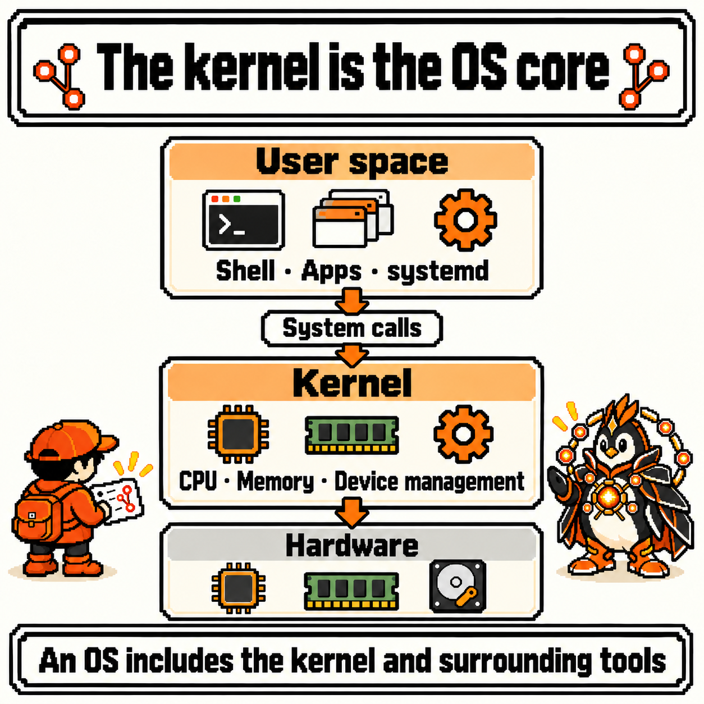
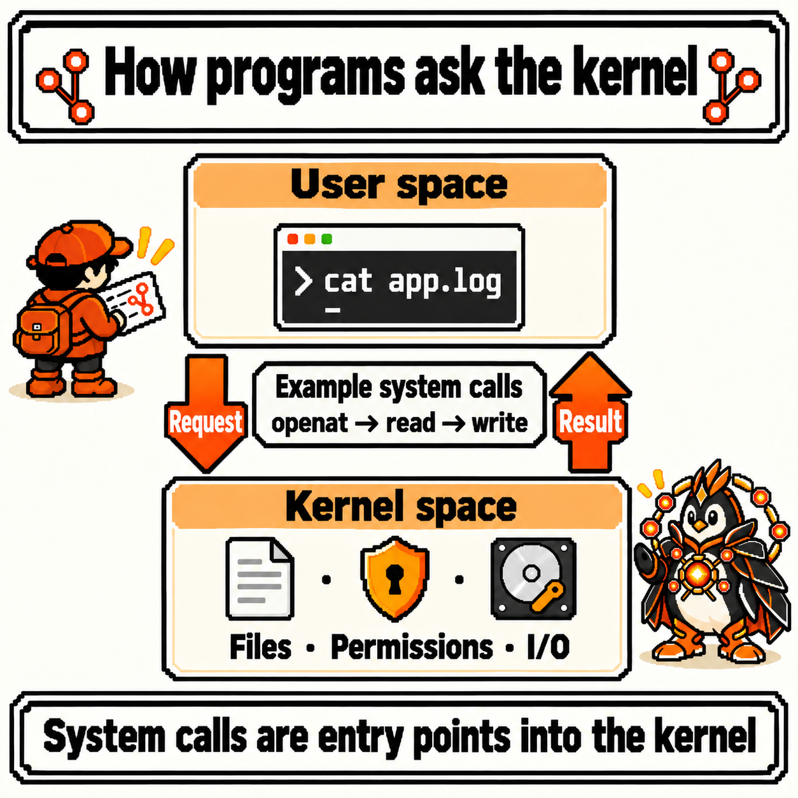
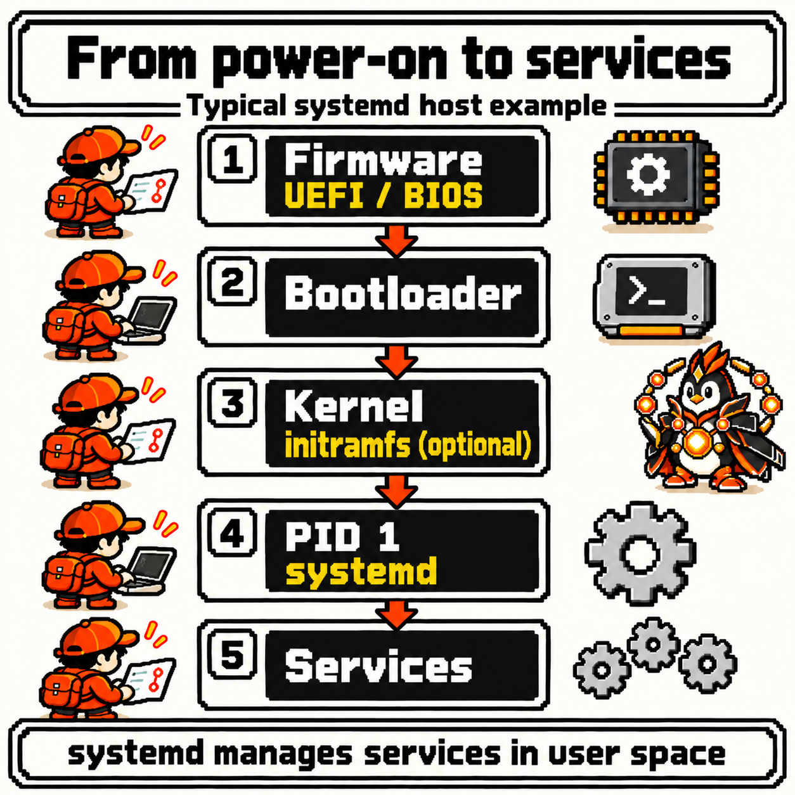
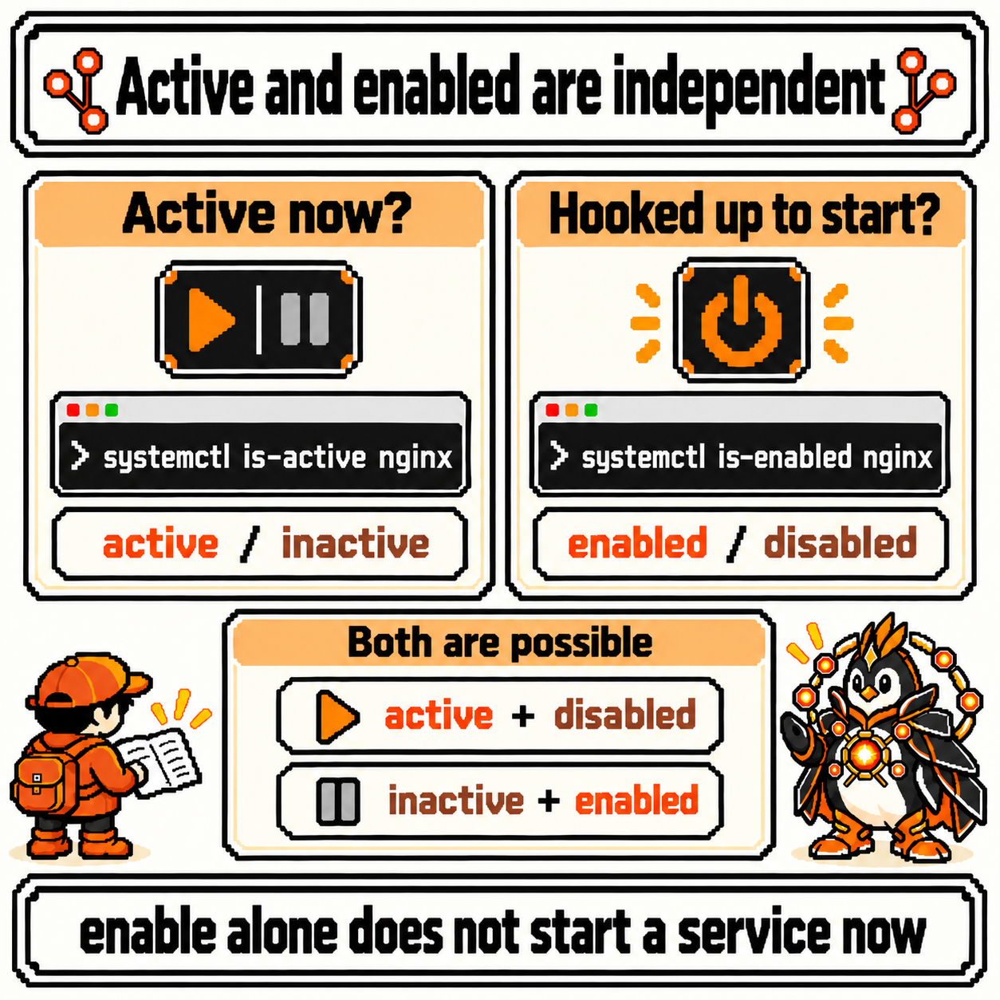
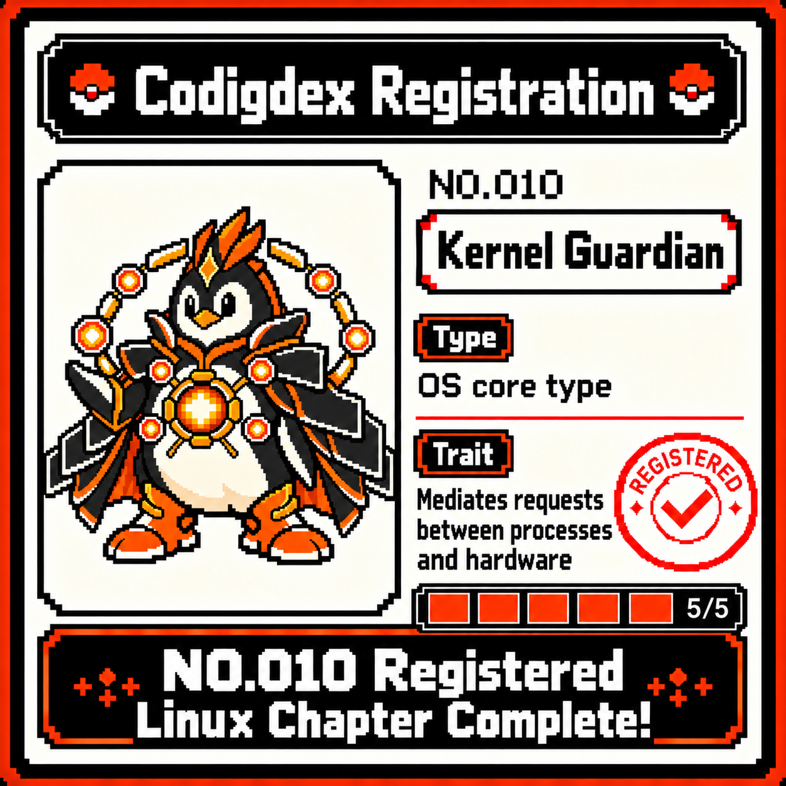

# Codigdex #02 — Linux Kernel and Operating System


Last observation, we changed where output flows with `|` and `>`, and handled processes with `ps`, `top`, and `kill`. Commands became processes wearing PIDs, and `kill` turned out to be a command that sends a signal rather than one that destroys.

But rereading my field notes, I noticed a missing subject. Who hands out the PIDs? Who delivers the signals? Who sets up the pipe between two processes? Those are the spots where I'd just written "the operating system" or "the kernel" and moved on. Following that subject down to the deepest part of the Shell Cave, I found a specimen in orange armor with a glowing core, spinning an orbital rig and guarding the passage.


---

## Specimen info

- Dex number: NO.010
- Name: Kernel Guardian
- Classification: OS core type
- Encounter rate: Always (you rarely face it directly, but it's behind every file a program opens and every character that reaches the screen)
- Danger level: ⚠️⚠️⚠️ (observing is safe, but one `restart` typed on a shared server without finding the cause can cut off other people's work too)

---

## First impression

Meeting the Kernel Guardian for the first time, these questions came up.

- Is Linux an operating system or a kernel? How are Ubuntu and Linux related?
- Does `cat app.log` read the file directly, or does it ask someone else?
- What happens between power-on and the shell appearing?
- Is `systemctl` part of the kernel? If a service is `active`, can I trust that it's fine?

Once again, I decided to sort out the questions before the commands.

---

## Observation 1 — the kernel and the OS: telling the core from its surroundings

These examples assume a typical Linux host that uses systemd. All output in this post is illustrative; numbers, names, and formats vary by distribution and version. The commands picked for you to try yourself in this post only read state.

First, the words.

- **Kernel**: the core program that manages hardware, hands out CPU and memory to processes, and takes requests from programs. "Linux" in the narrow sense means this kernel
- **Operating system**: what people commonly call the whole thing, the kernel plus surrounding tools such as a C library, a shell, basic commands, and a service manager. There's no single strict boundary for what it includes
- **Distribution**: something like Ubuntu, Debian, or Fedora, which selects and bundles a kernel and surrounding tools and settles on how packages are managed

Here's the answer to my first question. Ubuntu is an operating system distribution that uses the Linux kernel. So "what am I running?" is really two questions. `uname -r` tells you the kernel version (the "kernel release" in [uname(1)](https://man7.org/linux/man-pages/man1/uname.1.html)). Distribution information lives in `/etc/os-release`, defined by [os-release(5)](https://man7.org/linux/man-pages/man5/os-release.5.html).

```bash
uname -r
grep -E '^(NAME|VERSION)=' /etc/os-release
```

```text
6.8.0-45-generic
NAME="Ubuntu"
VERSION="24.04.1 LTS (Noble Numbat)"
```

Some distributions, such as rolling releases, may have no `VERSION`. The point is just that the first line and the other lines are about different things.

Now let's draw the structure. From the point of view of memory and execution privilege, the system splits roughly in two.

- **User space**: where programs such as the shell, `cat`, a web server, and systemd run. Each process has its own virtual memory and can't freely touch other processes' memory or devices
- **Kernel space**: where the kernel runs. It handles hardware directly and manages the memory of every process

The [memory management docs](https://docs.kernel.org/admin-guide/mm/concepts.html) explain that virtual memory hides the details of physical memory and provides protection and controlled sharing between processes. Thanks to this boundary, one misbehaving program usually stays that one process's problem.



The picture is a simplification. What caught my eye was where systemd sits. It has "system" in its name and manages the whole system, but it lives in **user space**, not inside the kernel. We'll meet it again in Observation 5.

---

## Observation 2 — system calls: the entrance programs use to ask the kernel for work

A program in user space can't open a file by itself. So what does it do? It asks the kernel. The entrance for that is the **system call**. [intro(2)](https://man7.org/linux/man-pages/man2/intro.2.html) defines a system call as "an entry point into the Linux kernel."

Let's follow `cat` as it reads last week's `app.log`. `cat` is the command that [copies files to standard output](https://www.gnu.org/software/coreutils/manual/html_node/cat-invocation.html). The conceptual path looks like this.

1. **`openat`**: asks "please open `app.log` for reading." The kernel finds the path and checks permissions, then returns a **file descriptor**, which [open(2)](https://man7.org/linux/man-pages/man2/open.2.html) describes as a small, nonnegative integer. Say this number is 3
2. **`read`**: asks "please read this much from 3." [read(2)](https://man7.org/linux/man-pages/man2/read.2.html) returns the number of bytes read, and 0 means end of file
3. **`write`**: asks "please write this to 1." The 1 in [write(2)](https://man7.org/linux/man-pages/man2/write.2.html) is last week's standard output
4. Once it has read to the end, `close` closes 3



This is where my earlier observations lined up.

- Week 3's `Permission denied` is the kernel checking permissions and refusing the request. So this is who was enforcing `rwx`
- Week 4's `> run.log` is the shell pointing 1 at a file. That's why `cat` makes the same `write`, and where the text ends up is decided by what 1 points to
- Week 4's PIDs are numbers the kernel assigns too. When the shell runs an external command, it requests a new process through a system call such as [fork(2)](https://man7.org/linux/man-pages/man2/fork.2.html), and the kernel gives it a unique PID and returns that number
- Week 4's `kill` also asks the kernel to deliver a signal, through the [kill(2)](https://man7.org/linux/man-pages/man2/kill.2.html) system call

That said, memorizing this path as-is would cause trouble, so I wrote down a few caveats.

- **Library functions and system calls aren't 1:1.** Programs usually go through wrapper functions in the C library ([syscalls(2)](https://man7.org/linux/man-pages/man2/syscalls.2.html)). For example, since glibc 2.26 the `open()` wrapper uses the `openat` system call internally. A function that buffers its output may not lead straight to a `write` on every call
- **`cat` doesn't make only these three calls.** Plenty of program startup calls come first, and depending on the implementation, version, and output target, it may use other system calls
- **`read` doesn't necessarily mean a disk read.** The kernel keeps file contents in the [page cache](https://docs.kernel.org/admin-guide/mm/concepts.html), so it can answer without going to disk
- **Not everything goes through the kernel.** Adding numbers in memory simply runs in user space. What a program asks the kernel for is work outside its own privileges, such as files, devices, and processes

If you want to see the actual calls, there's [strace(1)](https://man7.org/linux/man-pages/man1/strace.1.html), a tool that intercepts and records a process's system calls and signals. It may not be installed by default, or may be blocked depending on container settings.

```bash
strace -e trace=openat,read,write,close cat app.log
```

The illustrative excerpt below keeps only the call flow. Calls from program startup and exit, and `cat`'s own standard output, are omitted.

```text
...
openat(AT_FDCWD, "app.log", O_RDONLY)   = 3
read(3, "2026-10-26 09:00:01 INFO server "..., 131072) = 210
write(1, "2026-10-26 09:00:01 INFO server "..., 210) = 210
read(3, "", 131072)                     = 0
close(3)                                = 0
```

The 0 returned by the last `read` is the end of the file. It's the EOF indication `wc -l` was waiting for last week, visible right here.

---

## Observation 3 — CPU and memory: reading what the kernel hands out

If system calls are how the kernel takes requests, there's also work it keeps doing without being asked: **sharing out resources**.

**CPU**: there are often more processes ready to run than there are cores. The kernel's scheduler decides which task runs when, and takes turns running them. `sleep` barely used any CPU because a sleeping process doesn't join this rotation until it wakes up. The modern approach is described in the [EEVDF scheduler docs](https://docs.kernel.org/scheduler/sched-eevdf.html); it began replacing the earlier CFS in kernel 6.6.

**Memory**: the addresses a process sees are virtual, and the CPU translates them to physical addresses using page tables. Some memory, like the page cache holding file contents, can be freed when needed. When memory runs low, the kernel reclaims such pages, and if that still isn't enough, the OOM killer terminates a task.

The classic command for reading this state from user space is `free -h`.

```bash
free -h
```

```text
               total        used        free      shared  buff/cache   available
Mem:           7.7Gi       2.3Gi       1.0Gi        45Mi       4.6Gi       5.4Gi
Swap:          2.0Gi          0B       2.0Gi
```

At first, seeing a small `free` made me think memory was short. Checking the definitions of the two columns in [free(1)](https://man7.org/linux/man-pages/man1/free.1.html) changed how I read it.

- `free`: memory nothing is using
- `available`: an **estimate** of how much memory is available for starting new applications without swapping. It takes reclaimable page cache and the like into account
- `-h`: shows values in human-readable units

So to see "do I have memory to spare right now," look at `available` first. A small amount of empty memory may not be a problem if the rest is in use as cache and can be given back. Still, this value is an estimate at one moment, so it alone can't pin down a bottleneck.

The environment matters too. `free` builds its values by reading `/proc/meminfo`, so inside a container, the container's memory limit may not show up as such. `uname -r` inside a container also usually shows the host's kernel version. [UTS namespaces](https://man7.org/linux/man-pages/man7/uts_namespaces.7.html) isolate the hostname and the NIS domain name, and a container usually shares the host's kernel.

---

## Observation 4 — boot: from power-on to services

If the kernel matters that much, who starts the kernel? I followed the path from power-on to the shell, for a typical PC or server. This flow comes from reading [boot(7)](https://man7.org/linux/man-pages/man7/boot.7.html) alongside systemd's [bootup(7)](https://www.freedesktop.org/software/systemd/man/latest/bootup.html).

1. **Firmware (UEFI/BIOS)**: does minimal hardware initialization and hands control to the next stage
2. **Bootloader**: a program such as GRUB or systemd-boot loads the kernel and initramfs into memory
3. **Kernel and initramfs**: the kernel starts drivers and memory management. On a system that uses an initramfs, the tools inside it find and mount the real root filesystem
4. **PID 1**: the first user-space process, created by the kernel. On many distributions, systemd sits in this slot
5. **Services**: PID 1 brings up services such as networking, logging, and web servers



The boundary at step 3 was especially interesting. According to the [initramfs docs](https://docs.kernel.org/filesystems/ramfs-rootfs-initramfs.html), after unpacking, the kernel looks for a file called `init` and **executes it as PID 1**. Bringing up the rest and finding the real root device is that program's job. The kernel doesn't finish and disappear; it starts the first user process and keeps running behind it. On a system that uses an initramfs, that `init` runs as PID 1 first, and systemd usually takes over the PID 1 slot when the system switches to the real root.

There's a reason the picture's subtitle says "typical systemd host example." These five stages aren't a universal formula for all Linux.

- **Some Linux systems have no systemd.** [systemd(1)](https://www.freedesktop.org/software/systemd/man/latest/systemd.html) is a program that acts as the init system when run as PID 1, and boot(7) also mentions systems such as Slackware that use a different boot script scheme
- **Stages can be skipped.** In some setups the firmware loads the kernel directly, and the initramfs is optional too
- **Containers usually don't walk this path.** A container starts on top of a host kernel that's already running, and in Docker, the [process given by `ENTRYPOINT` or `CMD`](https://docs.docker.com/engine/containers/multi-service_container/) becomes its main process
- **WSL depends on configuration.** According to [Microsoft's docs](https://learn.microsoft.com/en-us/windows/wsl/systemd), the current Ubuntu installed by `wsl --install` uses systemd by default, but other distributions may be using the WSL init

So I decided to check whether my environment has systemd in the first place. Both lines below only read. The path on the second line is the check used by [sd_booted(3)](https://man7.org/linux/man-pages/man3/sd_booted.3.html).

```bash
ps -p 1 -o comm=
test -d /run/systemd/system && echo "booted with systemd" || echo "not booted with systemd"
```

```text
systemd
booted with systemd
```

---

## Observation 5 — systemctl: asking systemd, not the kernel

Before moving on to services, I sorted out my fourth question. `systemctl` is not part of the kernel.

- **systemd**: the user-space service manager, running as PID 1
- **`systemctl`**: in the words of [its manual](https://www.freedesktop.org/software/systemd/man/latest/systemctl.html), a command to introspect and control the state of systemd. It's a client that sends requests to systemd
- **Kernel**: the side that receives system calls when systemd creates processes or sends signals

So a failing `systemctl` doesn't mean something is wrong with the kernel. On a WSL distribution or container where systemd isn't PID 1, you may see a message like `System has not been booted with systemd...`, which is closer to "there's no systemd here to talk to."

From here on, the examples assume **a system where nginx is installed and registered as a unit named `nginx.service`**. Unit names vary by distribution and package. Even Apache is sometimes `httpd` and sometimes `apache2`. nginx's [Linux packages page](https://nginx.org/en/linux_packages.html) covers how to install it, but that doesn't guarantee the same state on every system. So check the name first.

```bash
systemctl list-unit-files --type=service --no-pager | grep -i nginx
```

```text
nginx.service                              enabled         enabled
```

If nothing shows up, you can't follow this example as written. In that case, substitute the name of another service on that system and read that instead. Now let's look at the state. The real output has more lines; this keeps only the ones the notes below need.

```bash
systemctl status nginx --no-pager
```

```text
● nginx.service - A high performance web server and a reverse proxy server
     Loaded: loaded (/usr/lib/systemd/system/nginx.service; enabled; preset: enabled)
     Active: active (running) since Mon 2026-11-02 09:00:00 KST; 2h 5min ago
   Main PID: 812 (nginx)
      Tasks: 2 (limit: 4553)
     Memory: 4.2M
     CGroup: /system.slice/nginx.service
             ├─812 "nginx: master process /usr/sbin/nginx"
             └─813 "nginx: worker process"
```

This is the order I read it in.

- `Loaded`: whether the unit file was read, where it is, and whether it's `enabled`
- `Active`: the current state. `active (running)` means the unit is active and its process is running
- `Main PID`: the same PID we learned about last week. You can check it again with `ps -p`
- `CGroup`: the processes that belong to this service

What caught my eye was `enabled` on the `Loaded` line and `active` on the `Active` line, kept apart. These two turned out to be the heart of this observation. There are commands that ask about each in a single word.

```bash
systemctl is-active nginx
systemctl is-enabled nginx
```

```text
active
enabled
```

- `is-active`: is it active **now**? Returns exit code 0 if active, non-zero otherwise
- `is-enabled`: is the unit **hooked up to start** at points such as boot? Returns 0 for `enabled` or `static`, non-zero for `disabled`, and 4 if the unit doesn't exist

`static` means the unit has no installation information for direct enablement. It may start as another unit's dependency, so exit code 0 alone does not mean `enabled`. Read the output string as well.



The manual describes this relationship as "enabling and starting units is orthogonal." Enabling creates the symlinks that hook a unit in at its start points, and starting actually launches its process. So all four combinations are possible.

- `active` + `enabled`: running now, and hooked up to start
- `active` + `disabled`: active now, but not enabled. Manual activation or another unit's dependency can produce this state
- `inactive` + `enabled`: hooked up, but inactive now. It may not have started yet, or may already have exited; read its state and logs together
- `inactive` + `disabled`: stopped now, and not hooked up either

There are more actual values than these. `is-active` can also answer `failed` or `activating`, and `is-enabled` can answer `static` or `masked`. The two axes in the picture are a simplification for understanding the relationship.

When reading values from a script, the manual says to use `show` instead of the human-oriented `status`.

```bash
systemctl show nginx -p LoadState -p ActiveState -p SubState -p UnitFileState
```

```text
LoadState=loaded
ActiveState=active
SubState=running
UnitFileState=enabled
```

The last thing I observed was the limit of `active`. **`active` doesn't mean "the service is healthy."** According to [systemd.service(5)](https://www.freedesktop.org/software/systemd/man/latest/systemd.service.html), a `Type=simple` service is considered started right after its main process is forked, and systemd has no way to know whether it's really ready to take requests. With something like `Type=notify` the service reports readiness itself, but that still doesn't guarantee it keeps answering correctly afterward. A process can be alive and still return nothing but errors because of a bad configuration. To know whether it's really healthy, you have to actually send the service a request, or look at health checks and logs alongside it.

---

## Observation 6 — the service lifecycle and journalctl: read before you fix

I also sorted out the service management commands. But the actions below **change system state, so in this post I only look at what they mean and don't run them.**

- `start`: starts it now
- `stop`: stops it now
- `reload`: has the service reread its configuration while its process stays up. It works only for services that support it, and it's different from `daemon-reload`, which rereads systemd's own configuration
- `restart`: stops it, then starts it. A service that was stopped also gets started
- `enable` / `disable`: changes only the hook-up at start points. The current state stays as it is

Reading what happens during `stop`, I ran into a familiar order. Putting [systemd.kill(5)](https://www.freedesktop.org/software/systemd/man/latest/systemd.kill.html) and systemd.service(5) together, it goes like this.

1. If the service has `ExecStop=`, run that command
2. Send `KillSignal=` to the remaining processes. The default is **SIGTERM**
3. Wait up to `TimeoutStopSec=`
4. If anything is still left, send **SIGKILL** by default

The "SIGTERM first, wait, SIGKILL last" I followed by hand last week is what systemd does per service. It gives the service a chance to clean up first. That doesn't make `restart` always gentle, though. How in-progress requests are handled differs per service, and whatever doesn't finish in time gets forcibly terminated.

So here's the order I settled on for when something goes wrong. Especially **on a system shared with others, don't start by typing `restart` without knowing the cause.** A restart can affect the people using that service and other services too, and while things look better for a moment, the clues to the cause get blurrier.

1. Read the current state with `systemctl status`
2. Read what happened and since when with `journalctl`
3. Check actual responses and health checks
4. If a change is needed, follow that system's owners and procedures

The tool for reading logs is [journalctl(1)](https://www.freedesktop.org/software/systemd/man/latest/journalctl.html). I started with just a few options.

```bash
journalctl -u nginx -b -n 20 --no-pager
```

```text
Nov 02 09:00:00 demo-host systemd[1]: Starting nginx.service - A high performance web server and a reverse proxy server...
Nov 02 09:00:00 demo-host systemd[1]: Started nginx.service - A high performance web server and a reverse proxy server.
```

- `-u nginx`: only messages for this unit
- `-b`: only messages since the current boot
- `-n 20`: limit to the most recent 20
- `--no-pager`: print directly without a pager

The `1` in the `systemd[1]` on each line is a PID. Observation 4's PID 1 was leaving its own number in the log. You can also show only warnings and above, or keep following new logs.

```bash
journalctl -u nginx -b -p warning --no-pager
journalctl -u nginx -f
```

`-p warning` filters by priority. `-f` keeps showing new logs until you quit with Ctrl-C. Both only read logs.

I also noted that an empty log doesn't immediately mean "nothing happened."

- **Permissions**: the system journal is fully visible only to root and users in groups such as `systemd-journal`, `adm`, and `wheel`. Without permission, you may see only part of it
- **Unit name**: the name you passed to `-u` may be wrong. Use the one you checked earlier
- **Log location**: if the service is configured to write its logs to a separate file, the important content is there
- **Environment**: in an environment without systemd, this journal may not exist at all

---

## Summary

- The kernel is the core that manages hardware and processes, and an operating system commonly means the kernel plus surrounding tools. A distribution bundles them together. Check the kernel with `uname -r` and the distribution with `/etc/os-release`
- Programs run in user space and ask the kernel for work outside their privileges through system calls. The conceptual path for `cat` is `openat` → `read` → `write`, but library functions aren't 1:1 with system calls, and the actual calls depend on the implementation
- The kernel shares the CPU with its scheduler and memory with virtual memory. When checking for headroom in `free -h`, look at the estimate in `available` before `free`
- A typical boot goes firmware → bootloader → kernel (initramfs optional) → PID 1 → services. Not all Linux uses these stages or systemd, and containers and WSL can differ
- `systemctl` is a client that asks the user-space systemd, not the kernel. Read with `status`, and pull out values with `show`
- `is-active` is the current state and `is-enabled` is the hook-up at start points, and the two are independent. `active` is no guarantee that a service is healthy
- `stop` usually sends SIGTERM, waits, and sends SIGKILL at the end. On a shared system, read first with `status` and `journalctl -u`, and restart only by following procedure

---

## Codigdex notes

When I met the Shell Scout, just asking where I was with `pwd` felt new. After that, I followed paths to handle files, read `rwx`, changed where output flows, and sent signals to processes. Now that the last slot is filled, all those commands point to the same place. Finding paths, checking permissions, connecting pipes, assigning PIDs, delivering signals: that was the kernel all along. The five observations were really practice at slowly reading "what is this program asking the kernel for?"

What changed most was how I read state. `active` doesn't mean healthy, a small `free` doesn't mean danger, and `kill` doesn't mean gone. The biggest takeaway from this chapter is the habit of checking exactly what a word on the screen is saying.

The next chapter is Codigdex #03, HTML/CSS. Having gone behind the screen all the way down to the kernel, it's time to turn around and start observing the structure and style of a web page.

Before that, the last specimen of the Linux chapter goes into the Codigdex. **NO.010 Kernel Guardian** — mediates requests between processes and hardware. Following the Shell Scout, Path Forager, Permission Guard, and Pipe Engineer, all five slots are now filled and the Linux chapter is complete.


