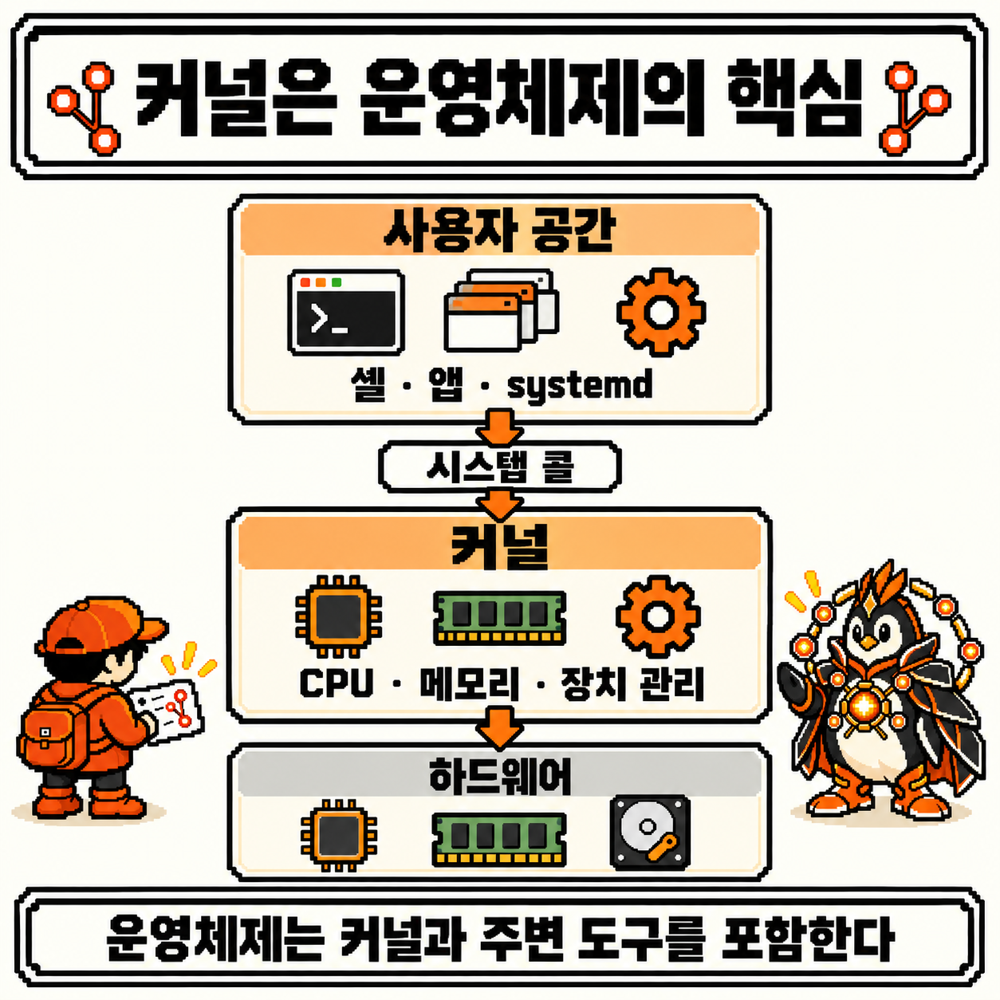
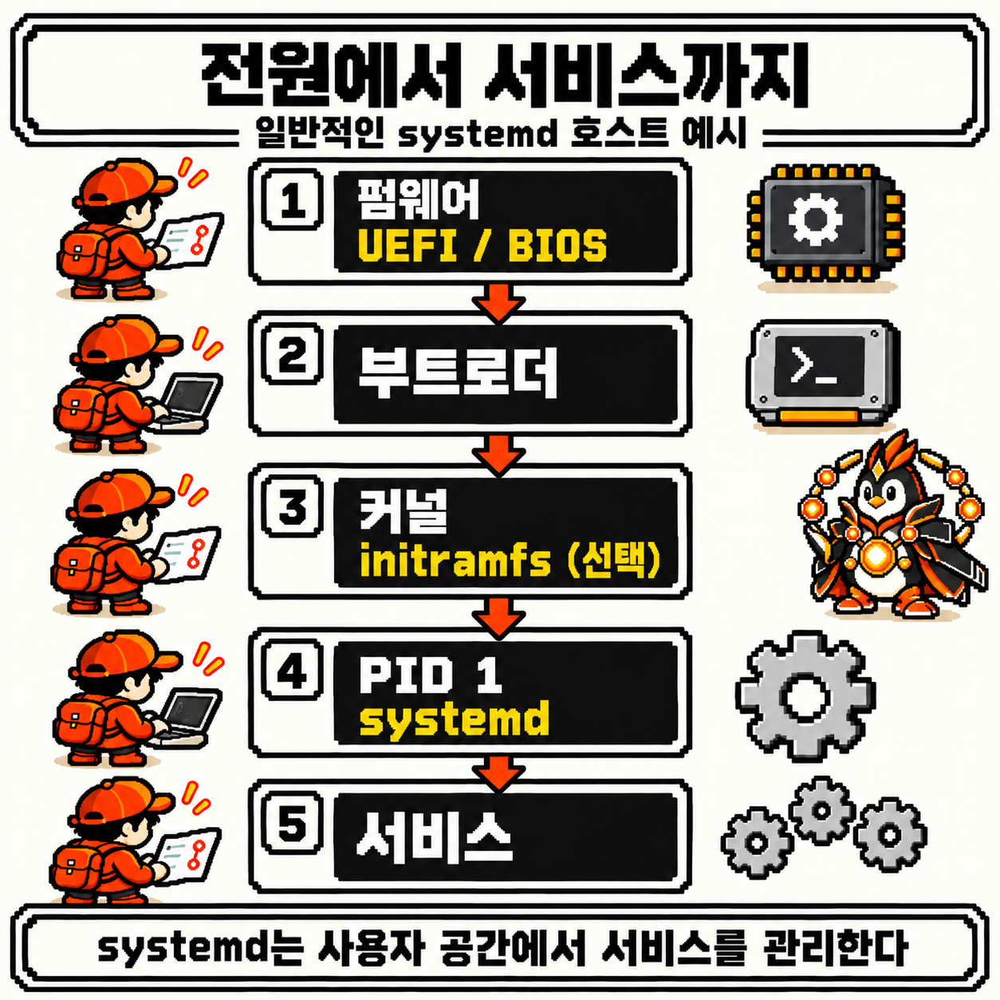
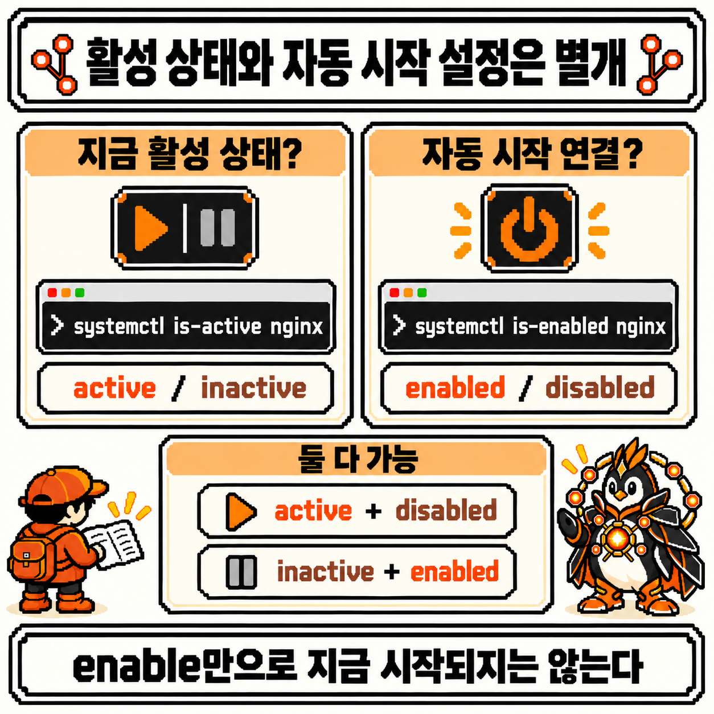

# 코딩 도감 #02 — Linux 커널과 운영체제


지난 관찰에서는 `|`와 `>`로 출력이 흘러갈 곳을 바꾸고, `ps`·`top`·`kill`로 프로세스를 다뤘다. 명령은 PID를 단 프로세스가 됐고, `kill`은 없애는 명령이 아니라 시그널을 보내는 명령이었다.

그런데 관찰 노트를 다시 읽다 보니 빠진 주어가 눈에 들어왔다. PID는 누가 붙여 줬을까? 시그널은 누가 전해 줬을까? 두 프로세스 사이의 파이프는 누가 마련했을까? 지금까지 "운영체제가", "커널이"라고 적고 지나간 자리다. 그 주어를 찾아 셸 동굴의 가장 깊은 곳까지 내려가자, 주황 갑옷에 빛나는 코어를 단 개체가 궤도 장치를 돌리며 길목을 지키고 있었다.


---

## 개체 정보

- 도감 번호: NO.010
- 이름: 커널 수호자
- 분류: 운영체제 핵심형
- 출현 빈도: 항상 (직접 마주치는 일은 드물어도, 프로그램이 파일을 열고 화면에 글자를 찍을 때마다 그 뒤에 있음)
- 위험도: ⚠️⚠️⚠️ (관찰만 하면 안전하지만, 공유 서버에서 원인 확인 없이 친 `restart` 한 번이 다른 사람의 작업까지 끊을 수 있음)

---

## 처음 만났을 때의 인상

커널 수호자를 처음 마주했을 때 이런 질문들이 떠올랐다.

- Linux는 운영체제일까, 커널일까? Ubuntu와 Linux는 무슨 관계일까?
- `cat app.log`는 파일을 직접 읽을까, 아니면 누군가에게 부탁할까?
- 전원을 켠 뒤 셸이 뜨기까지 무슨 일이 일어날까?
- `systemctl`은 커널의 일부일까? 서비스가 `active`면 정상이라고 믿어도 될까?

이번에도 명령어보다 이 질문들부터 정리해 보기로 했다.

---

## 관찰 1 — 커널과 운영체제: 핵심과 그 주변을 구분한다

예시는 systemd를 쓰는 일반적인 Linux 호스트를 기준으로 한다. 이 글의 출력은 모두 설명용이며, 숫자와 이름, 형식은 배포판과 버전에 따라 다르다. 그리고 이번 글에서 직접 실행해 볼 명령은 모두 상태를 읽기만 하는 것으로 골랐다.

먼저 단어부터 나눴다.

- **커널**: 하드웨어를 관리하고, 프로세스에 CPU와 메모리를 나눠 주고, 프로그램의 요청을 받아 처리하는 핵심 프로그램이다. 좁은 의미의 "Linux"는 이 커널을 가리킨다
- **운영체제**: 커널에 C 라이브러리, 셸, 기본 명령, 서비스 관리자 같은 주변 도구까지 더한 전체를 흔히 이렇게 부른다. 어디까지 포함하는지가 엄밀하게 하나로 정해진 말은 아니다
- **배포판**: Ubuntu, Debian, Fedora처럼 커널과 주변 도구를 골라 묶고 패키지 관리 방식까지 정해 내놓은 것이다

첫 번째 질문의 답이 여기 있었다. Ubuntu는 Linux 커널을 쓰는 운영체제 배포판이다. 그래서 "무엇을 쓰고 있나"라는 질문도 두 개로 나뉜다. 커널 버전은 `uname -r`이 알려 준다([uname(1)](https://man7.org/linux/man-pages/man1/uname.1.html)의 "kernel release"). 배포판 정보는 [os-release(5)](https://man7.org/linux/man-pages/man5/os-release.5.html)에 정의된 `/etc/os-release` 파일에 있다.

```bash
uname -r
grep -E '^(NAME|VERSION)=' /etc/os-release
```

```text
6.8.0-45-generic
NAME="Ubuntu"
VERSION="24.04.1 LTS (Noble Numbat)"
```

롤링 릴리스 배포판처럼 `VERSION`이 없는 경우도 있다. 첫 줄과 나머지 줄이 서로 다른 것을 말한다는 점만 보면 된다.

이제 구조를 그려 본다. 메모리와 실행 권한의 관점에서 시스템은 크게 둘로 나뉜다.

- **사용자 공간**: 셸, `cat`, 웹 서버, systemd 같은 프로그램이 도는 곳이다. 프로세스마다 자기 가상 메모리를 갖고, 다른 프로세스의 메모리나 장치에 마음대로 손댈 수 없다
- **커널 공간**: 커널이 도는 곳이다. 하드웨어를 직접 다루고, 모든 프로세스의 메모리를 관리한다

[메모리 관리 문서](https://docs.kernel.org/admin-guide/mm/concepts.html)는 가상 메모리가 물리 메모리의 세부 사항을 감추고, 프로세스 사이의 보호와 통제된 공유를 제공한다고 설명한다. 이 경계 덕분에 프로그램 하나가 잘못 돌아도 보통은 그 프로세스의 문제로 끝난다.



그림은 단순화한 것이다. 눈여겨본 건 systemd의 자리였다. 이름에 "system"이 들어가고 시스템 전체를 관리하지만, 커널 안이 아니라 **사용자 공간**에 있다. 관찰 5에서 다시 만난다.

---

## 관찰 2 — 시스템 콜: 프로그램이 커널에 일을 요청하는 입구

사용자 공간의 프로그램은 파일을 직접 열 수 없다. 그럼 어떻게 할까? 커널에 요청한다. 그 입구가 **시스템 콜**이다. [intro(2)](https://man7.org/linux/man-pages/man2/intro.2.html)는 시스템 콜을 "Linux 커널로 들어가는 진입점"이라고 정의한다.

지난주의 `app.log`를 `cat`으로 읽는 장면을 따라가 본다. `cat`은 [파일을 표준 출력으로 복사하는](https://www.gnu.org/software/coreutils/manual/html_node/cat-invocation.html) 명령이다. 개념적인 경로는 이렇다.

1. **`openat`**: "`app.log`를 읽기용으로 열어 달라"고 요청한다. 커널은 경로를 찾고 권한을 확인한 뒤, [open(2)](https://man7.org/linux/man-pages/man2/open.2.html)에 나오는 대로 작은 음이 아닌 정수인 **파일 디스크립터**를 돌려준다. 이 번호가 3이라고 하자
2. **`read`**: "3번에서 이만큼 읽어 달라"고 요청한다. [read(2)](https://man7.org/linux/man-pages/man2/read.2.html)는 읽은 바이트 수를 돌려주고, 0은 파일의 끝을 뜻한다
3. **`write`**: "이 내용을 1번에 써 달라"고 요청한다. [write(2)](https://man7.org/linux/man-pages/man2/write.2.html)의 그 1번은 지난주의 표준 출력이다
4. 끝까지 읽었으면 `close`로 3번을 닫는다


여기서 지난 관찰들이 한 줄로 이어졌다.

- 3주차의 `Permission denied`는 권한을 확인한 커널이 요청을 거절한 결과다. `rwx`를 지키는 쪽이 여기 있었다
- 4주차의 `> run.log`는 셸이 1번을 파일로 돌려놓은 것이다. 그래서 `cat`은 같은 `write`를 하고, 글자가 어디로 갈지는 1번이 가리키는 곳이 정한다
- 4주차의 PID도 커널이 붙인 번호다. 셸이 외부 명령을 실행할 때 [fork(2)](https://man7.org/linux/man-pages/man2/fork.2.html) 같은 시스템 콜로 새 프로세스를 요청하면, 커널이 고유한 PID를 붙여 돌려준다
- 4주차의 `kill`도 [kill(2)](https://man7.org/linux/man-pages/man2/kill.2.html) 시스템 콜로 커널에 시그널 전달을 요청한다

대신 이 경로를 그대로 외우면 곤란한 점이 있어서 정리해 뒀다.

- **라이브러리 함수와 시스템 콜이 1:1은 아니다.** 프로그램은 보통 C 라이브러리의 래퍼 함수를 거친다([syscalls(2)](https://man7.org/linux/man-pages/man2/syscalls.2.html)). 예를 들어 glibc 2.26부터 `open()` 래퍼는 내부에서 `openat` 시스템 콜을 쓴다. 출력을 버퍼에 모으는 함수라면 호출 한 번이 `write`로 바로 이어지지 않을 수도 있다
- **`cat`의 호출도 이 셋만은 아니다.** 프로그램 시작 단계의 호출이 앞에 잔뜩 붙고, 구현과 버전, 출력 대상에 따라 다른 시스템 콜을 쓸 수도 있다
- **`read`가 곧 디스크 읽기는 아니다.** 커널은 파일 내용을 [페이지 캐시](https://docs.kernel.org/admin-guide/mm/concepts.html)에 담아 두기 때문에, 디스크까지 가지 않고 응답할 수 있다
- **모든 일이 커널을 거치는 건 아니다.** 메모리 안에서 숫자를 더하는 계산은 사용자 공간에서 그냥 돈다. 프로그램이 커널에 요청하는 건 파일, 장치, 프로세스처럼 자기 권한 밖의 일이다

실제 호출을 보고 싶다면 [strace(1)](https://man7.org/linux/man-pages/man1/strace.1.html)가 있다. 프로세스의 시스템 콜과 시그널을 가로채 기록하는 도구다. 기본으로 설치돼 있지 않거나 컨테이너 설정에 따라 막혀 있을 수 있다.

```bash
strace -e trace=openat,read,write,close cat app.log
```

아래는 호출 흐름만 남긴 설명용 발췌다. 프로그램 시작·종료 단계의 호출과 `cat` 자체의 표준 출력은 생략했다.

```text
...
openat(AT_FDCWD, "app.log", O_RDONLY)   = 3
read(3, "2026-10-26 09:00:01 INFO server "..., 131072) = 210
write(1, "2026-10-26 09:00:01 INFO server "..., 210) = 210
read(3, "", 131072)                     = 0
close(3)                                = 0
```

마지막 `read`가 돌려준 0이 파일의 끝이다. 지난주에 `wc -l`이 기다리던 EOF 표시를 여기서 눈으로 볼 수 있다.

---

## 관찰 3 — CPU와 메모리: 커널이 나눠 주는 것을 읽는다

시스템 콜이 프로그램의 요청을 받는 쪽이라면, 커널에는 묻지 않아도 계속 하는 일이 있다. 바로 **자원 나누기**다.

**CPU**: 실행할 준비가 된 프로세스는 코어 수보다 많은 경우가 흔하다. 커널의 스케줄러가 어느 작업을 언제 돌릴지 정해서 번갈아 실행한다. `sleep`이 CPU를 거의 쓰지 않던 것도, 잠든 프로세스는 깨어날 때까지 이 차례에 끼지 않기 때문이다. 요즘 커널의 방식은 [EEVDF 스케줄러 문서](https://docs.kernel.org/scheduler/sched-eevdf.html)에 정리돼 있다. 커널 6.6부터 이전의 CFS를 대체하기 시작했다.

**메모리**: 프로세스가 보는 주소는 가상 주소이고, CPU가 페이지 테이블로 이를 물리 주소로 옮긴다. 파일 내용을 담은 페이지 캐시처럼 필요할 때 비울 수 있는 메모리도 있다. 메모리가 부족해지면 커널은 이런 페이지를 회수하고, 그래도 모자라면 OOM killer가 작업 하나를 종료시킨다.

이 상태를 사용자 공간에서 읽는 대표적인 명령이 `free -h`다.

```bash
free -h
```

```text
               total        used        free      shared  buff/cache   available
Mem:           7.7Gi       2.3Gi       1.0Gi        45Mi       4.6Gi       5.4Gi
Swap:          2.0Gi          0B       2.0Gi
```

처음에는 `free`가 작아서 메모리가 모자란 줄 알았다. [free(1)](https://man7.org/linux/man-pages/man1/free.1.html)에서 두 열의 정의를 확인하고 나서 읽는 법이 바뀌었다.

- `free`: 아무 데도 쓰이지 않는 메모리다
- `available`: 스와핑 없이 새 프로그램을 시작하는 데 쓸 수 있는 양의 **추정치**다. 회수 가능한 페이지 캐시 등을 고려한다
- `-h`: 사람이 읽기 쉬운 단위로 보여 준다

즉 "지금 메모리 여유가 있나"를 볼 때는 `available` 쪽을 먼저 본다. 비어 있는 메모리가 적어도, 캐시로 쓰이다가 돌려받을 수 있다면 문제가 아닐 수 있다. 물론 이 값도 한 시점의 추정치라, 이것만으로 병목을 단정할 수는 없다.

환경에 따른 차이도 있다. `free`는 `/proc/meminfo`를 읽어서 값을 만들기 때문에, 컨테이너 안에서는 컨테이너에 걸린 메모리 제한이 그대로 보이지 않을 수 있다. `uname -r`도 컨테이너 안에서는 보통 호스트의 커널 버전을 보여 준다. [UTS 네임스페이스](https://man7.org/linux/man-pages/man7/uts_namespaces.7.html)가 격리하는 건 호스트 이름과 NIS 도메인 이름이고, 컨테이너는 대개 호스트 커널을 함께 쓰기 때문이다.

---

## 관찰 4 — 부팅: 전원에서 서비스까지

커널이 그렇게 중요하다면, 그 커널은 누가 띄울까? 전원을 켠 뒤 셸이 뜨기까지의 길을 일반적인 PC나 서버 기준으로 따라가 봤다. [boot(7)](https://man7.org/linux/man-pages/man7/boot.7.html)과 systemd의 [bootup(7)](https://www.freedesktop.org/software/systemd/man/latest/bootup.html)을 함께 보며 정리한 흐름이다.

1. **펌웨어(UEFI/BIOS)**: 최소한의 하드웨어 초기화를 하고 다음 단계로 제어를 넘긴다
2. **부트로더**: GRUB이나 systemd-boot 같은 프로그램이 커널과 initramfs를 메모리에 올린다
3. **커널과 initramfs**: 커널이 드라이버와 메모리 관리를 시작한다. initramfs를 쓰는 시스템이라면 그 안의 도구로 실제 루트 파일시스템을 찾아 마운트한다
4. **PID 1**: 커널이 만든 첫 사용자 공간 프로세스다. 많은 배포판에서는 이 자리에 systemd가 있다
5. **서비스**: PID 1이 네트워크, 로그, 웹 서버 같은 서비스를 올린다



3번의 경계가 특히 흥미로웠다. [initramfs 문서](https://docs.kernel.org/filesystems/ramfs-rootfs-initramfs.html)에 따르면 커널은 압축을 푼 뒤 `init` 파일을 찾아 **PID 1로 실행**한다. 나머지를 띄우고 실제 루트 장치를 찾는 건 그 프로그램의 몫이다. 커널이 할 일을 끝내고 사라지는 게 아니라, 첫 사용자 프로세스를 띄운 뒤 뒤에서 계속 도는 것이다. initramfs를 쓰는 시스템이라면 그 `init`이 먼저 PID 1로 돌고, 보통 실제 루트로 전환하면서 systemd가 PID 1 자리를 이어받는다.

그림의 부제에 "일반적인 systemd 호스트 예시"라고 적어 둔 이유도 있다. 이 다섯 단계가 모든 Linux의 공통 공식은 아니다.

- **systemd가 없는 Linux도 있다.** [systemd(1)](https://www.freedesktop.org/software/systemd/man/latest/systemd.html)은 PID 1로 실행될 때 init 시스템 역할을 하는 프로그램이고, boot(7)도 Slackware처럼 다른 부트 스크립트 방식을 쓰는 시스템을 언급한다
- **단계가 생략되기도 한다.** 펌웨어가 커널을 직접 올리는 구성이 있고, initramfs도 선택 사항이다
- **컨테이너는 보통 이 길을 걷지 않는다.** 컨테이너는 이미 떠 있는 호스트 커널 위에서 시작되고, Docker에서는 [`ENTRYPOINT`나 `CMD`로 지정한 프로세스](https://docs.docker.com/engine/containers/multi-service_container/)가 메인 프로세스가 된다
- **WSL은 설정에 따라 다르다.** [Microsoft 문서](https://learn.microsoft.com/en-us/windows/wsl/systemd)에 따르면 `wsl --install`로 설치한 현재 Ubuntu는 systemd가 기본이지만, 다른 배포판은 WSL init을 쓰고 있을 수 있다

그래서 내 환경에 systemd가 있는지부터 확인하기로 했다. 아래 두 줄 모두 읽기만 한다. 두 번째 줄의 경로는 [sd_booted(3)](https://man7.org/linux/man-pages/man3/sd_booted.3.html)이 쓰는 판별 기준이다.

```bash
ps -p 1 -o comm=
test -d /run/systemd/system && echo "booted with systemd" || echo "not booted with systemd"
```

```text
systemd
booted with systemd
```

---

## 관찰 5 — systemctl: 커널이 아니라 systemd에게 묻는다

서비스 이야기로 넘어가기 전에 네 번째 질문부터 정리했다. `systemctl`은 커널의 일부가 아니다.

- **systemd**: PID 1로 도는 사용자 공간의 서비스 관리자다
- **`systemctl`**: [매뉴얼](https://www.freedesktop.org/software/systemd/man/latest/systemctl.html)의 표현대로 systemd의 상태를 들여다보고 제어하는 명령이다. systemd에 요청을 보내는 클라이언트다
- **커널**: systemd가 프로세스를 만들거나 시그널을 보낼 때 시스템 콜을 받는 쪽이다

그래서 `systemctl`이 실패한다고 커널에 문제가 있는 게 아니다. systemd가 PID 1이 아닌 WSL 배포판이나 컨테이너에서는 `System has not been booted with systemd...`와 비슷한 메시지가 나올 수 있는데, 이건 "이 환경에는 대화할 systemd가 없다"는 뜻에 가깝다.

여기부터의 예시는 **nginx가 설치돼 있고 `nginx.service`라는 유닛으로 등록된 시스템**을 가정한다. 유닛 이름은 배포판과 패키지에 따라 다르다. 같은 Apache도 `httpd`일 때가 있고 `apache2`일 때가 있다. nginx의 [Linux 패키지 안내](https://nginx.org/en/linux_packages.html)도 설치 방법을 다룰 뿐, 어떤 시스템에서든 같은 상태를 보장하지는 않는다. 그래서 이름부터 확인한다.

```bash
systemctl list-unit-files --type=service --no-pager | grep -i nginx
```

```text
nginx.service                              enabled         enabled
```

아무것도 나오지 않는다면 이 예시를 그대로 따라 할 수 없다는 뜻이다. 그럴 땐 그 시스템에 있는 다른 서비스 이름으로 바꿔서 읽어 본다. 이제 상태를 본다. 실제 출력에는 줄이 더 있지만, 여기서는 아래 설명에 필요한 줄만 남겼다.

```bash
systemctl status nginx --no-pager
```

```text
● nginx.service - A high performance web server and a reverse proxy server
     Loaded: loaded (/usr/lib/systemd/system/nginx.service; enabled; preset: enabled)
     Active: active (running) since Mon 2026-11-02 09:00:00 KST; 2h 5min ago
   Main PID: 812 (nginx)
      Tasks: 2 (limit: 4553)
     Memory: 4.2M
     CGroup: /system.slice/nginx.service
             ├─812 "nginx: master process /usr/sbin/nginx"
             └─813 "nginx: worker process"
```

읽는 순서를 이렇게 잡았다.

- `Loaded`: 유닛 파일을 읽었는지와 그 위치, 그리고 `enabled` 여부다
- `Active`: 지금 상태다. `active (running)`은 유닛이 활성이고 프로세스가 돌고 있다는 뜻이다
- `Main PID`: 지난주에 배운 그 PID다. `ps -p`로 다시 확인할 수 있다
- `CGroup`: 이 서비스에 속한 프로세스들이다

같은 `Loaded` 줄과 `Active` 줄에 `enabled`와 `active`가 따로 있는 게 눈에 걸렸다. 이 둘이 이번 관찰의 핵심이었다. 각각을 한 단어로 묻는 명령도 있다.

```bash
systemctl is-active nginx
systemctl is-enabled nginx
```

```text
active
enabled
```

- `is-active`: **지금** 활성 상태인가? 활성이면 종료 코드 0, 아니면 0이 아닌 값을 돌려준다
- `is-enabled`: 유닛이 부팅 같은 시점에 **시작되도록 연결돼 있는가?** `enabled`나 `static`이면 0, `disabled`면 0이 아닌 값을 돌려준다. 유닛이 없으면 4다

`static`은 직접 enable할 설치 정보가 없는 유닛이다. 다른 유닛의 의존성으로 시작될 수 있으므로, 종료 코드 0만으로 `enabled`라고 판단하면 안 된다. 출력 문자열도 함께 읽는다.



매뉴얼은 이 관계를 "enable과 start는 직교한다"고 적어 둔다. enable은 유닛을 시작 시점에 걸어 두는 심볼릭 링크를 만드는 일이고, start는 실제로 프로세스를 띄우는 일이다. 그래서 네 가지 조합이 모두 가능하다.

- `active` + `enabled`: 지금 돌고 있고, 시작 시점에도 연결돼 있다
- `active` + `disabled`: 지금 활성 상태지만 enable돼 있지는 않다. 수동 시작이나 다른 유닛의 의존성으로 이런 상태가 될 수 있다
- `inactive` + `enabled`: 연결은 돼 있지만 지금은 비활성이다. 아직 시작하지 않았거나 이미 종료됐을 수 있어, 상태와 로그를 함께 본다
- `inactive` + `disabled`: 지금도 멈춰 있고, 연결도 돼 있지 않다

실제 값은 이보다 많다. `is-active`는 `failed`나 `activating`을, `is-enabled`는 `static`이나 `masked`를 답할 수도 있다. 그림의 두 축은 이 관계를 이해하기 위한 단순화다.

스크립트에서 값을 읽을 때는 사람이 읽기 위한 `status` 대신 `show`를 쓰라고 매뉴얼이 안내한다.

```bash
systemctl show nginx -p LoadState -p ActiveState -p SubState -p UnitFileState
```

```text
LoadState=loaded
ActiveState=active
SubState=running
UnitFileState=enabled
```

마지막으로 관찰한 건 `active`의 한계였다. **`active`는 "서비스가 정상"이라는 말이 아니다.** [systemd.service(5)](https://www.freedesktop.org/software/systemd/man/latest/systemd.service.html)에 따르면 `Type=simple` 서비스는 메인 프로세스를 띄운 직후 시작된 것으로 간주되고, 서비스가 실제로 요청을 받을 준비가 됐는지는 systemd가 알 수 없다. `Type=notify`처럼 서비스가 준비 완료를 알려 주는 방식도 있지만, 그것도 그 뒤로 계속 올바르게 응답한다는 보장은 아니다. 프로세스는 살아 있어도 설정이 잘못돼 오류만 돌려줄 수 있다. 정말 정상인지는 그 서비스에 실제로 요청을 보내 보거나 헬스 체크, 로그를 함께 봐야 한다.

---

## 관찰 6 — 서비스의 일생과 journalctl: 고치기 전에 먼저 읽는다

서비스 관리 명령도 정리해 뒀다. 다만 아래 동작들은 **시스템 상태를 바꾸므로 이번 글에서는 실행하지 않고 뜻만 본다.**

- `start`: 지금 시작한다
- `stop`: 지금 멈춘다
- `reload`: 프로세스를 유지한 채 서비스가 설정을 다시 읽게 한다. 지원하는 서비스에서만 동작하고, systemd 자신의 설정을 다시 읽는 `daemon-reload`와는 다르다
- `restart`: 멈췄다가 시작한다. 멈춰 있던 서비스도 시작된다
- `enable` / `disable`: 시작 시점의 연결만 바꾼다. 지금 상태는 그대로다

`stop`에서 일어나는 일을 읽다가 낯익은 순서를 만났다. [systemd.kill(5)](https://www.freedesktop.org/software/systemd/man/latest/systemd.kill.html)과 systemd.service(5)를 합쳐 보면 이렇다.

1. 서비스에 `ExecStop=`이 있으면 그 명령을 실행한다
2. 남은 프로세스에 `KillSignal=`을 보낸다. 기본값은 **SIGTERM**이다
3. `TimeoutStopSec=`까지 기다린다
4. 그래도 남아 있으면 기본적으로 **SIGKILL**을 보낸다

지난주에 손으로 따라 했던 "먼저 SIGTERM, 기다리고, SIGKILL은 마지막"을 systemd가 서비스 단위로 하고 있었다. 정리할 기회를 먼저 주는 것이다. 그렇다고 `restart`가 늘 부드러운 건 아니다. 진행 중인 요청이 어떻게 처리될지는 서비스마다 다르고, 시간 안에 끝내지 못하면 강제로 종료된다.

그래서 문제가 생겼을 때의 순서를 이렇게 잡기로 했다. 특히 **여럿이 함께 쓰는 시스템이라면 원인도 모른 채 `restart`부터 치지 않는다.** 재시작하면 그 서비스를 쓰던 사람과 다른 서비스까지 영향을 받을 수 있고, 잠깐 나아 보이는 동안 원인을 찾을 단서도 흐려진다.

1. `systemctl status`로 현재 상태를 읽는다
2. `journalctl`로 언제부터 무슨 일이 있었는지 읽는다
3. 실제 응답과 헬스 체크를 확인한다
4. 변경이 필요하면 그 시스템의 담당자와 절차를 따른다

로그를 읽는 도구가 [journalctl(1)](https://www.freedesktop.org/software/systemd/man/latest/journalctl.html)이다. 옵션 몇 개만 먼저 익혔다.

```bash
journalctl -u nginx -b -n 20 --no-pager
```

```text
Nov 02 09:00:00 demo-host systemd[1]: Starting nginx.service - A high performance web server and a reverse proxy server...
Nov 02 09:00:00 demo-host systemd[1]: Started nginx.service - A high performance web server and a reverse proxy server.
```

- `-u nginx`: 이 유닛의 메시지만 본다
- `-b`: 현재 부팅 이후의 메시지만 본다
- `-n 20`: 최근 20개로 제한한다
- `--no-pager`: 페이저 없이 바로 출력한다

줄마다 붙은 `systemd[1]`의 `1`이 PID다. 관찰 4의 PID 1이 로그에 자기 번호를 남기고 있었다. 경고 이상만 보거나 새 로그를 계속 따라갈 수도 있다.

```bash
journalctl -u nginx -b -p warning --no-pager
journalctl -u nginx -f
```

`-p warning`은 우선순위로 거르는 옵션이다. `-f`는 새 로그를 계속 보여 주며 Ctrl-C로 빠져나온다. 둘 다 로그를 읽기만 한다.

로그가 비어 있다고 곧바로 "아무 일도 없었다"고 결론 내리면 안 된다는 점도 적어 뒀다.

- **권한**: 시스템 저널은 root와 `systemd-journal`, `adm`, `wheel` 같은 그룹의 사용자에게만 전부 보인다. 권한이 없다면 일부만 보일 수 있다
- **유닛 이름**: `-u`에 넘긴 이름이 틀렸을 수 있다. 앞에서 확인한 이름을 쓴다
- **로그 위치**: 서비스가 자기 로그를 별도 파일에 쓰도록 설정돼 있으면 중요한 내용은 그쪽에 있다
- **환경**: systemd가 없는 환경에서는 이 저널 자체가 없을 수 있다

---

## 요약 정리

- 커널은 하드웨어와 프로세스를 관리하는 핵심이고, 운영체제는 흔히 커널과 주변 도구까지 포함한다. 배포판은 그것을 묶어 내놓은 것이다. 커널은 `uname -r`, 배포판은 `/etc/os-release`로 확인한다
- 프로그램은 사용자 공간에서 돌고, 자기 권한 밖의 일은 시스템 콜로 커널에 요청한다. `cat`의 개념적 경로는 `openat` → `read` → `write`지만, 라이브러리 함수와 1:1은 아니고 실제 호출은 구현에 따라 다르다
- 커널은 스케줄러로 CPU를 나누고 가상 메모리로 메모리를 나눈다. `free -h`에서 여유를 볼 때는 `free`보다 추정치인 `available`을 먼저 본다
- 일반적인 부팅은 펌웨어 → 부트로더 → 커널(initramfs는 선택) → PID 1 → 서비스다. 모든 Linux가 이 단계와 systemd를 쓰는 건 아니고, 컨테이너와 WSL은 다를 수 있다
- `systemctl`은 커널이 아니라 사용자 공간의 systemd에 묻는 클라이언트다. `status`로 읽고, `show`로 값을 뽑는다
- `is-active`는 지금 상태, `is-enabled`는 시작 시점의 연결이며 서로 독립이다. `active`는 서비스가 정상이라는 보장이 아니다
- `stop`은 보통 SIGTERM을 보내고 기다린 뒤 마지막에 SIGKILL을 보낸다. 공유 시스템에서는 `status`와 `journalctl -u`로 먼저 읽고, 재시작은 절차에 따른다

---

## 코딩 도감 메모

셸 탐험가를 만났을 때는 `pwd`로 내 위치를 묻는 것만으로도 새로웠다. 그 뒤로 경로를 따라 파일을 다루고, `rwx`를 읽고, 출력의 흐름을 바꾸고, 프로세스에 시그널을 보냈다. 이번에 마지막 칸을 채우고 나니 그 명령들이 전부 같은 곳을 향해 있었다. 경로를 찾아 주고, 권한을 확인하고, 파이프를 잇고, PID를 붙이고, 시그널을 전해 주던 쪽이 커널이었다. 다섯 번의 관찰이 결국 "프로그램이 커널에 무엇을 부탁하고 있는가"를 조금씩 읽는 연습이었던 셈이다.

가장 크게 바뀐 건 상태를 읽는 태도였다. `active`가 정상을 뜻하지 않고, `free`가 작다고 위험한 것도 아니고, `kill`이 곧 소멸도 아니었다. 화면에 보이는 단어가 정확히 무엇을 말하는지부터 확인하는 습관이 이번 챕터에서 얻은 가장 큰 수확이다.

다음 챕터는 코딩 도감 #03 HTML/CSS다. 화면 뒤쪽을 커널까지 내려가 봤으니, 이번에는 방향을 바꿔 웹 페이지의 구조와 스타일부터 관찰해 볼 차례다.

그 전에, Linux 챕터의 마지막 개체를 코딩 도감에 등록한다. **NO.010 커널 수호자** — 프로세스와 하드웨어 사이의 요청을 중재한다. 셸 탐험가, 경로 채집가, 권한 수호병, 파이프 엔지니어에 이어 다섯 칸이 모두 채워지면서 Linux 챕터가 완성됐다.


