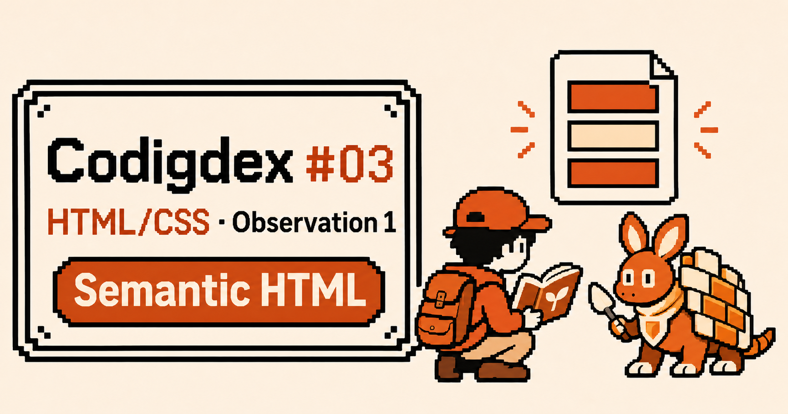
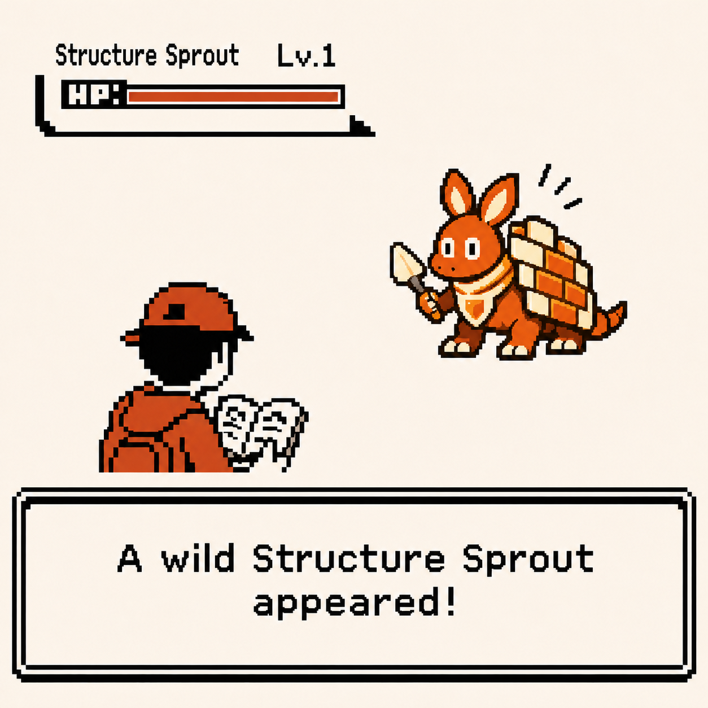
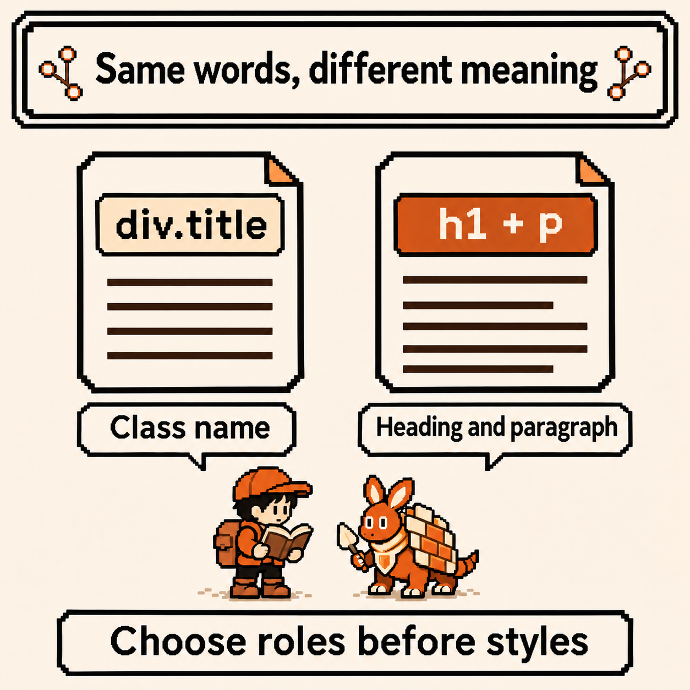
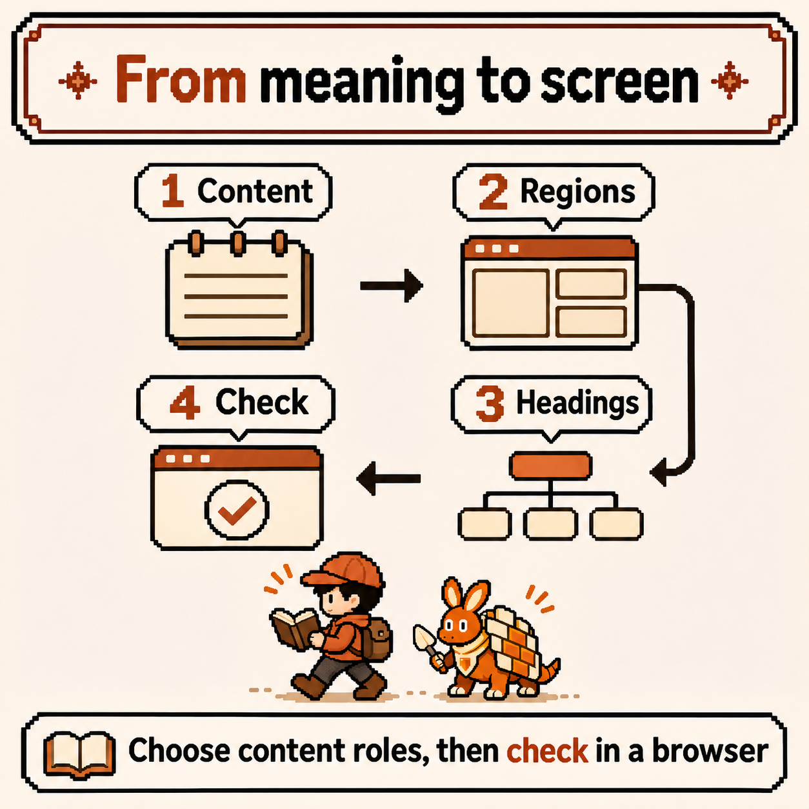
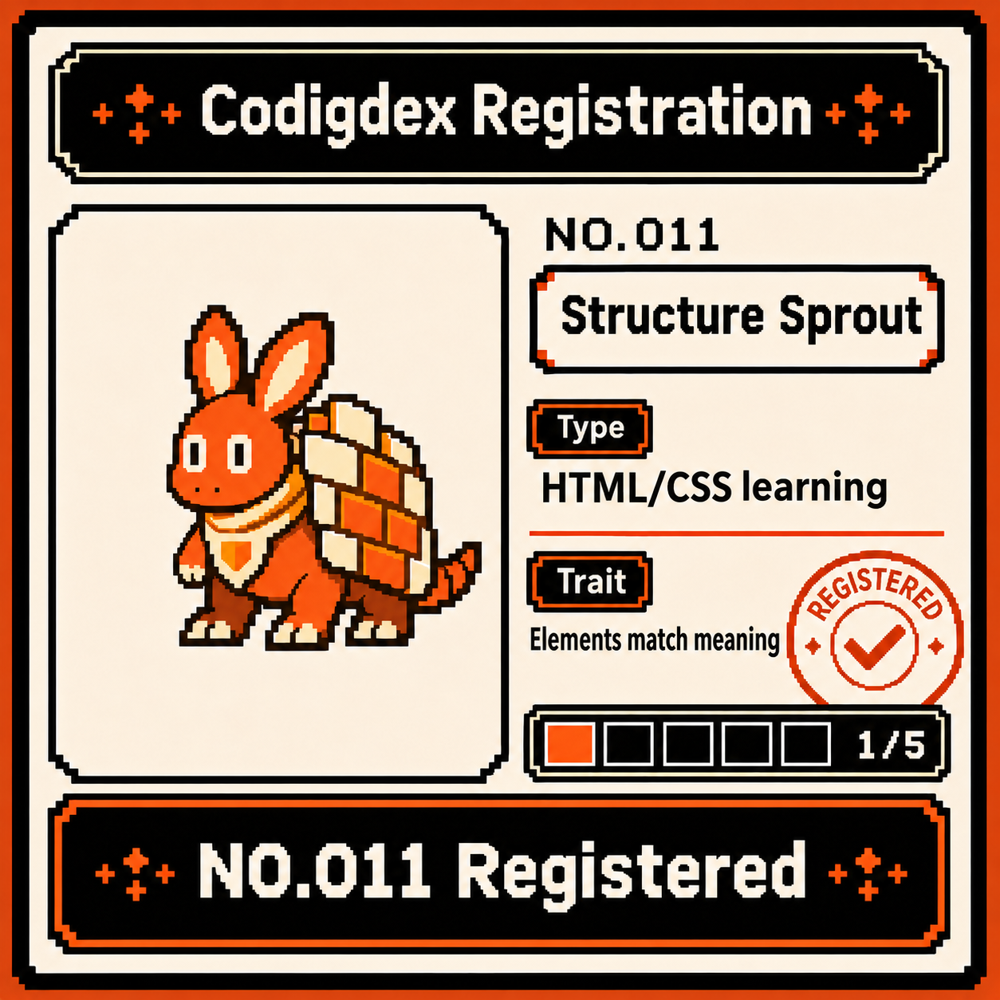

# Codigdex #03 — First Encounter with HTML/CSS: Semantic HTML



The last chapter took us from the shell down to the kernel. We observed the side that starts processes and reads files in response to commands. This time, it is the document on the screen that needs reading.

When I think about putting words in a browser, colors and layout come to mind first. But there is an earlier decision to make. Which part is a heading, where does the main content begin, and what leads somewhere else?

At the entrance to the new chapter, an orange creature waited with pieces of a document on its back. Our first specimen is the **Structure Sprout**. Before styling a page, I want to record what the page is saying.



---

## Specimen info

- Dex number: NO.011
- Name: Structure Sprout
- Classification: HTML/CSS learning type
- Encounter frequency: Whenever a web page opens (the appearance changes, but a document structure sits underneath)
- Danger level: ⚠️ (a page can look convincing while its headings and controls lack their intended roles)

---

## First impressions

Three questions go at the top of the field notes.

- What do HTML and CSS each do?
- If a page displays when everything is wrapped in `div`, why use other tags?
- Can looking at the screen tell us whether the structure is right?

The goal is a small page of field notes. We will start with one HTML file, without a framework or server. The sample text stays in English so both editions of this post can follow the same code.

---

## Observation 1 — HTML describes the role of content

HTML stands for **HyperText Markup Language**. It is a markup language that wraps content in elements to express structure and meaning. Start with the shape of an element, as described in [MDN's HTML basics](https://developer.mozilla.org/en-US/docs/Learn_web_development/Core/Structuring_content/Basic_HTML_syntax).

```html
<p>Today I met the Structure Sprout.</p>
```

`<p>` is the opening tag, `</p>` the closing tag, and the content goes between them. Together they form a paragraph element. Attributes add information to the opening tag. Not every element has this pair: `meta`, used later, is a void element with no content or closing tag.

CSS can add colors, spacing, fonts, and layout. JavaScript can respond to input or change the document. This observation focuses on HTML.

If a heading is just large text, choosing its font size comes first. If **a heading names the content that follows**, choosing `h1` or `h2` comes first. CSS can set its size afterward. That order is our starting point for reading this specimen.

---

## Observation 2 — semantic HTML adds meaning to appearance

“Semantic” concerns meaning. Semantic HTML means choosing elements that match the role of the content. Compare these fragments.

```html
<div class="title">Field notes</div>
<div>Today I met the Structure Sprout.</div>
```

```html
<h1>Field notes</h1>
<p>Today I met the Structure Sprout.</p>
```

In the first example, `title` is a class name chosen by the author. The name alone does not give the browser heading semantics. In the second, the elements themselves express a heading and a paragraph. Styling them similarly with CSS does not remove that difference.

`div` has a place too. As the [HTML standard's div definition](https://html.spec.whatwg.org/multipage/grouping-content.html#the-div-element) explains, it groups children without a special meaning of its own. It can wrap elements for layout, for example. But when content already has a role such as paragraph or heading, express that role first.



This meaning helps people reading the code and gives assistive technology a basis for navigation. [W3C's page structure tutorial](https://www.w3.org/WAI/tutorials/page-structure/) explains how well-structured content supports navigation and understanding. Changing a few tags, however, does not complete accessibility work.

---

## Observation 3 — divide the page into regions

Before turning the notes into a page, list its regions. This is a simplified map based on the [HTML standard's section elements](https://html.spec.whatwg.org/multipage/sections.html) and the meaning of `main`.

| Element | Role in this page |
| --- | --- |
| `header` | Site name and introduction |
| `nav` | A group of major navigation links |
| `main` | The page's main content |
| `article` | One observation that can be read independently |
| `section` | A thematic part of that observation |
| `footer` | Closing information for the site |

This table is not a mandatory top-to-bottom stack. An `article` can have its own `header` and `footer`, and a page does not need regions it has no use for. Similarly, `nav` is for major navigation, rather than a wrapper for every link.

`article` and `section` can be particularly confusing. The complete observation can stand on its own as a piece of writing, so it becomes an [`article`](https://developer.mozilla.org/en-US/docs/Web/HTML/Reference/Elements/article). “Today's discovery” is a named subtopic within it, so it becomes a [`section`](https://developer.mozilla.org/en-US/docs/Web/HTML/Reference/Elements/section). If a wrapper were needed only to add a border, a `div` could be more appropriate.

[`main`](https://developer.mozilla.org/en-US/docs/Web/HTML/Reference/Elements/main) represents the document's main content. This example uses one, leaving the repeated site introduction and footer outside. As [W3C's regions tutorial](https://www.w3.org/WAI/tutorials/page-structure/regions/) explains, these distinctions also help assistive technology navigate major regions. Not every HTML section element is always exposed as the same landmark. For example, a [`section` needs an accessible name](https://developer.mozilla.org/en-US/docs/Web/HTML/Reference/Elements/section#technical_summary) to become a `region` landmark.

---

## Observation 4 — build the field notes in one file

Create a file called `field-notes.html` in a new folder and save the following as UTF-8. Open it in a browser. This example needs no external files or server.

```html
<!doctype html>
<html lang="en">
  <head>
    <meta charset="utf-8">
    <meta name="viewport" content="width=device-width, initial-scale=1">
    <title>Field notes | Codigdex</title>
  </head>
  <body>
    <header>
      <p>Codigdex</p>
      <nav aria-label="Primary">
        <a href="#observation">Observation</a>
      </nav>
    </header>

    <main>
      <article id="observation">
        <h1>Meeting the Structure Sprout</h1>
        <p>A field note about giving content meaning.</p>

        <section>
          <h2>Today's discovery</h2>
          <p>Headings name topics. Paragraphs hold the details.</p>
        </section>

        <section>
          <h2>Next observation</h2>
          <p>Follow the meaning before choosing the style.</p>
          <a href="#observation">Back to the observation</a>
        </section>
      </article>
    </main>

    <footer>
      <p>Codigdex field notes</p>
    </footer>
  </body>
</html>
```

Rather than memorizing everything at once, read from the outside in.

1. [`<!doctype html>`](https://developer.mozilla.org/en-US/docs/Glossary/Doctype) is the document type declaration. It makes a normal HTML document render in standards mode.
2. `html` wraps the whole document. [`lang="en"`](https://developer.mozilla.org/en-US/docs/Web/HTML/Reference/Global_attributes/lang) says the example's main content is English. Use `ko` for a page written in Korean.
3. [`head`](https://developer.mozilla.org/en-US/docs/Web/HTML/Reference/Elements/head) holds information about the document: character encoding, viewport settings, and document title. `title` is used in places such as the browser tab; it is separate from the `h1` in the body.
4. Within `body`, the site introduction, main content, and closing information are distinct. The `article` contains a heading and two subtopics.

`aria-label="Primary"` names the navigation region. The link's `#observation` points to the element whose `id` is `observation` in the same document. Here, that is the start of the observation.



There are no colors or card borders of our own, but it is a readable page. Browsers have default styles, so headings may appear larger and links underlined. **Not having written CSS yet does not mean there are no styles.** For now, look at content order and roles before appearance.

---

## Observation 5 — headings have levels, not just sizes

The example uses `h1` for the page's topic and `h2` for each of its two subtopics. The second `section` is not inside the first, so its heading does not go down to `h3`.

```text
h1 Meeting the Structure Sprout
  h2 Today's discovery
  h2 Next observation
```

Ideally, reading just the headings gives a map of the writing. [W3C's headings tutorial](https://www.w3.org/WAI/tutorials/page-structure/headings/) recommends nesting heading levels according to their relationships and avoiding skipped levels when opening a new subsection. This example chooses a simple structure with one `h1` as the page's main heading.

Choosing `h4` instead of `h2` to get smaller text mixes structure with appearance. Choose levels for content relationships and adjust size in CSS. Do not expect putting a heading in a `section` to fix its level automatically, either. Write the intended `h2` or `h3` explicitly ([MDN heading elements](https://developer.mozilla.org/en-US/docs/Web/HTML/Reference/Elements/Heading_Elements)).

---

## Observation 6 — links navigate; buttons perform actions

Choosing roles does not end with large regions. “Back to the observation” **navigates** to another position in the document, so it uses an [`a` with `href`](https://developer.mozilla.org/en-US/docs/Web/HTML/Reference/Elements/a). For an **action** such as expanding a description or opening a dialog, a `button` is usually the starting point.

```html
<a href="#observation">Back to the observation</a>
<button type="button">Open field notes</button>
```

The second line is a fragment for comparing element choices. **No behavior is connected to this button, so pressing it does not open any notes.** It is left out of the complete example. Opening something requires implementing the behavior, for example with JavaScript.

As [MDN's button guide](https://developer.mozilla.org/en-US/docs/Web/HTML/Reference/Elements/button) explains, native buttons support activation through keyboards and assistive technology. Recreating that role with a click handler on a `div` also means managing focus and keyboard behavior yourself. For a button that does not submit a form, write `type="button"` to make the intent explicit.

Here is a first pass through the field notes.

- Do the headings alone explain the topic and subtopics?
- Can you find the boundaries of `main` and `article` in the developer tools' elements panel?
- Does Tab move to a link with a visible focus indicator, and does Enter navigate to its target? Browser or operating system settings may require enabling tab navigation.
- Is any heading only plain text, or is something meant to navigate presented as a fake button?

This is an initial checklist. Accessibility review also includes actual screen reader navigation, color contrast, image alternatives, form labels, and more. This observation covers **the starting point of expressing content meaning in HTML**.

---

## Summary

- HTML describes content structure and meaning. Choose roles before using CSS to set appearance.
- `h1` and `p` express headings and paragraphs. A class name on a `div` does not create the same semantics.
- Choose `header`, `nav`, `main`, `article`, `section`, and `footer` to fit the page. There is no requirement to include all of them everywhere.
- Heading levels describe content relationships. CSS controls size.
- Think of links for navigation and buttons for actions. Choosing an element and implementing its behavior are separate tasks.
- Check appearance and structure separately. Semantic HTML supports accessibility but does not replace a full review.

---

## Codigdex notes

In the Linux chapter, we read exactly what a word on the screen said about the system's state. The first observation of this chapter asks a related question. Is this text a heading? Is this group the main content? Does this control lead somewhere?

The note beside the Structure Sprout can be short. **Choose the content's role before styling it.** Even with one file, reading in that order makes the page's structure clearer.

**NO.011 Structure Sprout** goes into the first slot. The HTML/CSS chapter is now at 1/5.


