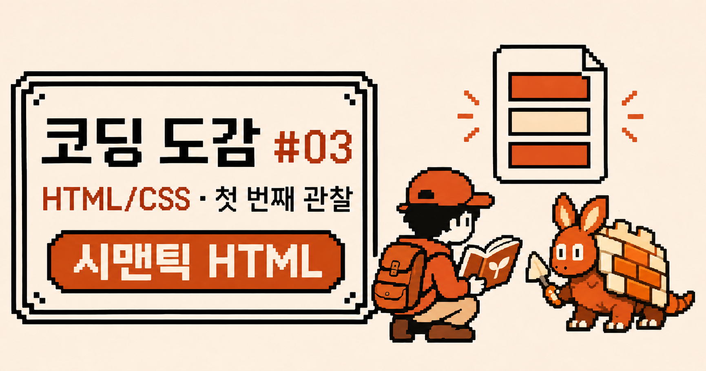
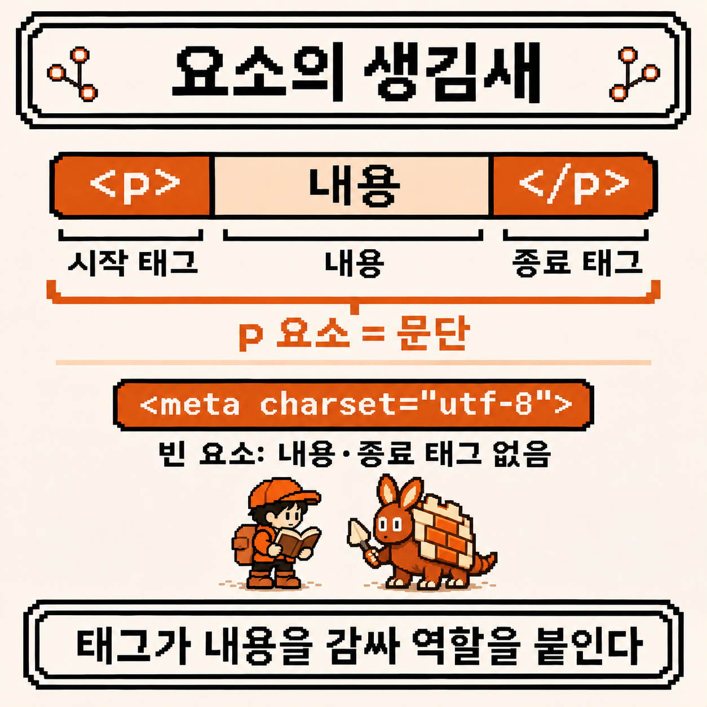
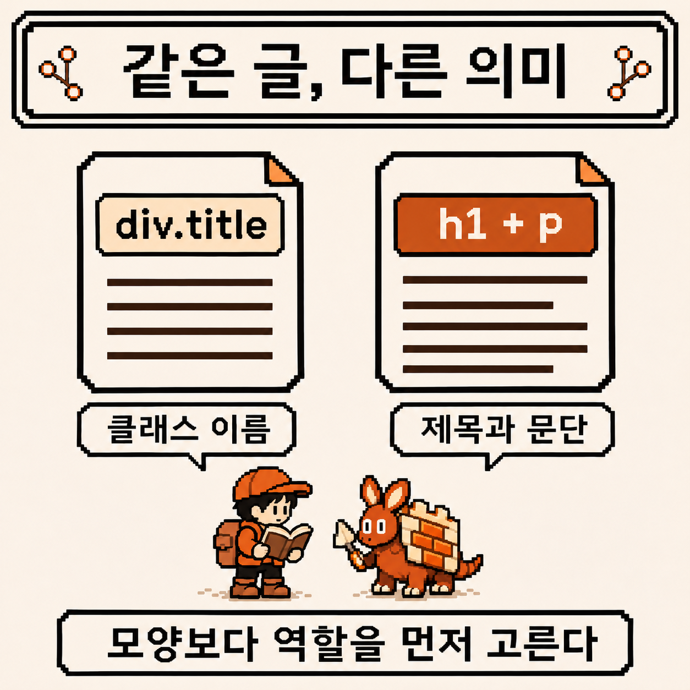
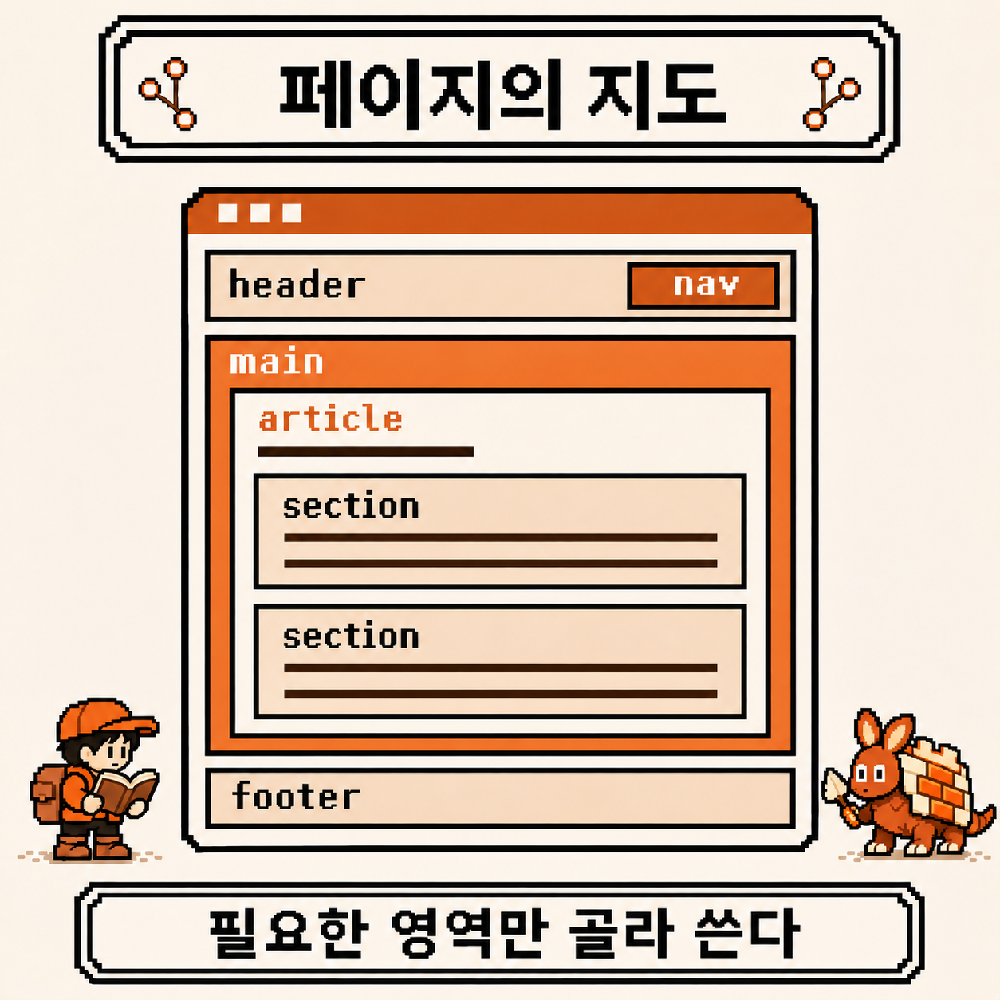
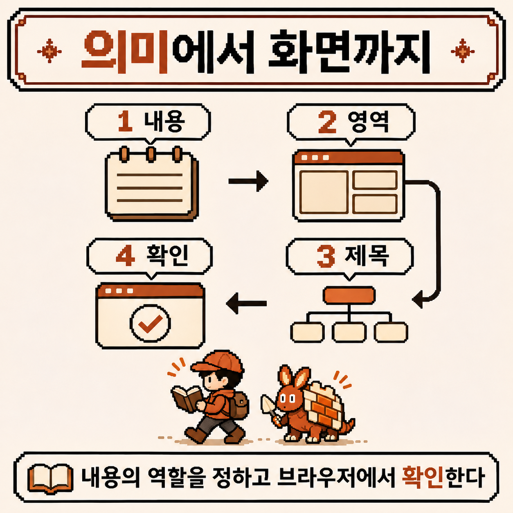
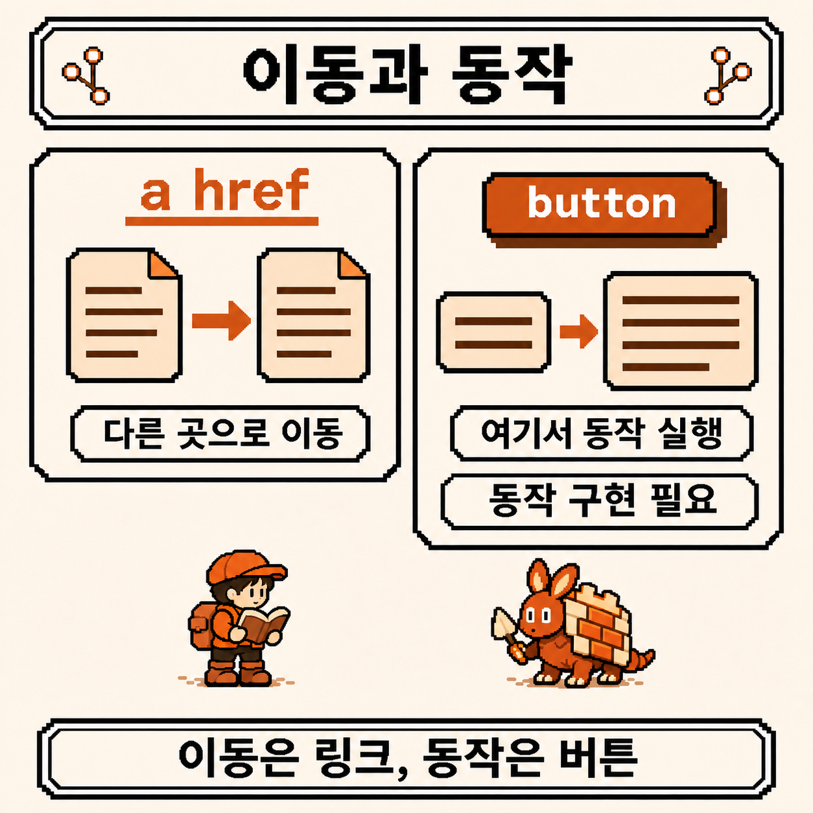
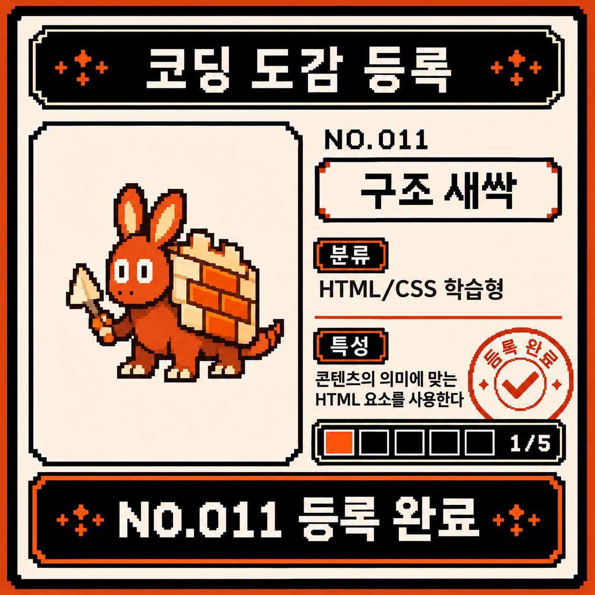

# 코딩 도감 #03 — HTML/CSS 첫 조우, 시맨틱 HTML



지난 챕터에서는 셸에서 시작해 커널까지 내려갔다. 명령을 받아 프로세스를 띄우고 파일을 읽게 해 주는 쪽을 살폈다면, 이번에는 화면에 도착한 문서를 읽어 볼 차례다.

브라우저에 글을 띄운다고 생각하니 색과 배치부터 떠오른다. 그런데 그보다 먼저 정해야 할 것이 있다. 어느 부분이 제목이고, 어디부터 본문이며, 무엇이 다른 곳으로 가는 길일까?

새 챕터의 입구에서 주황빛 개체가 문서 조각을 등에 얹은 채 기다리고 있었다. 첫 관찰 대상은 **구조 새싹**이다. 이번에는 페이지를 꾸미기 전에, 페이지가 무슨 말을 하는지부터 기록해 보기로 했다.


---

## 개체 정보

- 도감 번호: NO.011
- 이름: 구조 새싹
- 분류: HTML/CSS 학습형
- 특성: 콘텐츠의 의미에 맞는 HTML 요소를 사용한다
- 출현 빈도: 매우 높음 (웹 페이지를 열 때마다 등장. 겉모습은 달라도 그 아래에는 문서 구조가 있음)
- 위험도: ⚠️ (그럴듯하게 보여도 제목과 버튼의 역할이 빠져 있을 수 있음)

---

## 처음 만났을 때의 인상

관찰 노트의 첫 줄에는 질문 세 개를 적었다.

- HTML과 CSS는 각각 무엇을 맡을까?
- `div`로 전부 감싸도 화면이 나온다면, 다른 태그는 왜 필요할까?
- 구조가 맞는지는 화면을 보는 것만으로 알 수 있을까?

이번 목표는 작은 관찰 노트 한 페이지를 만드는 것이다. 프레임워크도 서버도 없이, HTML 파일 하나로 시작한다.

---

## 관찰 1 — HTML은 내용의 역할을 적는 언어다

HTML은 **HyperText Markup Language**다. 내용을 요소로 감싸 구조와 의미를 나타내는 마크업 언어다. 구조 새싹의 등에서 문서 조각 하나를 집어 [MDN의 HTML 기초](https://developer.mozilla.org/en-US/docs/Learn_web_development/Core/Structuring_content/Basic_HTML_syntax)와 나란히 놓고, 요소의 모양부터 살펴봤다.

```html
<p>Today I met the Structure Sprout.</p>
```

`<p>`는 시작 태그, `</p>`는 종료 태그이고, 그 사이에 내용이 들어간다. 전체가 문단 요소다. 속성은 시작 태그에 추가 정보를 붙인다. 모든 요소가 이처럼 짝을 이루지는 않는다. 뒤에서 쓸 `meta`는 내용과 종료 태그가 없는 빈 요소다.



여기에 CSS가 더해지면 색, 간격, 글꼴, 배치를 정할 수 있다. JavaScript는 사용자 입력에 반응하거나 문서를 바꾸는 동작을 맡을 수 있다. 이번 관찰에서는 HTML만 따라가 보기로 했다.

처음엔 제목을 그저 큰 글씨라고 생각했다. 그러면 글자 크기부터 고르게 된다. 그런데 노트에 **제목은 뒤에 오는 내용의 이름**이라고 고쳐 적고 나니, `h1`이냐 `h2`냐를 먼저 고르게 됐다. 크기는 그다음에 CSS로 정하면 된다. 이 순서가 이번 개체를 읽는 출발점이다.

---

## 관찰 2 — 시맨틱 HTML: 보이는 모양에 의미를 더한다

시맨틱(semantic)은 의미에 관한 말이다. 시맨틱 HTML은 콘텐츠의 역할에 맞는 요소를 고르는 방식이다. 아래 두 조각을 나란히 놓고 들여다봤다.

```html
<div class="title">Field notes</div>
<div>Today I met the Structure Sprout.</div>
```

```html
<h1>Field notes</h1>
<p>Today I met the Structure Sprout.</p>
```

첫 조각을 봤을 때는 `class="title"`이라고 적었으니 제목으로 통할 줄 알았다. 하지만 `title`은 작성자가 붙인 클래스 이름일 뿐이고, 이름만으로 브라우저에 제목이라는 의미가 생기지는 않는다. 둘째 조각은 요소 자체에 제목과 문단의 역할이 들어 있다. CSS로 비슷하게 꾸며도 이 차이는 남는다.

그렇다고 `div`가 틀린 답은 아니었다. [HTML 표준의 div 정의](https://html.spec.whatwg.org/multipage/grouping-content.html#the-div-element)처럼, 특별한 의미 없이 자식 요소를 묶을 때 쓴다. 예를 들어 배치를 위해 여러 요소를 함께 감쌀 수 있다. 다만 내용이 이미 문단이나 제목이라면 그 역할을 먼저 표현하면 된다.



이 의미는 코드를 읽는 사람에게도 도움이 되고, 보조 기술이 내용을 탐색하는 기반도 된다. [W3C의 페이지 구조 안내](https://www.w3.org/WAI/tutorials/page-structure/)는 잘 구조화된 콘텐츠가 탐색과 이해를 돕는다고 설명한다. 다만 태그 몇 개를 바꿨다고 접근성 전체가 완성되는 것은 아니다.

---

## 관찰 3 — 페이지를 영역으로 나눈다

관찰 노트를 페이지로 옮기기 전에 영역부터 적어 봤다. 아래는 [HTML 표준의 구획 요소](https://html.spec.whatwg.org/multipage/sections.html)와 `main`의 의미를 따라 단순화한 지도다.

| 요소 | 이번 페이지에서 맡을 역할 |
| --- | --- |
| `header` | 사이트 이름과 소개 |
| `nav` | 주요 탐색 링크 묶음 |
| `main` | 이 페이지의 핵심 내용 |
| `article` | 독립적으로 읽을 수 있는 관찰 기록 한 편 |
| `section` | 기록 안에서 주제로 묶인 부분 |
| `footer` | 사이트의 마무리 정보 |

이 표는 위에서 아래로 반드시 쌓아야 하는 공식이 아니다. `header`와 `footer`는 `article` 안에도 둘 수 있고, 페이지에 필요 없는 영역을 억지로 만들 필요도 없다. `nav` 역시 모든 링크의 포장지가 아니라 주요 탐색을 위한 영역이다.

가장 오래 망설인 건 `article`과 `section`이었다. 둘 다 그저 내용을 묶는 요소처럼 보였기 때문이다. 관찰 기록 전체는 따로 떼어 읽어도 하나의 글이어서 [`article`](https://developer.mozilla.org/en-US/docs/Web/HTML/Reference/Elements/article)로, 그 안의 ‘오늘의 발견’은 제목을 가진 하위 주제여서 [`section`](https://developer.mozilla.org/en-US/docs/Web/HTML/Reference/Elements/section)으로 잡았다. 단순히 테두리를 넣을 묶음이 필요했다면 `div`가 더 적절할 수 있다.

[`main`](https://developer.mozilla.org/en-US/docs/Web/HTML/Reference/Elements/main)은 문서의 주된 내용이다. 이번 예제에서는 하나만 두고, 반복되는 사이트 소개와 바닥글은 밖에 놓는다. [W3C의 영역 안내](https://www.w3.org/WAI/tutorials/page-structure/regions/)처럼 이런 구분은 보조 기술이 주요 영역으로 이동할 때도 도움이 된다. 의외였던 점도 있다. HTML의 모든 구획 요소가 언제나 같은 랜드마크로 노출되는 것은 아니다. 예를 들어 [`section`은 접근 가능한 이름이 있어야](https://developer.mozilla.org/en-US/docs/Web/HTML/Reference/Elements/section#technical_summary) `region` 랜드마크가 된다.



---

## 관찰 4 — 파일 하나로 관찰 노트를 만든다

새 폴더에 `field-notes.html`이라는 파일을 만들고 아래 내용을 UTF-8로 저장한다. 파일을 브라우저에서 열면 된다. 이 예제는 외부 파일이나 서버를 요구하지 않는다.

```html
<!doctype html>
<html lang="en">
  <head>
    <meta charset="utf-8">
    <meta name="viewport" content="width=device-width, initial-scale=1">
    <title>Field notes | Codigdex</title>
  </head>
  <body>
    <header>
      <p>Codigdex</p>
      <nav aria-label="Primary">
        <a href="#observation">Observation</a>
      </nav>
    </header>

    <main>
      <article id="observation">
        <h1>Meeting the Structure Sprout</h1>
        <p>A field note about giving content meaning.</p>

        <section>
          <h2>Today's discovery</h2>
          <p>Headings name topics. Paragraphs hold the details.</p>
        </section>

        <section>
          <h2>Next observation</h2>
          <p>Follow the meaning before choosing the style.</p>
          <a href="#observation">Back to the observation</a>
        </section>
      </article>
    </main>

    <footer>
      <p>Codigdex field notes</p>
    </footer>
  </body>
</html>
```

줄이 많아 보이지만 한 번에 다 외울 필요는 없다. 바깥에서 안쪽으로 한 겹씩 읽어 본다.

1. [`<!doctype html>`](https://developer.mozilla.org/en-US/docs/Glossary/Doctype)은 문서 형식 선언이다. 일반적인 HTML 문서에서 브라우저가 표준 모드로 처리하게 한다.
2. `html`이 문서 전체를 감싼다. [`lang="en"`](https://developer.mozilla.org/en-US/docs/Web/HTML/Reference/Global_attributes/lang)은 이 예제의 주된 콘텐츠가 영어라는 뜻이다. 한국어로 쓴 페이지라면 `ko`로 바꾼다.
3. [`head`](https://developer.mozilla.org/en-US/docs/Web/HTML/Reference/Elements/head)에는 문자 인코딩, 뷰포트 정보, 문서 제목처럼 문서에 관한 정보를 둔다. `title`은 브라우저 탭 등에 쓰이며 본문의 `h1`과 별개다.
4. `body` 안에서는 사이트 소개, 본문, 마무리를 구분한다. `article` 안에 제목과 두 하위 주제를 넣었다.

`aria-label="Primary"`는 탐색 영역에 이름을 준다. 링크의 `#observation`은 같은 문서 안에서 `id="observation"`인 요소를 가리킨다. 이 예제에서는 관찰 기록의 시작점이다.



열어 보니 색도 테두리도 없는 밋밋한 페이지였지만, 읽는 데는 문제가 없었다. 그런데 CSS를 한 줄도 쓰지 않았는데 제목은 크고 링크에는 밑줄이 있었다. 브라우저에 기본 스타일이 있기 때문이다. **CSS를 아직 쓰지 않았다는 말이 스타일이 전혀 없다는 뜻은 아니다.** 지금 볼 것은 모양보다 내용의 순서와 역할이다.

---

## 관찰 5 — 제목은 크기가 아니라 순서를 갖는다

예제에서 페이지의 주제는 `h1`, 그 아래 두 주제는 각각 `h2`다. 둘째 `section`이 첫째 안에 들어 있지 않으므로 `h3`로 내리지 않았다.

```text
h1 Meeting the Structure Sprout
  h2 Today's discovery
  h2 Next observation
```

제목만 뽑아 읽어도 글의 지도가 보인다면 제목 구조가 제대로 잡혔다는 신호다. [W3C의 제목 안내](https://www.w3.org/WAI/tutorials/page-structure/headings/)는 관계에 맞게 제목 단계를 중첩하고, 새 하위 구획을 시작할 때 단계를 건너뛰지 않도록 권한다. 이 예제는 페이지의 대표 제목을 `h1` 하나로 두는 단순한 구성을 택했다.

글씨를 작게 만들려고 `h2` 대신 `h4`를 고르면 구조와 모양이 섞인다. 제목 단계는 내용의 관계로 고르고 크기는 CSS로 조절한다. `section` 안에 넣었다고 제목 단계가 자동으로 맞춰질 것이라고 기대하지도 않는다. 의도한 `h2`, `h3`를 직접 적는다([MDN 제목 요소 안내](https://developer.mozilla.org/en-US/docs/Web/HTML/Reference/Elements/Heading_Elements)).

---

## 관찰 6 — 이동은 링크, 동작은 버튼

역할을 고르는 일은 큰 영역에서 끝나지 않는다. 예제의 ‘관찰로 돌아가기’는 문서 안의 다른 위치로 **이동**하므로 `href`가 있는 [`a`](https://developer.mozilla.org/en-US/docs/Web/HTML/Reference/Elements/a)다. 접힌 설명을 펴거나 대화상자를 여는 **동작**이라면 보통 `button`을 고른다.

```html
<a href="#observation">Back to the observation</a>
<button type="button">Open field notes</button>
```



두 번째 줄은 요소 선택을 비교하기 위한 조각이다. **이 버튼에는 동작을 연결하지 않았으므로 눌러도 노트가 열리지 않는다.** 완성 예제에는 넣지 않았다. 실제로 열리게 하려면 JavaScript 등으로 동작을 구현해야 한다.

[MDN의 button 안내](https://developer.mozilla.org/en-US/docs/Web/HTML/Reference/Elements/button)처럼 기본 버튼은 키보드나 보조 기술을 통한 활성화를 지원한다. `div`에 클릭 처리를 붙여 같은 역할을 만들려면 포커스와 키보드 처리까지 직접 챙겨야 한다. 폼 제출용이 아닌 버튼에는 `type="button"`을 적어 의도를 분명히 한다.

완성한 관찰 노트는 다음 순서로 훑어보기로 했다.

- 제목만 읽어도 주제와 하위 주제를 이해할 수 있는가?
- 개발자 도구의 요소 패널에서 `main`과 `article`의 경계를 찾을 수 있는가?
- Tab 키로 링크에 이동했을 때 포커스가 보이고 Enter로 목적지에 갈 수 있는가? 페이지가 짧으면 스크롤이 없을 수 있으니 주소 끝의 `#observation`도 확인한다. 브라우저·운영체제 설정에 따라 탭 탐색 설정이 필요할 수 있다.
- 제목이 필요한 곳에 일반 텍스트만 넣거나, 이동할 곳에 가짜 버튼을 만들지는 않았는가?

물론 이 목록이 접근성 검토의 전부는 아니다. 화면 낭독기로 실제 탐색해 보기, 색 대비, 이미지 대체 텍스트, 폼 레이블도 모두 검토 대상이다. 오늘 관찰한 것은 그 출발점, **내용의 의미를 HTML로 표현하는 일**이다.

---

## 정리

- HTML은 콘텐츠의 구조와 의미를 적는다. CSS로 모양을 정하기 전에 역할을 먼저 고른다.
- `h1`과 `p`는 제목과 문단을 표현한다. `div`의 클래스 이름만으로 같은 의미가 생기지는 않는다.
- 페이지의 필요에 맞춰 `header`, `nav`, `main`, `article`, `section`, `footer`를 고른다. 모든 페이지에 전부 넣는 공식은 아니다.
- 제목 단계는 내용의 관계를 나타낸다. 크기는 CSS에서 조절한다.
- 목적지로 이동하면 링크, 동작을 실행하면 버튼을 먼저 생각한다. 요소를 고르는 것과 동작을 구현하는 것은 별개다.
- 보기 좋은 화면과 올바른 구조는 따로 확인해야 한다. 시맨틱 HTML은 접근성의 기반이지만 전체 검토를 대신하지는 않는다.

---

## 도감 기록

Linux 챕터에서는 화면에 나온 단어가 정확히 무슨 상태를 말하는지 읽었다. 새 챕터의 첫 관찰도 비슷한 질문으로 이어진다. 이 글자는 제목일까, 이 묶음은 본문일까, 이 링크는 어디로 가는 길일까?

구조 새싹 옆에 적어 둘 문장은 짧다. **꾸미기 전에, 내용의 역할부터 고른다.** 파일 하나라도 이 순서로 읽으면 페이지의 뼈대가 조금 더 선명해진다.

그럼 HTML/CSS 챕터의 첫 개체를 코딩 도감에 등록한다. **NO.011 구조 새싹** — 내용의 의미에 맞는 요소를 고른다. HTML/CSS 챕터 다섯 칸 중 첫 칸이 채워졌다.


