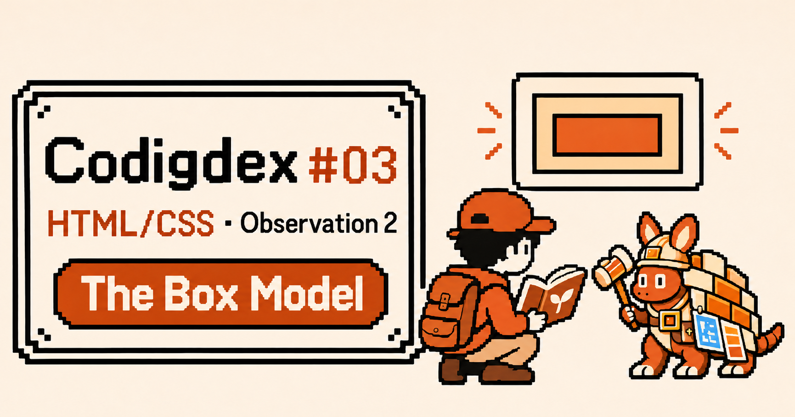
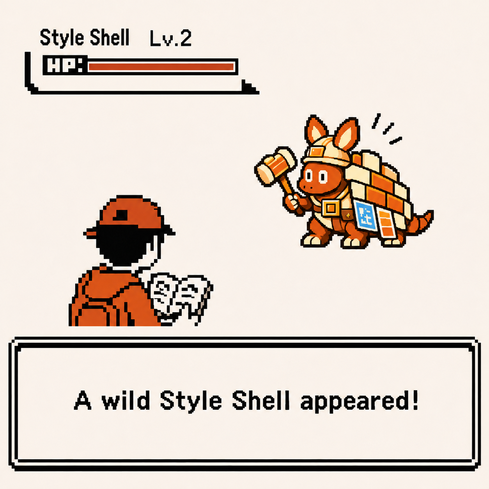
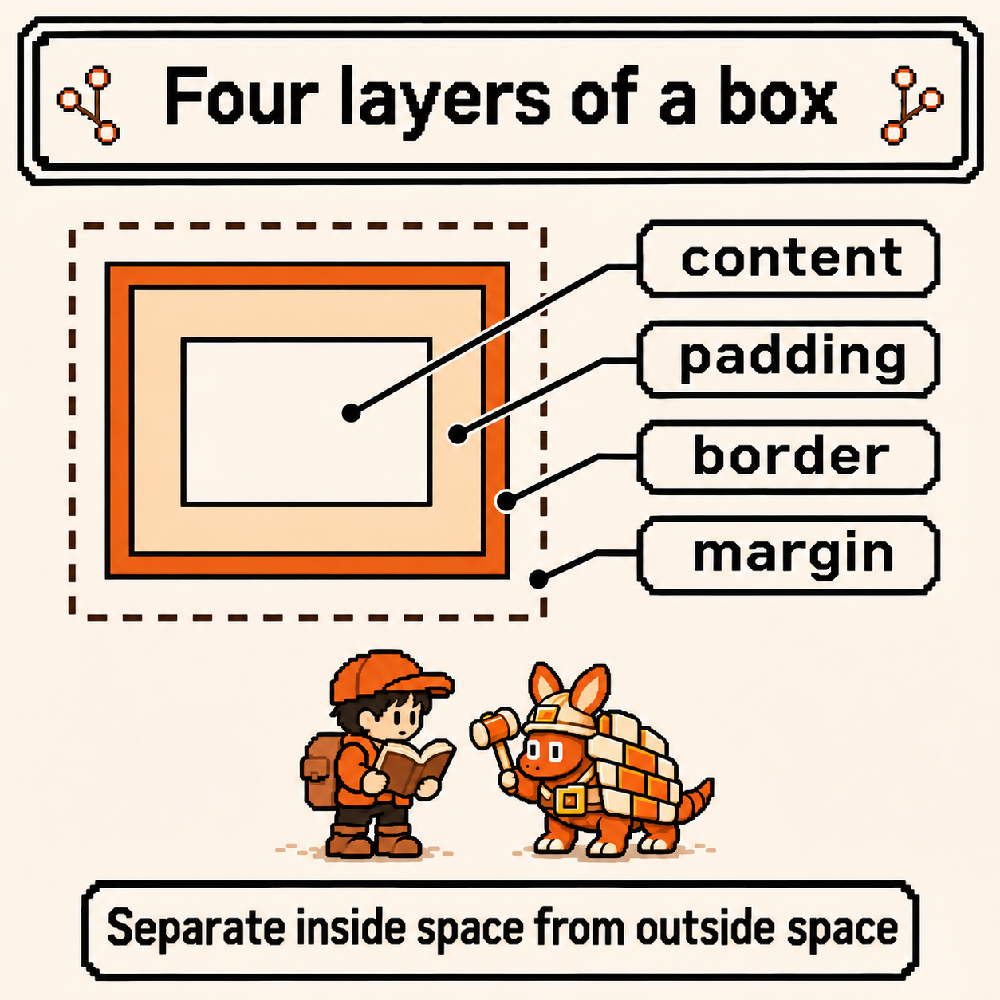
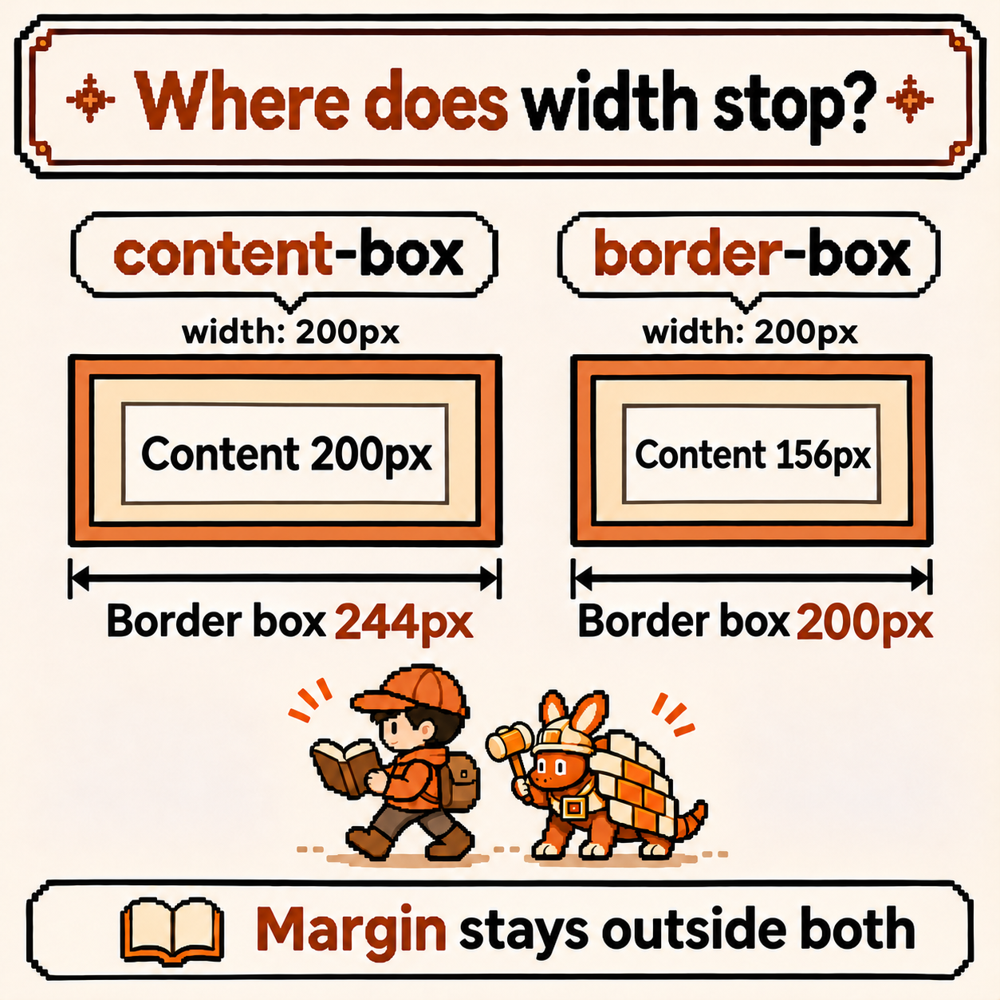
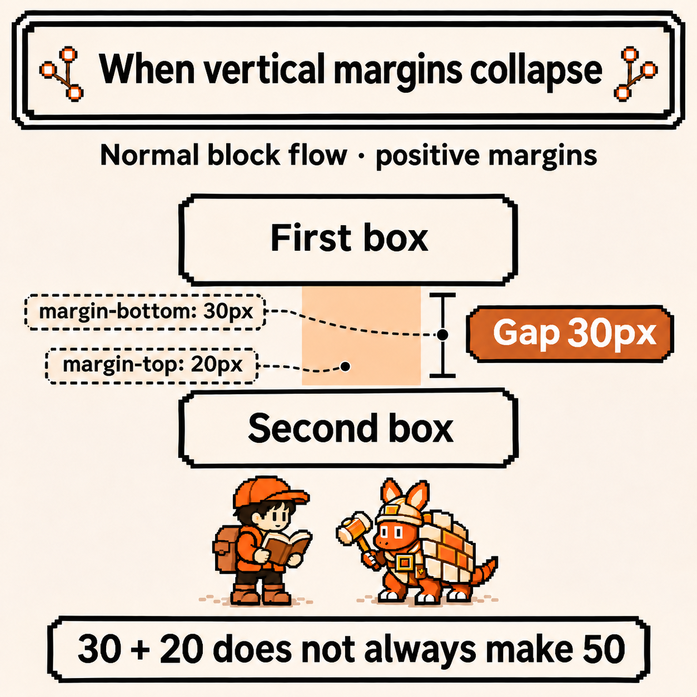
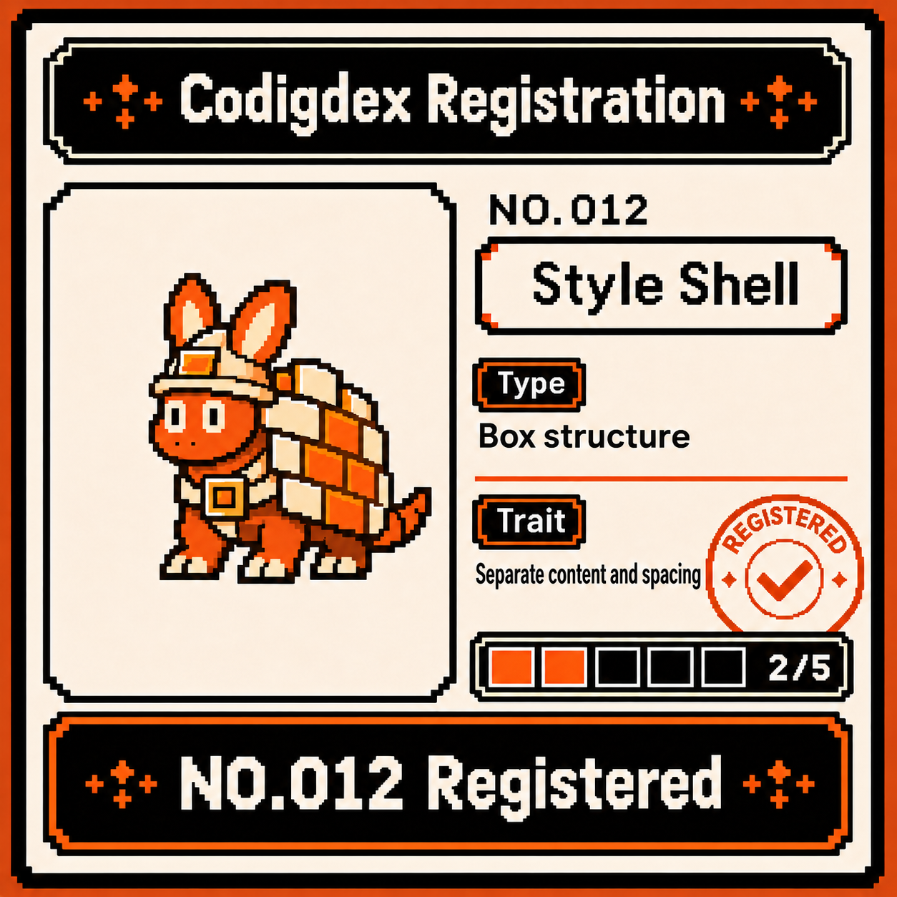

# Codigdex #03 — The Box Model: Four Layers of the Style Shell



In the last observation, the Structure Sprout helped us identify roles in a document. A heading became `h1`, and a complete field note became `article`. Now, adding a border and some space raises another question. If the width says `200px`, does that include the border?

At the second checkpoint of the HTML/CSS region waits the **Style Shell**, its back wrapped in layers. Before changing its appearance, I want to unfold the space that appearance takes up.



---

## Specimen info

- Dex number: NO.012
- Name: Style Shell
- Classification: Box structure type
- Encounter rate: Very high (whenever borders and spacing surround content)
- Danger level: ⚠️⚠️ (confusing the declared width with the outside size can push a card beyond its parent)

---

## First impression

Once again, questions go into the notes before appearances.

- Is the space between text and a border the same as the space outside a card?
- Can two cards with `width: 200px` have different visible widths?
- Do a bottom margin of 30 and the next card's top margin of 20 always make 50?

The examples use block boxes in a typical horizontal writing mode. We will start with fixed widths and positive margins, without adding Flexbox or Grid sizing behavior. Numbers are in CSS pixels, which do not necessarily match the number of physical screen pixels.

---

## Observation 1 — unfold four layers from the content outward

With [MDN's box model guide](https://developer.mozilla.org/en-US/docs/Learn_web_development/Core/Styling_basics/Box_model) beside the notes, I read the Style Shell's back one layer at a time. From inside to outside, a CSS box has these areas.

- **content**: where content such as text and images sits
- **padding**: the space between the content and the border
- **border**: the boundary around the padding
- **margin**: the space outside the border



If content is too close to its border, inspect `padding` first. If neighboring cards are too close, inspect `margin`. Both may look like empty space, but they belong to different boundaries. [Padding](https://developer.mozilla.org/en-US/docs/Web/CSS/Reference/Properties/padding) creates inside space; [margin](https://developer.mozilla.org/en-US/docs/Web/CSS/Reference/Properties/margin) sets outside space. A normal background color also paints the padding area, but does not paint the margin.

The colored box model map in developer tools is an explanatory overlay. The actual page does not paint its margin in that color. Beside the Style Shell, I write: **find the layer before adding more space.**

---

## Observation 2 — where does 200px stop?

Start by imagining one card with this CSS.

```css
.specimen {
  box-sizing: content-box;
  width: 200px;
  padding: 20px;
  border: 2px solid #9b3e16;
  margin: 10px;
}
```

`.specimen` is a class selector for elements with `class="specimen"`. Inside the braces, `:` joins a property and value, and `;` separates declarations. `padding: 20px` and `margin: 10px` give all four sides the same value.

The boundary measured by [`width`](https://developer.mozilla.org/en-US/docs/Web/CSS/Reference/Properties/width) depends on `box-sizing`. With `content-box`, **only the content area gets 200px**. The outside of the border needs a separate calculation.

```text
content width = 200px
border box width = 200 + 20 + 20 + 2 + 2 = 244px
border box width + horizontal margins = 244 + 10 + 10 = 264px
```

244 reaches the outer edges of the visible border. 264 also adds this example's left and right margins. This is not a universal formula for the space an element occupies in every layout. We are reading the horizontal dimensions of one normal block box with a fixed width and no transforms.

What if 200 should reach the outer edges of the border? Switch to [`box-sizing: border-box`](https://developer.mozilla.org/en-US/docs/Web/CSS/Reference/Properties/box-sizing). Padding and border now fit inside that 200. With the same values, content width becomes `200 - 40 - 4 = 156px`; adding horizontal margins gives `220px`. **Margin is still outside.**



The difference to record is which boundary the number measures. The [CSS sizing specification](https://www.w3.org/TR/css-sizing-3/#box-sizing) describes this property as choosing the box to which sizing properties apply. `border-box` does not remove padding: the space padding takes comes out of the content area. If padding and borders together exceed the declared width, content width cannot become negative, so the border box can exceed that declared width.

---

## Observation 3 — put the two boundaries into the same HTML

Create `box-model.html` in an empty folder, save the complete example below as UTF-8, and open it in a browser. Both cards are `article` elements from the last observation.

```html
<!doctype html>
<html lang="en">
  <head>
    <meta charset="utf-8">
    <meta name="viewport" content="width=device-width, initial-scale=1">
    <title>Style Shell | Codigdex</title>
    <style>
      body {
        margin: 24px;
        font-family: sans-serif;
      }

      .specimen {
        box-sizing: content-box;
        width: 200px;
        padding: 20px;
        border: 2px solid #9b3e16;
        margin: 10px;
        background: #fff4dc;
      }

      .border-box {
        box-sizing: border-box;
      }

      .specimen h2 {
        margin: 0 0 8px;
        font-size: 20px;
      }

      .specimen p {
        margin: 0;
      }
    </style>
  </head>
  <body>
    <main>
      <h1>Meeting the Style Shell</h1>
      <article class="specimen">
        <h2>content-box</h2>
        <p>Content gets 200px.</p>
      </article>
      <article class="specimen border-box">
        <h2>border-box</h2>
        <p>Content, padding, and border share 200px.</p>
      </article>
    </main>
  </body>
</html>
```

The second card has two classes. It receives the common `.specimen` declarations, and the later `.border-box` declaration changes `box-sizing` at the same specificity. The cascade's detailed rules sit outside this observation; here, compare the resulting boundaries.

The example explicitly sets the headings' and paragraphs' margins, keeping the browser's original spacing separate from the card's spacing. Height is not fixed, so it grows with content and line wrapping.

Open developer tools and select the first and second cards in turn. Names vary by browser, but a box model diagram usually appears near the element's styles or computed styles.

1. Read `box-sizing`: `content-box` for one and `border-box` for the other.
2. Find the first card's content width of 200, horizontal padding of 20 per side, and border of 2 per side.
3. Check that the second card has content width 156 with the same padding and border.
4. Check that both cards still have margin 10 outside the border.

If a width differs from expectations, read the selected element and computed values before adding another declaration. Page zoom and the tools' presentation may also affect how the displayed dimensions look compared with lengths on the screen.

---

## Observation 4 — read spacing values clockwise

We started with equal values on every side, but they do not need to match. The `padding` and `margin` shorthands use the same directional order.

```css
.specimen {
  padding: 12px 20px;
  margin: 8px 10px 16px 6px;
}
```

This fragment only compares notation. Applying it to the earlier cards changes their dimensions, so keep the original values when checking 244 and 200.

- One value: the same for top, right, bottom, and left
- Two values: vertical / horizontal. The padding above is 12 vertically and 20 horizontally
- Three values: top / horizontal / bottom
- Four values: top / right / bottom / left. The margin goes clockwise: 8, 10, 16, 6

If changing inside space also seems to change the gap to a neighbor, reread the property name before the numbers. The directions match, but padding and margin remain different layers.

---

## Observation 5 — vertical margins do not always add up

Return to the last question. Consider two neighboring boxes in normal block flow. This is a small comparison fragment, separate from the previous example.

```html
<style>
  .note {
    margin: 0;
    padding: 10px;
    border: 1px solid #9b3e16;
  }
  .first { margin-bottom: 30px; }
  .second { margin-top: 20px; }
</style>
<div class="stack">
  <div class="note first">First note</div>
  <div class="note second">Second note</div>
</div>
```

Under these conditions, the gap between the borders is **30px rather than 50px**. Adjacent vertical margins undergo **margin collapsing**. When positive margins collapse like this, the larger value remains. Having a border on each card does not stop these siblings' outside margins from collapsing. [MDN's margin collapsing guide](https://developer.mozilla.org/en-US/docs/Web/CSS/Guides/Box_model/Margin_collapsing) explains the conditions.

For the same reason, the gap between the two cards in Observation 3 is 10px rather than 20px. The first card's 10px bottom margin collapses with the second card's 10px top margin.



Do not apply this rule to every gap. Horizontal margins do not collapse this way, nor do the margins of flex or grid items. Parent-child collapsing has its own conditions, and negative margins make the calculation more than simply picking the largest value. Today's registration notes stop at **two normal-flow siblings with positive vertical margins**, as shown above.

The inspection order is short: **which layer → which boundary does width measure → what values were actually calculated?** Return to these questions when spacing looks unexpected.

---

## Summary

- Read a box from content through padding, border, and margin, inside to outside.
- With `content-box`, width measures the content. In this example, padding and borders turn 200 into a 244px border box.
- `border-box` includes padding and borders within width. Here, the border box is 200 and content is 156. Margin stays outside.
- Padding is inside space; margin is outside space. Four values run top, right, bottom, left.
- Adjacent vertical margins in normal block flow can collapse. The example's positive 30 and 20 leave a gap of 30.
- In developer tools, check the selected element and the calculated values of its layers.

---

## Codigdex notes

With the Structure Sprout, we chose content roles first. With the Style Shell, we read the boundaries of the boxes holding those roles. The same `200px` can look different depending on which boundary it measures: that is the center of this observation.

The border might look like the end, but margin remains outside it. When appearance feels wrong, I want to identify the layer before making its numbers larger.

Time to register the second specimen. **NO.012 Style Shell** — reads size by separating content, spacing, and borders. Two of the HTML/CSS chapter's five slots are now filled.


