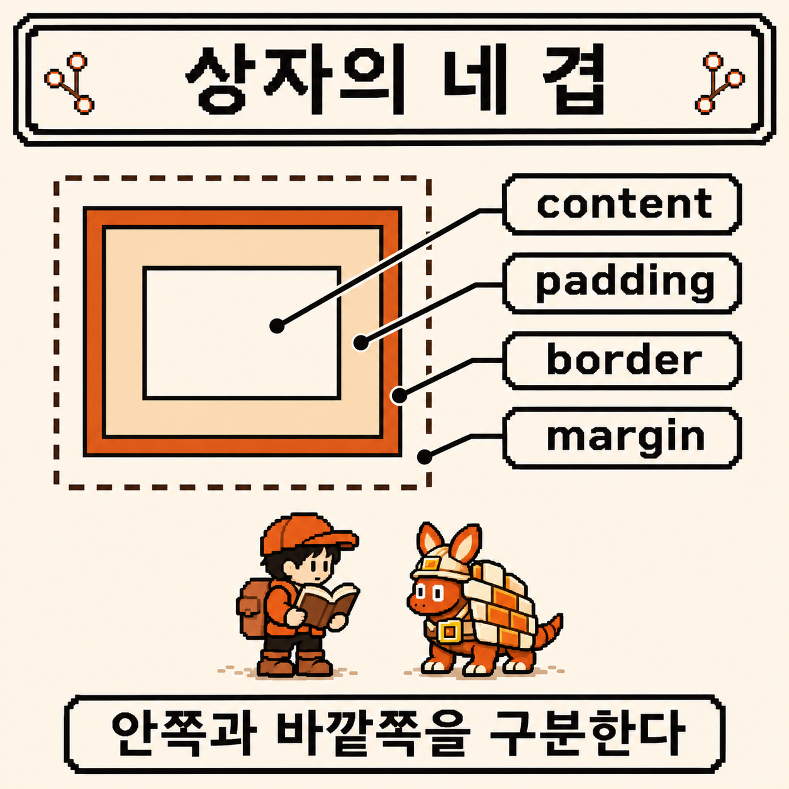
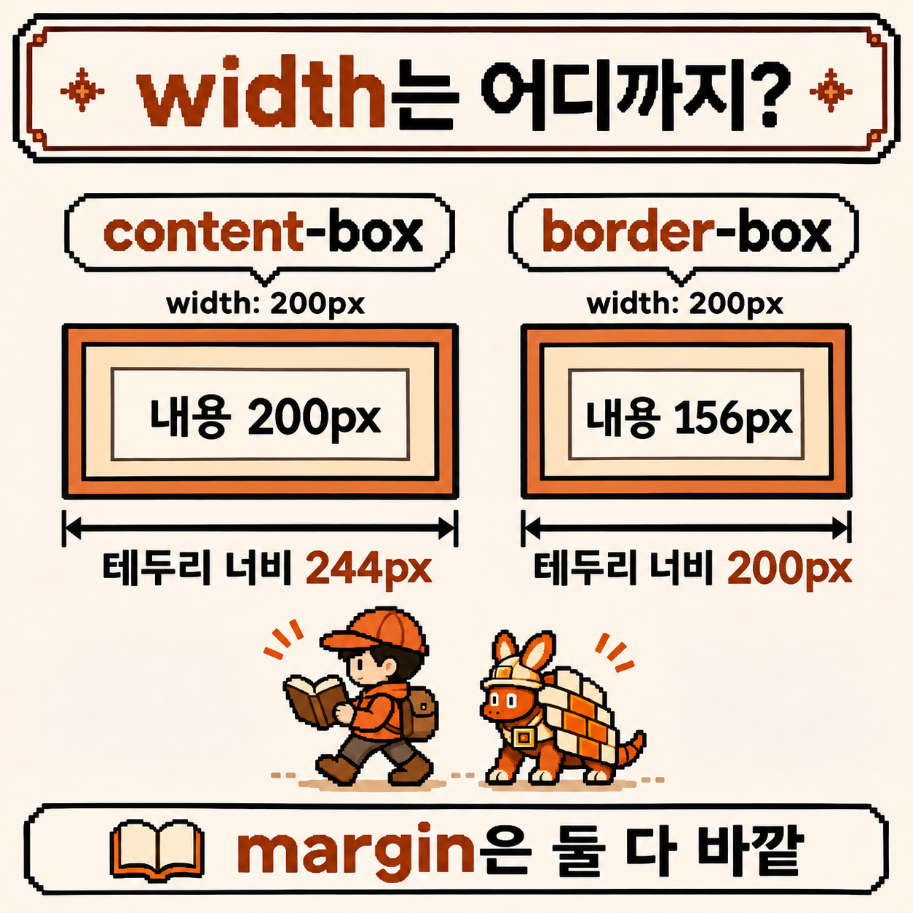
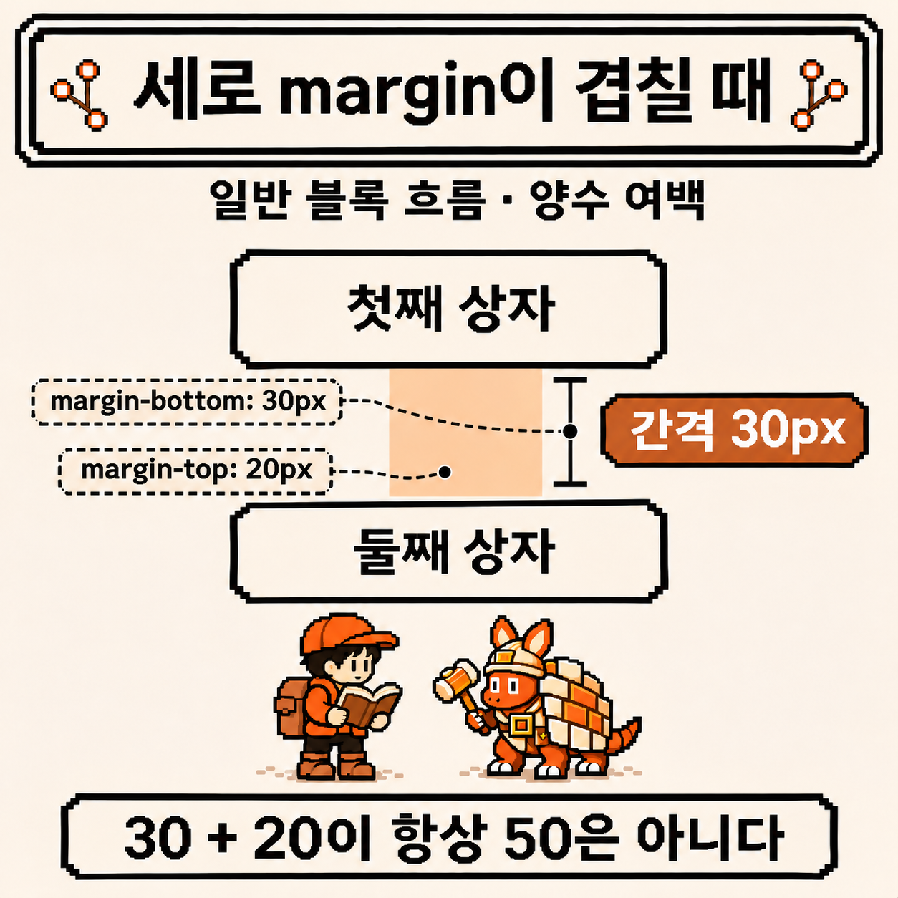
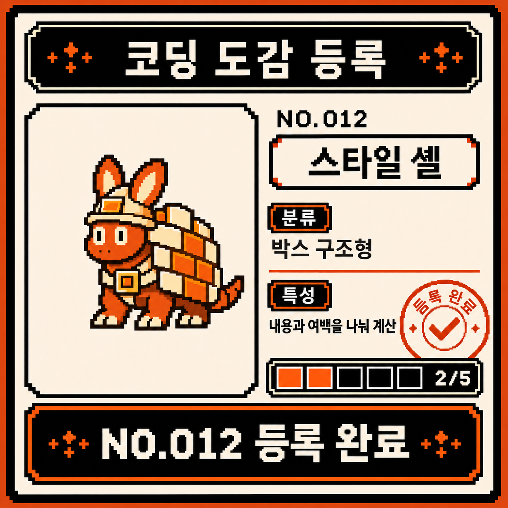

# 코딩 도감 #03 — 박스 모델, 스타일 셸의 네 겹


지난 관찰에서 구조 새싹과 문서의 역할을 나눴다. 제목은 `h1`, 관찰 기록 한 편은 `article`로 적었다. 이제 그 기록에 테두리를 두르고 여백을 주려니 새로운 질문이 생긴다. 너비를 `200px`이라고 적으면 테두리 바깥까지 200일까?

HTML/CSS 지역의 두 번째 길목에는 등을 여러 겹으로 감싼 **스타일 셸**이 기다린다. 이번에는 겉모습을 바꾸기 전에, 그 겉모습이 차지하는 공간부터 펼쳐 보기로 했다.


---

## 개체 정보

- 도감 번호: NO.012
- 이름: 스타일 셸
- 분류: 박스 구조형
- 출현 빈도: 매우 높음 (내용에 테두리와 여백을 줄 때마다 만남)
- 위험도: ⚠️⚠️ (너비와 실제 바깥 크기를 혼동하면 카드가 부모 밖으로 밀려날 수 있음)

---

## 처음 만났을 때의 인상

노트에는 이번에도 모양보다 질문을 먼저 적는다.

- 글자와 테두리 사이의 여백과 카드 바깥의 여백은 같은 것일까?
- `width: 200px`인 두 카드가 서로 다른 너비로 보일 수 있을까?
- 아래 여백 30과 다음 카드의 위 여백 20은 언제나 50이 될까?

이번 예제는 일반적인 가로 쓰기 문서의 블록 상자다. Flexbox나 Grid의 크기 조정은 섞지 않고, 고정된 너비와 양수 여백부터 따라간다. 숫자는 CSS 픽셀 단위이며, 화면의 물리 픽셀 개수와 같다는 뜻은 아니다.

---

## 관찰 1 — 내용에서 바깥으로 네 겹을 펼친다

[MDN의 박스 모델 안내](https://developer.mozilla.org/en-US/docs/Learn_web_development/Core/Styling_basics/Box_model)를 옆에 두고 스타일 셸의 등을 한 겹씩 읽는다. CSS의 상자는 안에서 밖으로 다음 영역을 갖는다.

- **content**: 글자나 이미지 같은 내용이 놓이는 영역
- **padding**: 내용과 테두리 사이의 안쪽 여백
- **border**: 안쪽 여백을 둘러싼 테두리
- **margin**: 테두리 바깥의 여백



내용이 테두리에 너무 붙으면 먼저 `padding`을 살핀다. 이웃 카드와 너무 붙으면 `margin`을 살핀다. 둘 다 빈 공간처럼 보여도 어느 경계에 붙어 있는지가 다르다. [padding](https://developer.mozilla.org/en-US/docs/Web/CSS/Reference/Properties/padding)은 안쪽 공간을 만들고, [margin](https://developer.mozilla.org/en-US/docs/Web/CSS/Reference/Properties/margin)은 바깥 공간을 정한다. 일반적인 배경색은 padding 영역에도 칠해지지만 margin에는 칠해지지 않는다.

박스 모델의 색깔 지도는 개발자 도구의 설명용 표시다. 실제 페이지에서 margin 영역이 그 색으로 보이는 것은 아니다. 스타일 셸 옆에는 이렇게 적어 둔다. **빈 공간부터 늘리지 말고, 어느 겹인지 먼저 찾는다.**

---

## 관찰 2 — 200px에서 어디까지 세는가

우선 카드 하나에 다음 CSS를 준다고 생각해 본다.

```css
.specimen {
  box-sizing: content-box;
  width: 200px;
  padding: 20px;
  border: 2px solid #9b3e16;
  margin: 10px;
}
```

`.specimen`은 `class="specimen"`인 요소를 고르는 클래스 선택자다. 중괄호 안에서 속성과 값을 `:`로 연결하고 `;`로 선언을 나눈다. `padding: 20px`과 `margin: 10px`은 네 방향에 같은 값을 준다.

여기서 [`width`](https://developer.mozilla.org/en-US/docs/Web/CSS/Reference/Properties/width)가 가리키는 경계는 `box-sizing`에 달려 있다. `content-box`에서는 **내용 영역만 200px**이다. 테두리 바깥까지의 너비는 따로 계산한다.

```text
content width = 200px
border-box width = 200 + 20 + 20 + 2 + 2 = 244px
border-box width + horizontal margins = 244 + 10 + 10 = 264px
```

244는 눈에 보이는 테두리의 바깥 경계까지다. 264는 이 예제의 좌우 margin까지 더한 값이다. 모든 배치에서 요소의 점유 공간을 이 공식 하나로 설명할 수 있다는 뜻은 아니다. 지금은 너비가 정해져 있고, 변형도 없는 일반 블록 상자 하나의 가로 치수를 읽고 있다.

그럼 `200px`을 테두리 바깥까지의 너비로 삼고 싶으면 어떻게 할까? [`box-sizing: border-box`](https://developer.mozilla.org/en-US/docs/Web/CSS/Reference/Properties/box-sizing)로 바꾸면 된다. padding과 border가 그 200 안으로 들어간다. 같은 수치에서 내용 너비는 `200 - 40 - 4 = 156px`, 좌우 margin까지 더한 값은 `220px`이다. **margin은 여전히 밖에 있다.**



노트에 적는 차이는 ‘더 좋은 상자’보다 ‘어디까지 포함해 센 값인가’다. [CSS 크기 명세](https://www.w3.org/TR/css-sizing-3/#box-sizing)에서도 이 속성은 크기 속성이 적용되는 상자의 경계를 정한다. `border-box`가 padding을 없애 주는 것은 아니다. padding이 차지하는 만큼 내용 자리가 줄어든다. 지정 너비보다 padding과 border의 합이 더 크면 내용 너비는 음수가 되지 않으므로, 테두리 상자가 지정 너비보다 커질 수도 있다.

---

## 관찰 3 — 같은 HTML에 두 경계를 나란히 놓는다

빈 폴더에 `box-model.html`을 만들고 아래 전체를 UTF-8로 저장해 브라우저에서 연다. 두 카드 모두 지난 관찰의 `article`이다. 영어 예제 문구는 한·영 원고에서 같은 코드를 따라가기 위해 유지했다.

```html
<!doctype html>
<html lang="en">
  <head>
    <meta charset="utf-8">
    <meta name="viewport" content="width=device-width, initial-scale=1">
    <title>Style Shell | Codigdex</title>
    <style>
      body {
        margin: 24px;
        font-family: sans-serif;
      }

      .specimen {
        box-sizing: content-box;
        width: 200px;
        padding: 20px;
        border: 2px solid #9b3e16;
        margin: 10px;
        background: #fff4dc;
      }

      .border-box {
        box-sizing: border-box;
      }

      .specimen h2 {
        margin: 0 0 8px;
        font-size: 20px;
      }

      .specimen p {
        margin: 0;
      }
    </style>
  </head>
  <body>
    <main>
      <h1>Meeting the Style Shell</h1>
      <article class="specimen">
        <h2>content-box</h2>
        <p>Content gets 200px.</p>
      </article>
      <article class="specimen border-box">
        <h2>border-box</h2>
        <p>Content, padding, and border share 200px.</p>
      </article>
    </main>
  </body>
</html>
```

두 번째 카드에는 클래스가 두 개다. `.specimen`의 공통 선언을 받고, 뒤에 적힌 `.border-box` 선언이 같은 우선순위의 `box-sizing` 값을 바꾼다. 캐스케이드의 자세한 규칙은 이번 관찰 밖에 두고, 여기서는 결과 경계를 비교한다.

제목과 문단의 기본 margin은 예제에서 따로 정했다. 브라우저가 원래 주던 여백과 카드의 여백을 섞어 읽지 않기 위해서다. 높이는 고정하지 않았으므로 내용과 줄바꿈에 따라 늘어난다.

개발자 도구를 열고 첫째 카드와 둘째 카드를 번갈아 선택해 본다. 브라우저마다 이름은 다르지만 요소의 스타일이나 계산된 스타일 근처에 박스 모델 표시가 있다.

1. `box-sizing`이 각각 `content-box`, `border-box`인지 읽는다.
2. 첫 카드의 content 너비 200, 좌우 padding 20, border 2를 찾는다.
3. 둘째 카드에서는 content 너비 156, padding과 border는 같은지 확인한다.
4. margin 10이 두 카드 모두 테두리 밖에 남아 있는지 확인한다.

너비가 예상과 다르면 선언 하나를 계속 덧붙이기 전에, 선택한 요소와 계산된 값을 먼저 읽는다. 페이지 확대 비율과 개발자 도구의 표시 방식에 따라 화면상의 길이와 표시 숫자의 인상이 다를 수도 있다.

---

## 관찰 4 — 여백의 숫자는 시계 방향으로 읽는다

네 면에 같은 값을 주는 것부터 시작했지만, 모두 같은 여백일 필요는 없다. `padding`과 `margin`의 축약 표기는 같은 방향 순서를 쓴다.

```css
.specimen {
  padding: 12px 20px;
  margin: 8px 10px 16px 6px;
}
```

이 조각은 표기법만 비교하는 예제다. 앞의 두 카드 예제에 이어 적용하면 치수가 바뀌므로, 244와 200을 확인할 때는 원래 값을 유지한다.

- 값 하나: 위·오른쪽·아래·왼쪽 모두 같은 값
- 값 두 개: 위아래 / 좌우. 위 예제의 padding은 위아래 12, 좌우 20
- 값 세 개: 위 / 좌우 / 아래
- 값 네 개: 위 / 오른쪽 / 아래 / 왼쪽. margin은 시계 방향으로 8·10·16·6

안쪽만 넓히려다 이웃과의 간격까지 바꾸고 있었다면, 숫자보다 먼저 속성 이름을 다시 본다. 같은 네 방향이라도 padding과 margin은 여전히 다른 겹이다.

---

## 관찰 5 — 세로 margin은 항상 더해지지 않는다

마지막 질문으로 돌아온다. 다음과 같은 일반 블록 흐름의 이웃 상자 둘을 생각해 본다. 앞 예제와 분리해 읽는 작은 비교 조각이다.

```html
<style>
  .note {
    margin: 0;
    padding: 10px;
    border: 1px solid #9b3e16;
  }
  .first { margin-bottom: 30px; }
  .second { margin-top: 20px; }
</style>
<div class="stack">
  <div class="note first">First note</div>
  <div class="note second">Second note</div>
</div>
```

이 조건에서 두 테두리 사이의 간격은 **50px가 아니라 30px**이다. 인접한 세로 margin이 겹쳐지는 **margin collapsing** 때문이다. 이처럼 양수끼리 겹칠 때는 큰 값이 남는다. 카드 자체에 border가 있어도 두 형제의 바깥 margin이 겹치는 것을 막지는 않는다. [MDN의 margin collapsing 안내](https://developer.mozilla.org/en-US/docs/Web/CSS/Guides/Box_model/Margin_collapsing)에 정리된 조건을 함께 읽으면 좋다.



이 규칙을 모든 여백에 적용하지는 않는다. 가로 margin은 이렇게 겹치지 않으며, flex나 grid 항목의 margin도 겹치지 않는다. 부모와 자식 사이에서 겹치는 조건도 따로 있고, 음수 margin이 섞이면 단순히 큰 값 하나를 고르는 계산이 아니다. 오늘은 위의 **양수 세로 margin을 가진 일반 흐름의 두 형제**까지만 등록 노트에 남긴다.

이번 관찰에서 가져갈 확인 순서는 짧다. **어느 겹인가 → width는 어디까지인가 → 값이 실제로 어떻게 계산됐나.** 여백이 예상과 다를 때마다 이 세 질문으로 돌아오면 된다.

---

## 정리

- 박스는 content, padding, border, margin을 안에서 밖으로 읽는다.
- `content-box`의 width는 내용 너비다. 예제에서는 200에 padding과 border가 더해져 테두리 너비가 244가 된다.
- `border-box`는 padding과 border를 width 안에 포함한다. 같은 예제에서 테두리 너비는 200, 내용 너비는 156이다. margin은 밖에 남는다.
- padding은 안쪽 여백, margin은 바깥 여백이다. 네 값의 순서는 위·오른쪽·아래·왼쪽이다.
- 일반 블록 흐름에서 인접한 세로 margin은 겹칠 수 있다. 양수 30과 20이 만난 위 예제의 간격은 30이다.
- 개발자 도구에서 선택한 요소와 계산된 각 겹의 값을 확인한다.

---

## 도감 기록

구조 새싹의 관찰에서는 내용의 역할을 먼저 골랐다. 스타일 셸과는 그 역할을 담은 상자의 경계를 읽었다. `200px`이라는 같은 글자도 어떤 경계를 재느냐에 따라 다르게 보인다는 점이 이번 기록의 중심이다.

테두리가 있는 곳까지가 끝이라고 생각했지만 margin은 그 바깥에 남아 있다. 모양이 마음에 들지 않을 때 숫자부터 키우기보다, 지금 만지는 것이 어느 겹인지부터 짚어 보고 싶다.

그럼 두 번째 개체를 코딩 도감에 등록한다. **NO.012 스타일 셸** — 내용과 여백, 테두리를 나눠 크기를 읽는다. HTML/CSS 챕터 다섯 칸 중 두 칸이 채워졌다.


