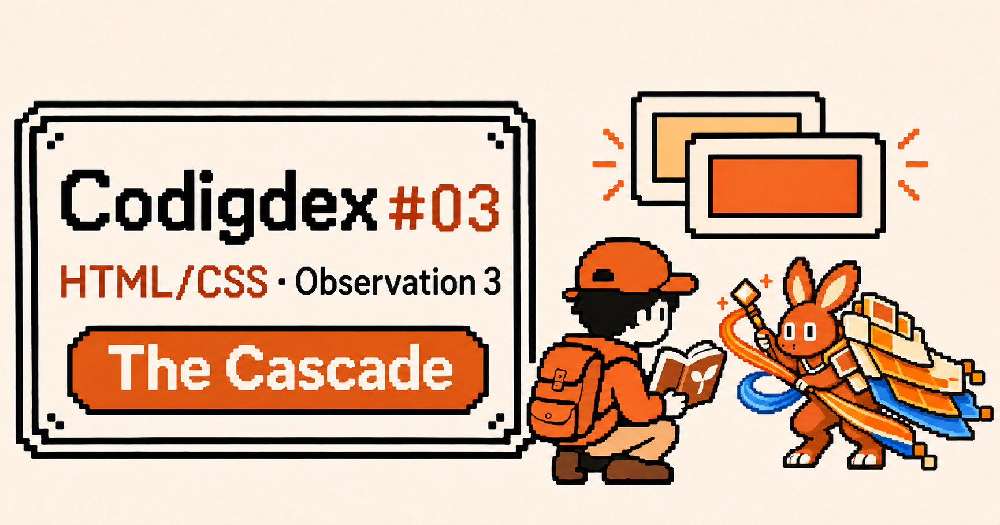
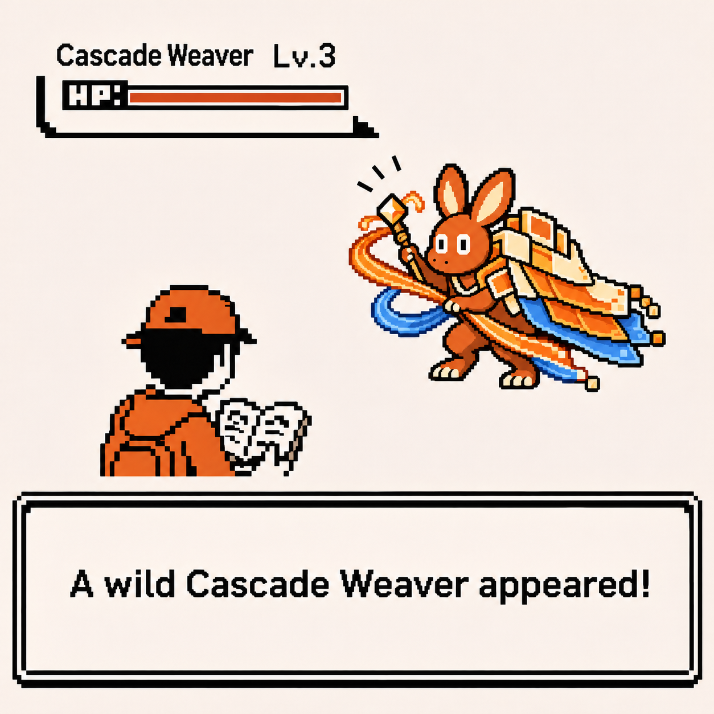
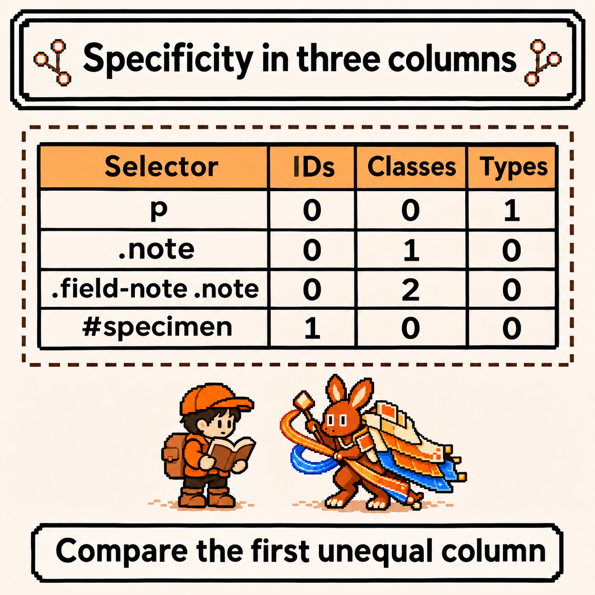
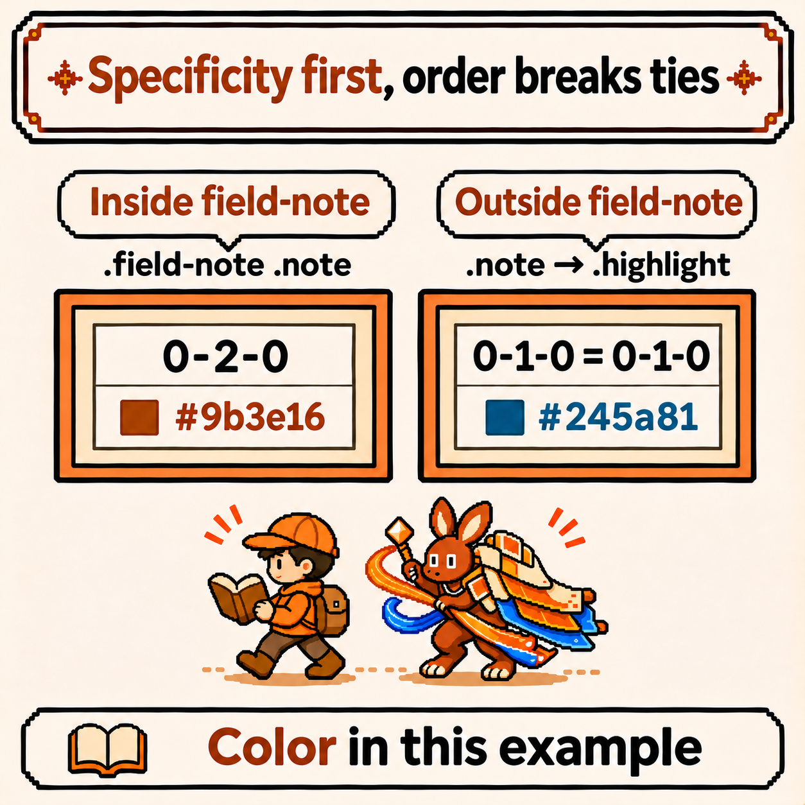
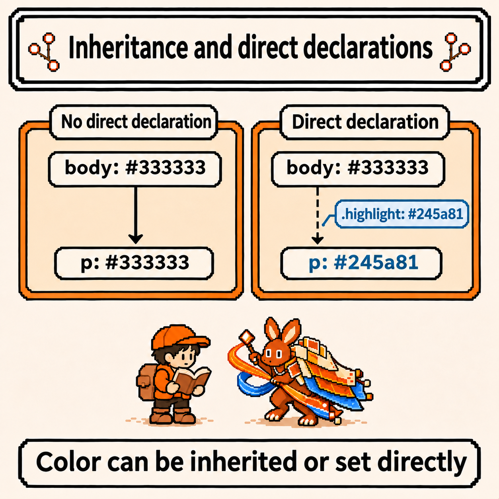
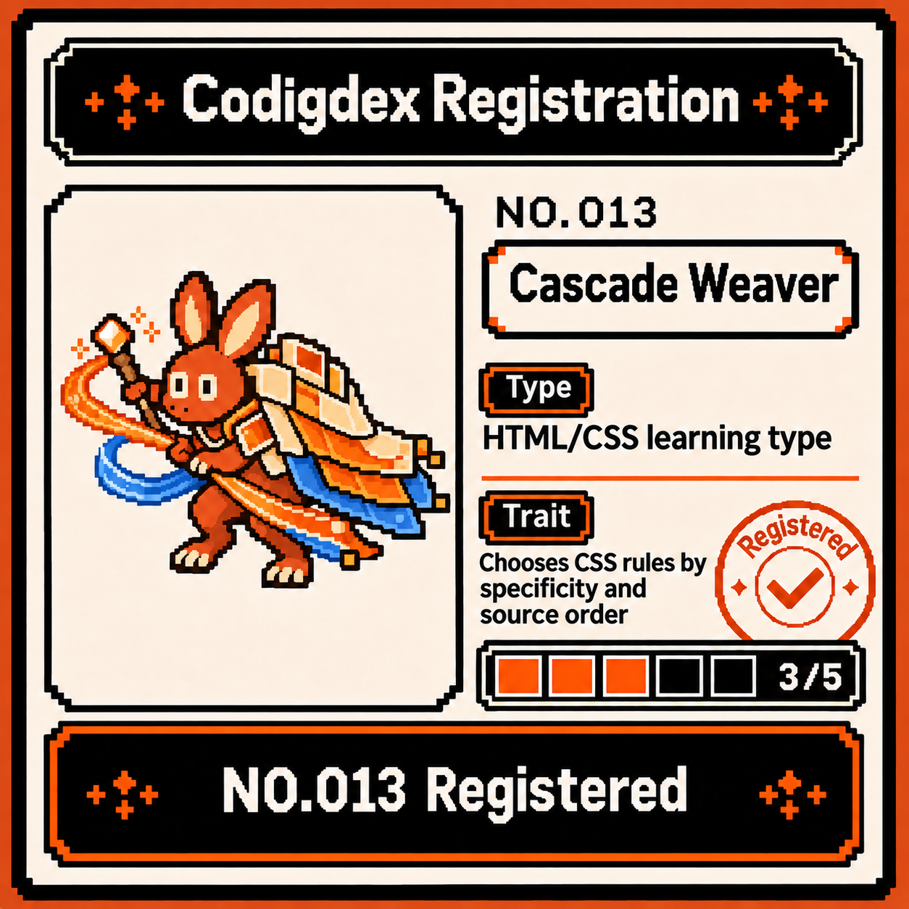

# Codigdex #03 — The Cascade: Which CSS Declaration Wins?



Last time, we unfolded the Style Shell's four layers. Now I want to give the card a color. When several rules select the same paragraph, which color remains? Does the last color in the file always win?

At the third checkpoint waits the **Cascade Weaver**, carrying a staff and wearing a cape. Before adding more declarations, the notes will follow the declaration the browser actually chooses.



---

## Specimen info

- Dex number: NO.013
- Name: Cascade Weaver
- Classification: HTML/CSS learning type
- Trait: chooses CSS rules by specificity and source order
- Encounter rate: Very high (whenever multiple rules match an element)
- Danger level: ⚠️⚠️ (adding stronger selectors without checking the cause makes the next change harder)

---

## First impression

Three questions go into the notes.

- Does a later rule always override an earlier one?
- How do two classes compare with one class?
- Does an inherited color compete in the same way as a color declared on the paragraph?

This experiment uses **normal declarations in stylesheets from the same author**. There is no `!important`, inline `style`, `@layer`, `@scope`, animation, or transition. Stating these limits prevents our small “specificity → source order” comparison from becoming an inaccurate rule for the whole cascade. [MDN's cascade guide](https://developer.mozilla.org/en-US/docs/Web/CSS/Guides/Cascade/Introduction) covers the full decision process.

---

## Observation 1 — choose per property, not per rule

A selector chooses the elements a rule applies to. `p` selects paragraph elements, and `.note` selects elements with the `note` class. Both can match one paragraph.

```css
.note {
  color: #9b3e16;
  padding: 16px;
}

p {
  color: #333333;
}
```

Under these conditions, the `.note` color wins. That does not mean the browser discards whole rules or selects the entire `.note` block as a single unit. It compares declarations for the **same property on the same element**. Here, `color` has competing values; `padding` has no other candidate. This property-by-property choice is the starting point of [CSS value processing](https://developer.mozilla.org/en-US/docs/Web/CSS/Guides/Cascade/Property_value_processing).

The padding from our Style Shell observation remains. Changing a color does not remove the box's inside space.

---

## Observation 2 — compare specificity in three columns

I record **specificity**, the selector comparison weight, in three columns. For the simple selectors used here, count IDs, classes, and element types.

| Selector | IDs | Classes | Types | Specificity |
| --- | --- | --- | --- | --- |
| `p` | 0 | 0 | 1 | `0-0-1` |
| `.note` | 0 | 1 | 0 | `0-1-0` |
| `.field-note .note` | 0 | 2 | 0 | `0-2-0` |
| `#specimen` | 1 | 0 | 0 | `1-0-0` |

Do not add the columns into a decimal score. Compare from the left: **the first unequal column decides**. The ID is only a comparison example; it is not added to the runnable page. The space in `.field-note .note` selects matching descendants of a `field-note` element. The space itself adds no specificity.



The [Selectors specification](https://www.w3.org/TR/selectors-4/#specificity-rules) also counts attribute selectors and pseudo-classes in the class column, and pseudo-elements in the type column. Selectors such as `:where()` have special rules. Start with these four rows rather than trying to memorize every case today.

---

## Observation 3 — use source order when specificity ties

Both `.note` and `.highlight` have specificity `0-1-0`. Under our conditions, the declaration appearing **later in the source** wins for the same property. Changing `class="note highlight"` to `class="highlight note"` does not change the CSS source order. As [MDN's specificity guide](https://developer.mozilla.org/en-US/docs/Web/CSS/Guides/Cascade/Specificity) explains, earlier precedence conditions must tie before this final comparison matters.

Save the complete example as `cascade.html` in UTF-8 and open it in a browser. Both paragraphs have the same classes, but only the first is inside `.field-note`.

```html
<!doctype html>
<html lang="en">
  <head>
    <meta charset="utf-8">
    <meta name="viewport" content="width=device-width, initial-scale=1">
    <title>Cascade Weaver | Codigdex</title>
    <style>
      body {
        margin: 24px;
        color: #333333;
        font-family: sans-serif;
      }

      .field-note .note {
        color: #9b3e16;
      }

      .note {
        color: #6a4a2c;
        padding: 16px;
        border: 2px solid currentColor;
        margin: 12px 0;
      }

      p {
        color: #333333;
      }

      .highlight {
        color: #245a81;
      }
    </style>
  </head>
  <body>
    <main>
      <article class="field-note">
        <h1>Meeting the Cascade Weaver</h1>
        <p class="note highlight">Inside the field note.</p>
      </article>
      <p class="note highlight">Outside the field note.</p>
    </main>
  </body>
</html>
```

`currentColor` refers to the element's `color` value, so the borders follow the text colors in this example ([MDN's currentColor guide](https://developer.mozilla.org/en-US/docs/Web/CSS/Reference/Values/color_value#currentcolor_keyword)).

Write down the expected results first.

| Paragraph | Chosen color | Reason |
| --- | --- | --- |
| `Inside the field note.` | `#9b3e16` | `.field-note .note` has higher specificity, `0-2-0` |
| `Outside the field note.` | `#245a81` | `.note` and `.highlight` tie, so the later `.highlight` wins |

Both paragraphs receive `.note`'s 16px padding and 2px border. The first paragraph's color survives despite appearing earlier. The `p` selector matches the second paragraph too, but its specificity is lower than a class selector's.



Try one change at a time, restoring the original file before each next experiment.

1. Reverse only the paragraphs' class attribute order. The colors stay the same.
2. Move the entire `.note` rule after `.highlight`. The second paragraph becomes `#6a4a2c`; the first stays `#9b3e16`.
3. Restore the original order, then remove only the color declaration from `.field-note .note`. The first paragraph now also uses `.highlight`'s `#245a81`.

Changing several things at once makes the cause harder to read. Pull just one thread from the Weaver's bundle at a time.

---

## Observation 4 — distinguish inheritance from direct declarations

The example's `body` declares a font family and color. The paragraphs inherit the font because they do not set one themselves. Their colors come from rules applied directly to them. A parent's complicated selector does not pass its specificity down to compete with the child's declarations.

To check, remove **all color declarations from the four rules other than body**. Both paragraphs inherit body's `#333333`. Leave padding and border declarations intact: the boxes remain, and the `currentColor` borders follow that inherited color too.



Not every property inherits automatically. `color` and `font-family` normally do; padding and border do not. Values such as `inherit` can explicitly request inheritance. Here, focus on the distinction between default inheritance and direct declarations ([MDN's inheritance guide](https://developer.mozilla.org/en-US/docs/Web/CSS/Guides/Cascade/Inheritance)). Restore the original CSS after the experiment.

---

## Observation 5 — read the cause before writing a stronger declaration

In developer tools, select the first and second paragraphs in turn.

1. Find the selectors matching the selected element in the styles panel.
2. Filter for `color` and compare crossed-out declarations with the winning one.
3. Check the computed color. The tool may show `rgb(...)` instead of hexadecimal notation.
4. Open the declaration's file and line location to compare specificity and order.
5. Distinguish a directly applied color from a value inherited from a parent.

A crossed-out declaration alone does not prove a specificity problem. Tools can also explain invalid values or inactive declarations. Start with the selected element and the declaration actually applied.

It can be tempting to add `!important` wherever a style gets stuck. It changes the cascade's importance handling rather than adding points to specificity. It has uses elsewhere, but selectors and order already explain this example ([MDN's important guide](https://developer.mozilla.org/en-US/docs/Web/CSS/Reference/Values/important)). Before making a declaration stronger, check whether you can explain why the current value won.

---

## Summary

- Compare declarations for the same property on the same element, rather than treating a rule as one indivisible winner.
- For this experiment with normal declarations, compare specificity first, then source order when it ties.
- Compare IDs, classes, and types from the left. The order of class names in HTML does not decide the winner.
- An earlier higher-specificity declaration can beat a later lower-specificity one.
- Distinguish inheritance from declarations applied directly to the paragraph.
- Use developer tools to inspect the selected element, winning declaration, and computed value.

---

## Codigdex notes

With the Structure Sprout, we read content roles. With the Style Shell, we read box boundaries. Beside the Cascade Weaver, the notes ask **where the values painted on those boundaries came from**.

Writing several colors for the same paragraph does not make the last line the whole answer. Follow the matching element, compare specificity, and check whether the value is direct or inherited.

Time to register the third specimen. **NO.013 Cascade Weaver** — chooses CSS rules by specificity and source order. Three of the HTML/CSS chapter's five slots are filled.


