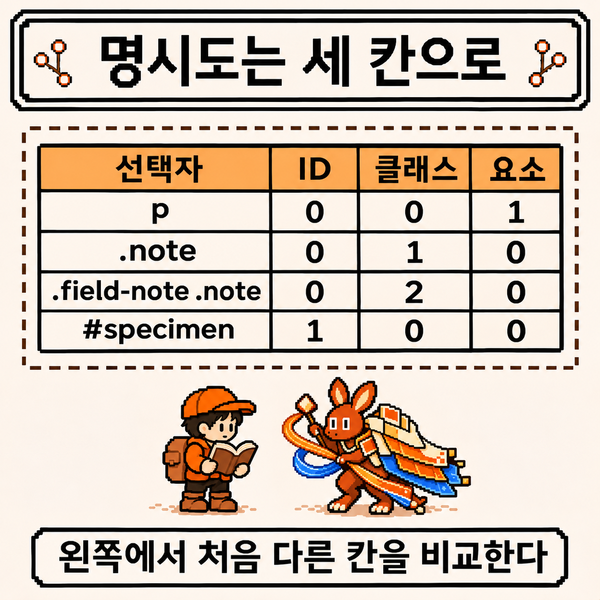
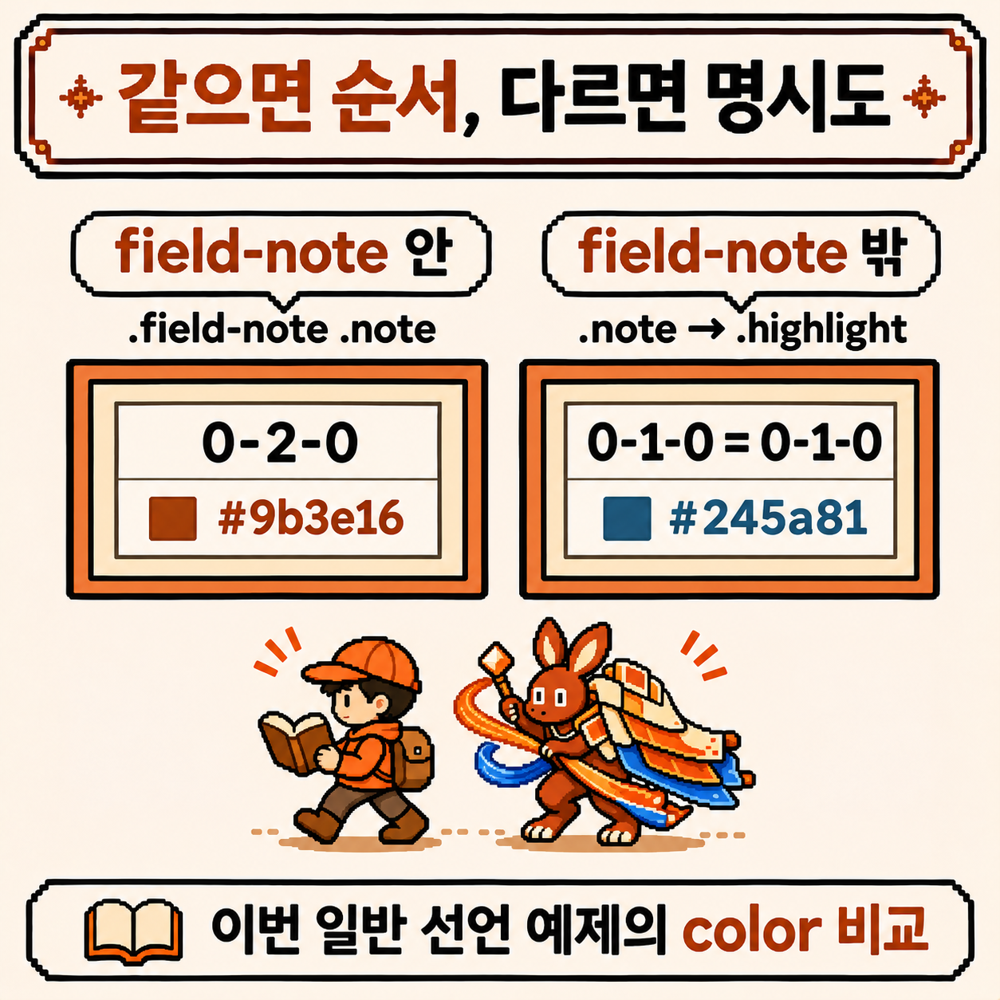
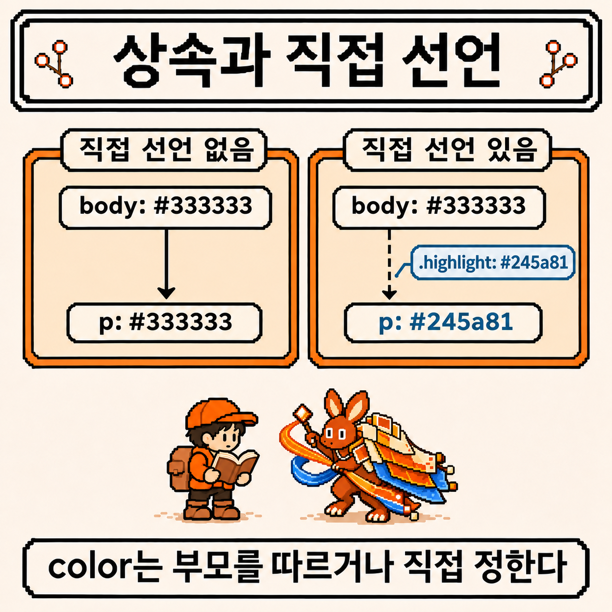

# 코딩 도감 #03 — 캐스케이드, 어떤 CSS가 남을까


지난 관찰에서는 스타일 셸의 네 겹을 펼쳤다. 이제 카드에 색을 입혀 보려는데, 같은 문단을 고르는 규칙이 여러 개라면 어떤 색이 남을까? 파일 맨 아래에 적은 색이 언제나 이길까?

세 번째 길목에는 지팡이와 망토를 갖춘 **캐스케이드 위버**가 기다린다. 이번 노트에서는 선언을 더 붙이기 전에, 브라우저가 어떤 선언을 골랐는지 따라가 보기로 한다.


---

## 개체 정보

- 도감 번호: NO.013
- 이름: 캐스케이드 위버
- 분류: HTML/CSS 학습형
- 특성: 우선순위와 선언 순서로 적용할 CSS 규칙을 결정한다
- 출현 빈도: 매우 높음 (한 요소에 여러 규칙이 맞을 때마다 만남)
- 위험도: ⚠️⚠️ (이유를 확인하지 않고 선택자를 늘리면 다음 수정이 어려워진다)

---

## 처음 만났을 때의 인상

노트의 질문은 세 가지다.

- 뒤에 쓴 규칙이 앞의 규칙을 항상 덮을까?
- 클래스 두 개는 클래스 하나보다 어떻게 비교할까?
- 부모의 글자색과 문단에 직접 준 글자색은 같은 경쟁일까?

이번 실험은 **같은 작성자의 스타일시트에 있는 일반 선언**으로 범위를 좁힌다. `!important`, 인라인 `style`, `@layer`, `@scope`, 애니메이션과 트랜지션은 넣지 않는다. 이 조건을 먼저 적어야 ‘명시도 → 선언 순서’라는 작은 비교를 전체 캐스케이드의 공식으로 오해하지 않는다. [MDN의 캐스케이드 안내](https://developer.mozilla.org/en-US/docs/Web/CSS/Guides/Cascade/Introduction)에서 전체 결정 과정도 확인할 수 있다.

---

## 관찰 1 — 규칙 통째가 아니라 속성별로 고른다

선택자는 규칙을 적용할 요소를 고른다. `p`는 문단 요소, `.note`는 `note` 클래스가 있는 요소를 고른다. 둘 다 같은 문단에 맞을 수 있다.

```css
.note {
  color: #9b3e16;
  padding: 16px;
}

p {
  color: #333333;
}
```

이 조건에서는 `.note` 쪽의 글자색이 남는다. 그렇다고 `p` 규칙 전체가 버려지거나 `.note` 규칙 전체가 한 덩어리로 승리하는 것은 아니다. 브라우저는 같은 요소의 **같은 속성**에 대한 선언을 비교한다. 여기서 충돌하는 것은 `color`이고, `padding`에는 다른 후보가 없다. 이 속성별 선택은 [CSS 값 처리 안내](https://developer.mozilla.org/en-US/docs/Web/CSS/Guides/Cascade/Property_value_processing)의 출발점이다.

스타일 셸에서 본 padding은 그대로 남는다. 색을 바꿨다고 상자의 안쪽 여백까지 사라지는 것은 아니다.

---

## 관찰 2 — 명시도는 세 칸을 왼쪽부터 비교한다

선택자 사이의 비교 기준인 **명시도(specificity)**를 노트에 세 칸으로 적는다. 이번에 쓰는 단순 선택자에서는 ID / 클래스 / 요소의 개수를 세면 된다.

| 선택자 | ID | 클래스 | 요소 | 명시도 |
| --- | --- | --- | --- | --- |
| `p` | 0 | 0 | 1 | `0-0-1` |
| `.note` | 0 | 1 | 0 | `0-1-0` |
| `.field-note .note` | 0 | 2 | 0 | `0-2-0` |
| `#specimen` | 1 | 0 | 0 | `1-0-0` |

세 칸은 십진수 점수처럼 더하지 않는다. **왼쪽에서 처음 다른 칸**이 큰 쪽이 앞선다. 위 표의 ID는 비교용이며 실제 예제에는 넣지 않는다. 공백으로 연결한 `.field-note .note`는 `field-note` 클래스 요소 안의 자손 중 `note` 클래스 요소를 고른다. 공백 자체는 명시도를 더하지 않는다.



[Selectors 명세의 명시도 계산](https://www.w3.org/TR/selectors-4/#specificity-rules)은 속성 선택자와 가상 클래스도 클래스 칸에, 가상 요소도 요소 칸에 포함한다. `:where()`처럼 별도 규칙이 있는 선택자까지 모두 외우려 하지 말고, 오늘은 위 네 줄부터 읽는다.

---

## 관찰 3 — 같은 명시도일 때 선언 순서를 본다

`.note`와 `.highlight`는 둘 다 `0-1-0`이다. 이번 조건에서 같은 속성을 정하면 **소스에서 나중에 나온 선언**이 선택된다. HTML의 `class="note highlight"`를 `class="highlight note"`로 바꾸는 것은 CSS 선언 순서를 바꾸는 일이 아니다. [MDN의 명시도 안내](https://developer.mozilla.org/en-US/docs/Web/CSS/Guides/Cascade/Specificity)처럼 다른 우선 조건이 같아야 이 마지막 비교로 내려온다.

`cascade.html`에 다음 전체를 UTF-8로 저장하고 브라우저에서 연다. 두 문단의 클래스는 같지만 첫째 문단만 `.field-note` 안에 있다.

```html
<!doctype html>
<html lang="en">
  <head>
    <meta charset="utf-8">
    <meta name="viewport" content="width=device-width, initial-scale=1">
    <title>Cascade Weaver | Codigdex</title>
    <style>
      body {
        margin: 24px;
        color: #333333;
        font-family: sans-serif;
      }

      .field-note .note {
        color: #9b3e16;
      }

      .note {
        color: #6a4a2c;
        padding: 16px;
        border: 2px solid currentColor;
        margin: 12px 0;
      }

      p {
        color: #333333;
      }

      .highlight {
        color: #245a81;
      }
    </style>
  </head>
  <body>
    <main>
      <article class="field-note">
        <h1>Meeting the Cascade Weaver</h1>
        <p class="note highlight">Inside the field note.</p>
      </article>
      <p class="note highlight">Outside the field note.</p>
    </main>
  </body>
</html>
```

`currentColor`는 해당 요소의 `color` 값을 참조한다. 그래서 이 예제에서는 글자색을 따라 테두리색도 달라진다([MDN currentColor 안내](https://developer.mozilla.org/en-US/docs/Web/CSS/Reference/Values/color_value#currentcolor_keyword)).

예상 결과를 먼저 적는다.

| 문단 | 선택된 color | 이유 |
| --- | --- | --- |
| `Inside the field note.` | `#9b3e16` | `.field-note .note`의 `0-2-0`이 더 크다 |
| `Outside the field note.` | `#245a81` | `.note`와 `.highlight`가 같아 뒤의 `.highlight`가 남는다 |

두 문단 모두 `.note`의 padding 16px과 border 2px을 받는다. 첫째 문단의 색 선언은 앞에 있어도 남는다. 둘째 문단에 `p` 규칙이 맞아도 클래스 선택자보다 명시도가 낮다.



이어서 하나씩 바꿔 본다. 매번 원래 파일로 되돌린 뒤 다음 실험을 한다.

1. 두 문단의 클래스 나열 순서만 뒤집는다. 색은 그대로다.
2. `.note` 규칙 전체를 `.highlight` 뒤로 옮긴다. 둘째 문단은 `#6a4a2c`, 첫째는 여전히 `#9b3e16`이다.
3. 원래 위치로 돌리고 `.field-note .note`의 color 선언만 지운다. 이제 첫째도 `.highlight`의 `#245a81`이다.

한 번에 여러 곳을 바꾸면 무엇 때문에 결과가 달라졌는지 읽기 어렵다. 위버의 실타래에서도 한 가닥씩만 당겨 보기로 한다.

---

## 관찰 4 — 상속은 같은 요소의 선언 경쟁과 구분한다

예제의 `body`에는 글꼴과 글자색이 있다. 문단의 글꼴은 따로 정하지 않아 부모를 따라가지만, 글자색은 문단에 직접 적용된 규칙으로 결정된다. 부모의 선택자가 복잡하다고 해서 그 명시도를 물려받아 자식의 선언과 대결하는 것은 아니다.

확인하려면 예제 CSS에서 `body`를 제외한 네 규칙의 **color 선언만 모두 지운다**. 두 문단은 body의 `#333333`을 상속한다. padding과 border 선언은 그대로 두었으므로 상자는 남고, `currentColor`를 쓰는 테두리도 그 색을 따른다.



모든 속성이 자동으로 상속되는 것은 아니다. `color`와 `font-family`는 보통 상속되지만 padding과 border는 그렇지 않다. 명시적으로 상속시키는 `inherit` 같은 값도 있다. 여기서는 기본 상속과 직접 선언을 구분하는 데 집중한다([MDN 상속 안내](https://developer.mozilla.org/en-US/docs/Web/CSS/Guides/Cascade/Inheritance)). 실험이 끝나면 원래 CSS로 되돌린다.

---

## 관찰 5 — 더 강한 선언을 쓰기 전에 이유를 읽는다

개발자 도구에서 첫째 문단과 둘째 문단을 번갈아 선택한다.

1. 스타일 패널에서 그 요소에 맞은 선택자를 찾는다.
2. `color`를 검색하고 취소선이 그어진 선언과 남은 선언을 비교한다.
3. 계산된 스타일에서 최종 색을 확인한다. 도구는 16진수 대신 `rgb(...)`로 표시할 수도 있다.
4. 적용한 규칙의 파일·줄 위치를 열어 명시도와 순서를 확인한다.
5. 직접 적용된 색인지, 부모에서 상속한 값인지 구분한다.

취소선만 보고 명시도 문제라고 단정하지 않는다. 도구에는 덮인 선언뿐 아니라 잘못된 값이나 비활성 선언에 대한 안내도 있을 수 있다. 먼저 선택한 요소와 실제 적용된 선언을 읽는다.

막힌 자리마다 `!important`를 붙이고 싶어질 수도 있다. 하지만 그것은 명시도에 숫자를 보태는 표기가 아니라 캐스케이드의 중요도 단계에 영향을 준다. 다른 경우에 필요한 기능이지만, 이번 예제의 원인은 선택자와 순서만으로 설명된다([MDN important 안내](https://developer.mozilla.org/en-US/docs/Web/CSS/Reference/Values/important)). 더 강하게 쓰기보다 왜 이 값이 남았는지를 먼저 설명할 수 있는지 확인한다.

---

## 정리

- 같은 요소의 같은 속성에 맞는 선언을 비교한다. 규칙 전체를 통째로 덮는다고 읽지 않는다.
- 이번 일반 선언 예제에서는 명시도를 먼저, 같으면 소스의 선언 순서를 본다.
- ID / 클래스 / 요소 세 칸을 왼쪽부터 비교한다. HTML의 클래스 나열 순서는 승패를 정하지 않는다.
- 앞에 있는 높은 명시도가 뒤에 있는 낮은 명시도보다 앞설 수 있다.
- 상속과 문단에 직접 적용된 선언은 구분한다.
- 개발자 도구로 선택된 요소, 남은 선언, 계산된 값의 이유를 확인한다.

---

## 도감 기록

구조 새싹과는 내용의 역할을, 스타일 셸과는 상자의 경계를 읽었다. 캐스케이드 위버 옆에서는 **그 경계에 칠해진 값이 어디서 왔는지**를 노트에 남긴다.

같은 문단에 색을 여러 번 적어도 마지막 줄만 보면 답이 나오지는 않는다. 어떤 요소를 고른 규칙인지, 명시도가 같은지, 직접 적용된 값인지 차례로 따라가고 싶다.

그럼 세 번째 개체를 코딩 도감에 등록한다. **NO.013 캐스케이드 위버** — 우선순위와 선언 순서로 적용할 CSS 규칙을 결정한다. HTML/CSS 챕터 다섯 칸 중 세 칸이 채워졌다.


